<div align="center">

# 灵枢（LingShu）系统架构说明书

## ——百万字级长篇小说智能写作工作台

**文档编号**：LS-ARCH-2026-001
**保密等级**：TSOFTP所有
**版本**：v2.0
**编制日期**：2026-07-03
**适用范围**：灵枢项目全栈（后端 / 前端 / 桌面端 / 数据库 / 部署）

</div>

---

> ⚠️ **所有权声明**
>
> 本文档及灵枢项目的完整架构、数据库设计、安全机制、API 契约与部署细节，均为 TSOFTP所有，保留一切权利。
>
> 本文档按角色分发，阅读前请确认您的职责范围与本章节相关。

---

## 目录

- [1. 文档控制](#1-文档控制)
- [2. 项目概述](#2-项目概述)
- [3. 技术栈总览](#3-技术栈总览)
- [4. 系统全局架构](#4-系统全局架构)
- [5. 后端架构](#5-后端架构)
- [6. 前端架构](#6-前端架构)
- [7. 数据库架构](#7-数据库架构)
- [8. AI 分析流水线](#8-ai-分析流水线)
- [9. 安全架构](#9-安全架构)
- [10. API 接口契约](#10-api-接口契约)
- [11. 部署架构](#11-部署架构)
- [12. 关键业务流程](#12-关键业务流程)
- [13. 配置与环境变量](#13-配置与环境变量)
- [14. 风险与约束](#14-风险与约束)
- [15. 附录](#15-附录)

---

## 1. 文档控制

### 1.1 修订记录

| 版本 | 日期 | 修订人 | 变更摘要 |
|------|------|--------|----------|
| v1.0 | 2026-03 | 研发部 | 首次发布（Qt 单机版） |
| v1.3 | 2026-05 | 研发部 | 增加 V1 写回层、状态机三轴模型 |
| v2.0 | 2026-07-03 | 研发部 | 全栈重构（Vue3 + Electron + FastAPI），新增 V3 流水线、混合数据库、Redis 缓存、HNSW 向量、双轨认证 |

### 1.2 分发对象

| 角色 | 可读章节 |
|------|----------|
| 研发工程师 | 全文 |
| 测试工程师 | 1, 2, 4, 10, 11, 12 |
| 运维工程师 | 1, 2, 4, 11, 13, 14 |
| 产品经理 | 1, 2, 4, 6, 8, 12 |
| 安全审计 | 1, 4, 7, 9, 14 |

---

## 2. 项目概述

### 2.1 项目定位

**灵枢**是一款面向网络文学创作者的百万字级长篇小说智能写作工作台。系统以"AI 协同创作 + 多智能体审查 + 五级深度分析 + 时间分层记忆"为核心能力，提供从创作、审查、分析到写回的完整闭环。

### 2.2 核心能力

| 能力域 | 描述 |
|--------|------|
| **创作工作台** | 三栏分屏编辑器、章节树、大纲编辑、AI 续写/润色、写作探针 |
| **多智能体审查** | Planner→Writer→Auditor→Reviser 流水线 + 12 维度雷达图 + APPROVE/REVISE/REJECT 判决 |
| **五级深度分析（V3）** | L1 语义分块 → L2 实体提及 → L3 共指消解 → L4 原子事实 → L5 卡片生成 + 证据门禁 |
| **三维记忆系统** | 时间维度（hot/warm/cold/archive）+ 重要性维度（0-1 评分）+ 性质维度（事件/关系/状态/伏笔/世界规则） |
| **文章探针** | 伏笔回收 / 实体状态 / 世界规则 / 关系演变 四类主动一致性检查 |
| **本地↔云端同步** | 基于 `cloud_book_id` 绑定 + 标题相似度匹配的双向同步 |
| **多端形态** | Web 书城（读者） / 桌面写作台（作者） / 三种管理台（运营） |

### 2.3 业务上下文

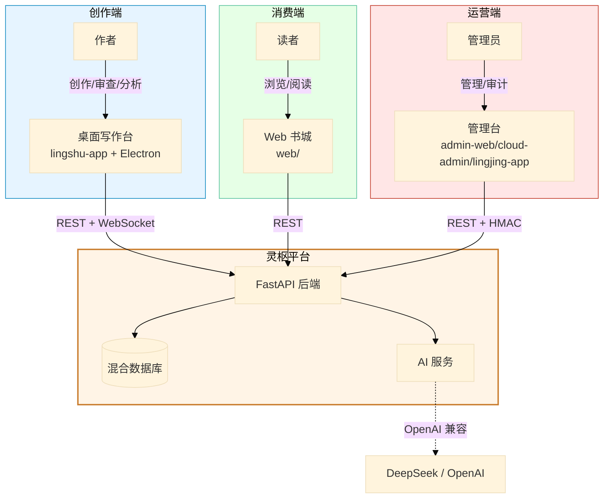

### 2.4 关键指标

| 指标 | 数值 |
|------|------|
| 后端代码行数（Python） | ~30,000+ 行 |
| 前端代码行数（Vue/TS） | ~25,000+ 行 |
| API 路由数 | 199 条 |
| 数据库表数 | 80+ 张（novels.db 50+ / bookstore_demo.db 30+） |
| Vue 前端应用数 | 5 个（web / admin-web / cloud-admin / lingjing-app / lingshu-app） |
| AI 调用并发上限 | 425 workers（AIMD 动态调整） |
| 已交付版本 | v1.2 / v1.3 / v1.3 预览 / v2.0 |

---

## 3. 技术栈总览

### 3.1 后端技术栈

| 类别 | 技术 | 版本 | 用途 |
|------|------|------|------|
| Web 框架 | FastAPI | ≥0.115, <1 | REST + WebSocket API |
| ASGI 服务器 | uvicorn | ≥0.23, <1 | 异步服务运行时 |
| 限流 | slowapi | ≥0.1, <1 | API 限流（登录 5/min） |
| WebSocket | websockets | ≥12, <17 | 实时双向通信 |
| HTTP 客户端 | httpx | ≥0.27 | AI API 同步/异步调用 |
| 密码哈希 | bcrypt | ≥4, <6 | 服务端密码哈希（rounds=12） |
| 加密 | cryptography | ≥43, <45 | AES-256-GCM（管理员密钥） |
| 文档处理 | python-docx | ==1.1.2 | Word 文档导入 |
| 向量索引 | faiss-cpu | ≥1.14, <2 | HNSW 向量检索 |
| 数值计算 | numpy | ≥2.0, <3 | 向量矩阵运算 |
| 缓存/锁 | redis[hiredis] | ≥5.0.0, <9 | 缓存层 + 分布式锁 |
| 数据库 | SQLite | 内置 | 主存储（WAL 模式） |
| ~~GUI~~ | ~~PyQt6~~ | ~~已移除~~ | 已迁移至 Vue3 + Electron |

### 3.2 前端技术栈

| 类别 | 技术 | 版本 | 用途 |
|------|------|------|------|
| 核心框架 | Vue | ^3.5.13 | Composition API + `<script setup>` |
| 构建工具 | Vite | ^6.0.7 | 开发服务器 + 打包 |
| 类型系统 | TypeScript | ^5.7.3 | 类型安全 |
| 路由 | vue-router | ^4.5.0 | SPA 路由 |
| 状态管理 | Pinia | ^2.3.1 | 组合式 store |
| UI 组件库 | Element Plus | ^2.9.3 | 企业级 UI |
| HTTP 客户端 | axios | ^1.7.9 | API 调用 |
| 图表 | ECharts / vue-echarts | ^6.1.0 / ^8.0.1 | 数据可视化（管理台） |
| 关系图谱 | @antv/g6 | ^5.0.0 | 人物关系图（写作台） |
| 动画 | GSAP | ^3.15.0 | 营销页动画 |
| 分屏布局 | splitpanes | ^3.1.0 | 三栏编辑器 |
| Markdown | marked + highlight.js | ^12.0.0 / ^11.9.0 | Markdown 渲染 |
| 桌面壳 | Electron | ^30.5.1 | 跨平台桌面应用 |
| 打包 | electron-builder | ^24.0.0 | Windows portable x64 |
| 自动更新 | electron-updater | ^6.0.0 | 增量更新 |
| E2E 测试 | Playwright | ^1.61.0 | 端到端测试 |
| 单元测试 | Vitest + @vue/test-utils | ^4.1.9 / ^2.4.11 | 组件测试 |
| HTTP Mock | msw | ^2.14.6 | API 模拟 |

### 3.3 外部依赖服务

| 服务 | 用途 | 必需性 |
|------|------|--------|
| OpenAI 兼容 API（DeepSeek/OpenAI） | AI 能力（生成/审查/分析/对话） | 必需（AI 功能） |
| Redis 7 | 缓存 + 分布式锁 | 可选（桌面端可降级） |
| PostgreSQL + pgvector | 云端多用户（计划中） | 待实施 |

---

## 4. 系统全局架构

### 4.1 顶层架构图

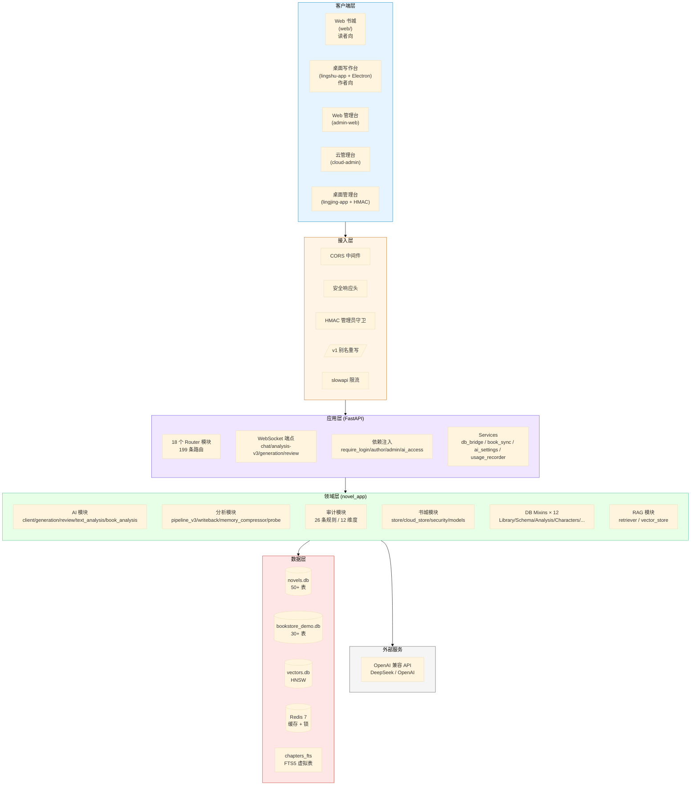

### 4.2 目录结构

```
f:\项目\灵枢\
├── lingshu_api/                  # FastAPI 后端
│   ├── main.py                   # 应用工厂 create_app()
│   ├── dependencies.py           # 依赖注入（认证/权限/所有权）
│   ├── routers/                  # 18 个路由模块（199 条路由）
│   │   ├── auth.py / admin_auth.py / admin.py
│   │   ├── workspace.py / bookstore.py / bookshelf.py
│   │   ├── analysis_v3_runs.py / analysis_v3_steps.py / analysis_v3_cards.py
│   │   ├── characters.py / world.py / skills.py / references.py
│   │   ├── rag.py / export.py / settings.py / foreshadows.py
│   │   ├── writing_techniques.py / cloud_books.py / community.py
│   │   └── analysis_v3.py        # 兼容垫片（合并三子模块）
│   ├── services/                 # 业务服务层
│   │   ├── db_bridge.py          # WorkspaceDB（novels.db 桥接）
│   │   ├── book_sync.py          # 本地↔云端同步
│   │   ├── ai_settings.py        # 10 个 AI 用途配置
│   │   └── usage_recorder.py     # AI 用量记录
│   └── ws/                       # WebSocket 模块
│       ├── connection.py         # ConnectionManager 单例
│       ├── tasks.py              # ClientTaskRegistry
│       ├── chat.py / analysis_v3_ws.py / generation.py / review_ws.py
│
├── novel_app/                    # 领域核心
│   ├── database.py               # Database 类（12 Mixin 组合）
│   ├── ai/                       # AI 服务（14 文件）
│   │   ├── client.py             # AIClientMixin（SSRF 防护）
│   │   ├── service.py            # SimpleAIService（5 Mixin）
│   │   ├── provider.py           # AIProvider 组合式
│   │   ├── generation.py / review_service.py / text_analysis_service.py
│   │   ├── book_analysis.py / limits.py / types.py / protocols.py
│   ├── analysis/                 # V3 分析流水线（42 文件）
│   │   ├── pipeline_v3.py / pipeline_v3_stages.py / pipeline_v3_incremental.py
│   │   ├── ai_provider.py        # AIAnalysisProvider + AIMD 控制器
│   │   ├── writeback.py / v3_writeback.py / state_machine_writeback.py
│   │   ├── memory_compressor.py / fact_store.py / llm_cache.py
│   │   ├── vector_store.py / retriever.py
│   │   ├── probe_planner.py / probe_executor.py / consistency_checker.py
│   │   ├── backtrack.py / card_coordinator.py / card_generators_v3.py
│   │   └── ...
│   ├── db/                       # 数据库 Mixins（18 文件）
│   │   ├── schema.py             # 全表 DDL + 迁移注册
│   │   ├── library.py            # 书籍/章节/伏笔 CRUD + sync_changelog 注入
│   │   ├── analysis.py           # V3 分析表 CRUD + 批量方法
│   │   ├── cache.py              # CacheManager（4 类缓存 + 锁）
│   │   ├── redis_client.py       # Redis 单例
│   │   ├── hnsw_store.py         # HNSW 向量存储
│   │   ├── sync_changelog.py     # 离线变更追踪
│   │   ├── sync_engine.py        # 增量同步引擎
│   │   ├── vector_store.py       # AnalysisVectorStore
│   │   ├── characters.py / character_state_machine.py
│   │   ├── review.py / media.py / legacy.py / structured.py
│   │   ├── resources.py / chapter_generation_snapshots.py / common.py
│   ├── bookstore/                # 书城（cloud_books/users/auth）
│   │   ├── store.py / cloud_store.py / security.py / models.py
│   ├── audit/rules.py            # 26 条审计规则
│   ├── core/state.py             # StateManager
│   ├── rag/retriever.py          # ChapterRetriever（BM25 + 向量）
│   ├── secure_storage.py         # DPAPI/keyring 密钥保护
│   ├── text_importer.py / exporter.py / json_utils.py / env_utils.py
│   └── ai_client.py / ai_service.py / ...  # 向后兼容垫片
│
├── web/                          # Vue3 读者 Web 书城
├── admin-web/                    # Vue3 Web 管理台
├── cloud-admin/                  # Vue3 云管理台（Token 混淆）
├── lingjing-app/                 # Vue3 桌面管理台（HMAC 签名）
├── lingshu-app/                  # Vue3 桌面写作台（核心创作应用）
│   └── src/ (13 stores + 30+ components)
├── electron/                     # Electron 桌面壳
│   ├── main.js / preload.js / splash.html
├── packaging/                    # C# 自解压启动器与图标（旧 PyInstaller 脚本已归档至 _attic/legacy-packaging/）
├── data/                         # 数据库与配置
│   ├── novels.db / bookstore_demo.db
│   ├── .password_pepper / .password_salt
│   └── ai_settings.json / tags_map.json / ui_settings.json
├── docs/                         # 已有文档
├── tests/                        # 测试套件
├── release/                      # 打包产物
├── main.py                       # CLI 入口
├── docker-compose.yml            # Redis 服务
├── requirements.txt / requirements-dev.txt / requirements.lock
└── ARCHITECTURE.md               # 本文档
```

---

## 5. 后端架构

### 5.1 应用分层

```mermaid
%%{init: {'theme': 'base', 'themeVariables': { 'darkMode': false }}}%%
graph LR
    subgraph L1["L1 接入层"]
        FastAPI[FastAPI App]
        MW[中间件栈 × 4]
    end

    subgraph L2["L2 路由层"]
        Auth["auth / admin_auth"]
        Workspace["workspace<br/>40+ 路由"]
        AnalysisV3["analysis_v3<br/>runs/steps/cards"]
        Other[其他 15 个<br/>Router]
        WSRouters[WS × 4]
    end

    subgraph L3["L3 服务层"]
        DBridge[WorkspaceDB<br/>novels.db 桥接]
        BookSync[BookSyncService<br/>双向同步]
        AISettings[AI Settings<br/>10 用途]
        UsageRec[Usage Recorder]
        WSConn["ConnectionManager<br/>+ TaskRegistry"]
    end

    subgraph L4["L4 领域层"]
        Database[Database<br/>12 Mixin]
        AIService[SimpleAIService<br/>5 Mixin]
        Pipeline[AnalysisPipelineV3<br/>11 阶段]
        Writeback["Writeback<br/>V1+V3"]
        Audit[AuditEngine<br/>26 规则]
        Bookstore["BookstoreStore<br/>+ CloudBookStore"]
    end

    subgraph L5["L5 数据层"]
        SQLite[(SQLite × 2)]
        Redis[(Redis)]
        FAISS[(FAISS HNSW)]
        FTS5[(FTS5)]
        LLM[OpenAI API]
    end

    FastAPI --> MW --> L2
    L2 --> L3
    L3 --> L4
    L4 --> L5

    style L1 fill:#fff4e6
    style L2 fill:#e6f4ff
    style L3 fill:#f0e6ff
    style L4 fill:#e6ffe6
    style L5 fill:#ffe6e6
```

### 5.2 应用工厂与生命周期

**入口**：[lingshu_api/main.py](file:///f:/项目/灵枢/lingshu_api/main.py)

```python
# 模块级 app（兼容 uvicorn lingshu_api.main:app 直接导入）
app = create_app()

def create_app(db_path: str | None = None) -> FastAPI:
    # 1. 创建 FastAPI 实例（docs_url/redoc_url 受 DISABLE_API_DOCS 控制）
    # 2. lifespan 上下文管理器：
    #    - startup: 启动 WS 心跳后台任务 + 清理过期管理员 Token
    #    - shutdown: 取消心跳任务 + 关闭 WorkspaceDBProvider
    # 3. 注册 4 层中间件（详见 5.3）
    # 4. 注册 4 个异常处理器（RateLimitExceeded/HTTPException/RequestValidationError/Exception）
    # 5. 挂载 18 个 Router + 4 个 WebSocket
    # 6. 暴露 /api/health 与 /api/v1/health
```

### 5.3 中间件栈（自上而下执行）

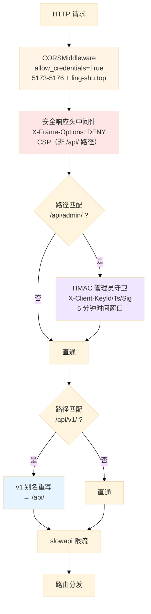

**关键安全响应头**：
- `X-Content-Type-Options: nosniff`
- `X-Frame-Options: DENY`
- `X-XSS-Protection: 1; mode=block`
- `Referrer-Policy: strict-origin-when-cross-origin`
- `Permissions-Policy: camera=(), microphone=(), geolocation=()`
- `Content-Security-Policy: default-src 'self'; script-src 'self'; ...`（仅非 API 路径）

### 5.4 异常处理

| 异常 | HTTP 状态 | 响应体 |
|------|-----------|--------|
| `RateLimitExceeded` | 429 | `{"detail": "请求过于频繁，请稍后再试"}` |
| `HTTPException` | 自定义 | `{"detail": "..."}` |
| `RequestValidationError` | 422 | `{"detail": "请求参数验证失败", "errors": [...]}` |
| `Exception`（兜底） | 500 | `{"detail": "服务器内部错误，请稍后重试"}`（堆栈仅记录日志） |

> **安全约束**：500 错误响应绝不暴露原始异常详情，仅记录服务端日志（来自 project_memory 硬约束）。

### 5.5 路由模块清单

| Router | 前缀 | 文件 | 路由数 | 主要职责 |
|--------|------|------|--------|----------|
| auth | `/api/auth` | [auth.py](file:///f:/项目/灵枢/lingshu_api/routers/auth.py) | 7 | 登录/注册/登出/me/设备信任 |
| admin_auth | `/api/admin/auth` | [admin_auth.py](file:///f:/项目/灵枢/lingshu_api/routers/admin_auth.py) | 3 | 管理员独立登录（HMAC） |
| admin | `/api/admin` | [admin.py](file:///f:/项目/灵枢/lingshu_api/routers/admin.py) | 28 | 用户/作品/章节/Token/审计 CRUD |
| workspace | `/api/workspace` | [workspace.py](file:///f:/项目/灵枢/lingshu_api/routers/workspace.py) | 40+ | 书籍/分卷/章节 CRUD、AI 检测、写作探针 |
| analysis_v3 | `/api/workspace` | [analysis_v3_runs.py](file:///f:/项目/灵枢/lingshu_api/routers/analysis_v3_runs.py) [steps](file:///f:/项目/灵枢/lingshu_api/routers/analysis_v3_steps.py) [cards](file:///f:/项目/灵枢/lingshu_api/routers/analysis_v3_cards.py) | 25+ | V3 分析运行/步骤/卡片 |
| characters | `/api/workspace` | [characters.py](file:///f:/项目/灵枢/lingshu_api/routers/characters.py) | 15+ | 人物卡/状态机/循环/快照 |
| world | `/api/workspace/books/{id}` | [world.py](file:///f:/项目/灵枢/lingshu_api/routers/world.py) | 2 | 世界观读写 |
| skills | `/api/workspace` | [skills.py](file:///f:/项目/灵枢/lingshu_api/routers/skills.py) | 2 | 写作技能查询 |
| references | `/api/workspace` | [references.py](file:///f:/项目/灵枢/lingshu_api/routers/references.py) | 8+ | 参考文档/片段/绑定 |
| rag | `/api/workspace` | [rag.py](file:///f:/项目/灵枢/lingshu_api/routers/rag.py) | 2 | RAG 检索/重建索引 |
| export | `/api/workspace` | [export.py](file:///f:/项目/灵枢/lingshu_api/routers/export.py) | 2 | 书籍/章节导出 |
| settings | `/api/settings` | [settings.py](file:///f:/项目/灵枢/lingshu_api/routers/settings.py) | 4 | AI 设置/工作区设置 |
| foreshadows | `/api/workspace` | [foreshadows.py](file:///f:/项目/灵枢/lingshu_api/routers/foreshadows.py) | 5+ | 伏笔 CRUD/同步 |
| writing_techniques | `/api/workspace/writing-techniques` | [writing_techniques.py](file:///f:/项目/灵枢/lingshu_api/routers/writing_techniques.py) | 6+ | 写作技巧索引/推荐 |
| cloud_books | `/api/cloud` | [cloud_books.py](file:///f:/项目/灵枢/lingshu_api/routers/cloud_books.py) | 6+ | 云端书籍/上传/下载/同步 |
| community | `/api/community` | [community.py](file:///f:/项目/灵枢/lingshu_api/routers/community.py) | 5+ | 社区卡片 CRUD |
| bookstore | `/api` | [bookstore.py](file:///f:/项目/灵枢/lingshu_api/routers/bookstore.py) | 10+ | 遗留路径（/api/books 等） |
| bookshelf | `/api/bookshelf` | [bookshelf.py](file:///f:/项目/灵枢/lingshu_api/routers/bookshelf.py) | 6+ | 书架 shelves/items |

### 5.6 WebSocket 端点

| 端点 | 文件 | 协议消息类型 | 用途 |
|------|------|--------------|------|
| `/ws/chat` | [chat.py](file:///f:/项目/灵枢/lingshu_api/ws/chat.py) | chat / chunk / result / progress / cancel | AI 对话流式回复 |
| `/ws/analysis-v3` | [analysis_v3_ws.py](file:///f:/项目/灵枢/lingshu_api/ws/analysis_v3_ws.py) | analyze_v3 / progress / result / error / cancel | V3 分析实时进度 |
| `/ws/generation` | [generation.py](file:///f:/项目/灵枢/lingshu_api/ws/generation.py) | generation / chunk / result / cancel | 文本生成流式 |
| `/ws/review` | [review_ws.py](file:///f:/项目/灵枢/lingshu_api/ws/review_ws.py) | review / progress / result / cancel | 多智能体审查 |

**WS 基础设施**（[connection.py](file:///f:/项目/灵枢/lingshu_api/ws/connection.py)）：
- `ConnectionManager` 单例，`MAX_WS_CONNECTIONS=1000`
- 心跳：每 25s 发 ping，120s 未 pong 标记僵尸（V3 分析中放宽至 600s）
- 认证：首条消息必须 `{"type":"auth","payload":{"token":"..."}}`
- IP 频率限制：120 连接/分钟（`WS_MAX_CONNECTS_PER_IP_PER_MINUTE`）
- IP 封禁：失败次数超阈值自动封禁 900s
- 消息大小上限：1MB

### 5.7 依赖注入

**核心依赖**（[dependencies.py](file:///f:/项目/灵枢/lingshu_api/dependencies.py)）：

| 依赖 | 用途 |
|------|------|
| `require_login` | 校验 Bearer Token，注入 user |
| `require_author` | 校验 is_author=1 |
| `require_admin` | 校验管理员 Token |
| `require_ai_access` | AI 功能访问控制（强制登录） |
| `check_book_owner` | 书籍归属校验 |
| `verify_publish_token` | 桌面端发布令牌（`secrets.compare_digest`） |
| `try_cloud_sync` | 静默触发云端同步 |
| `get_workspace_db` | 获取 WorkspaceDB 实例 |
| `get_store` / `get_cloud_store` / `get_sync_service` | 获取业务 store |

---

## 6. 前端架构

### 6.1 多应用矩阵

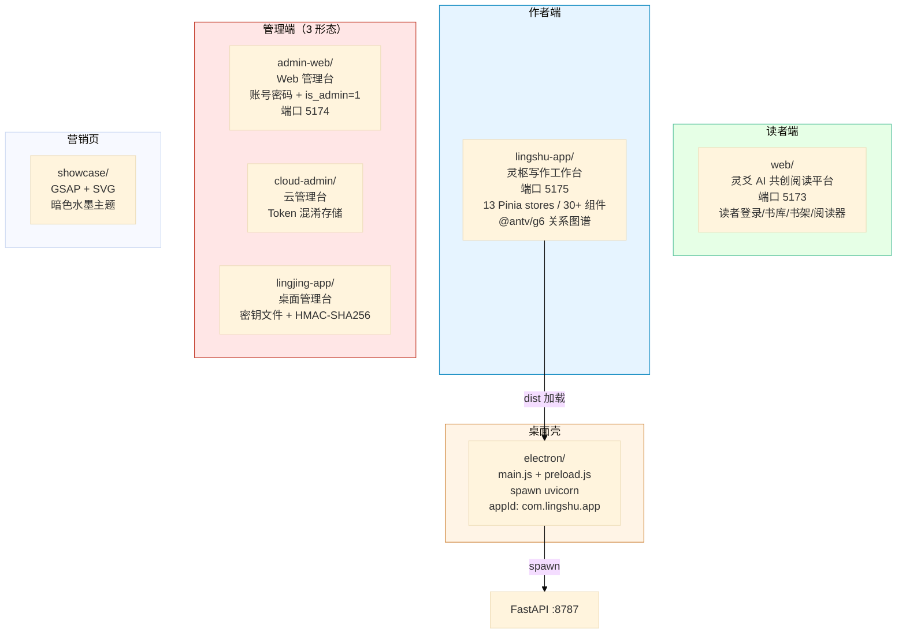

### 6.2 lingshu-app 写作台组件树

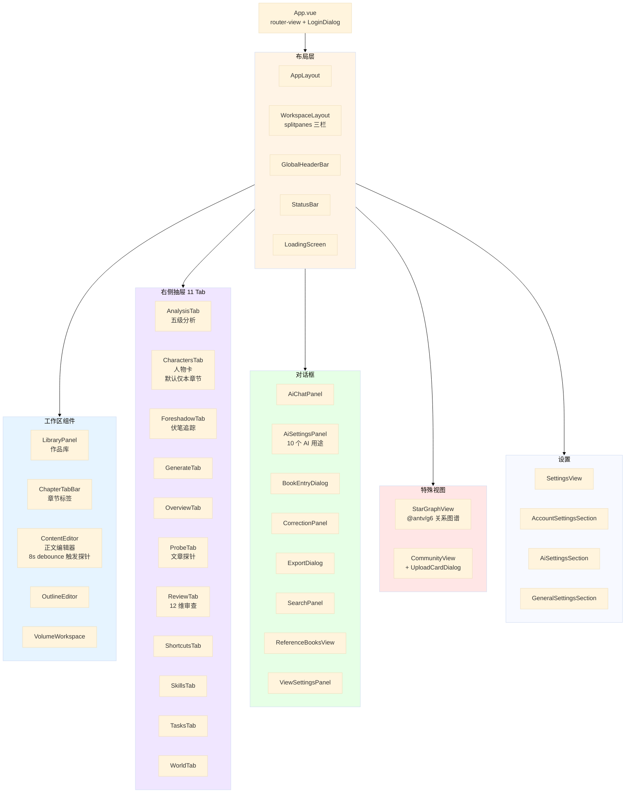

### 6.3 lingshu-app Pinia Stores（13 个）

| Store | 职责 |
|-------|------|
| `auth` | 用户认证、Token 管理 |
| `book` | 当前书籍状态 |
| `chapter` | 当前章节、编辑状态 |
| `character` | 人物卡列表、筛选 |
| `cloud` | 云端同步状态 |
| `community` | 社区卡片 |
| `foreshadow` | 伏笔追踪 |
| `generation` | AI 生成任务 |
| `skill` | 写作技能 |
| `task` | 后台任务队列 |
| `theme` | UI 主题 |
| `websocket` | WS 连接管理 |
| `workspace` | 工作区布局 |
| `world` | 世界观 |

### 6.4 路由结构（web/）

| 路径 | 组件 | 鉴权 | 用途 |
|------|------|------|------|
| `/` | HomeView | 否 | 首页（公告/热门标签/话题） |
| `/bookstore` | BookstoreView | 否 | 书库（性别+三级标签筛选） |
| `/books/:bookId` | BookDetailView | 否 | 作品详情 |
| `/books/:bookId/chapters/:chapterId` | ReaderView | 否 | 阅读器（暖色护眼） |
| `/shelf` | BookshelfView | ✅ | 我的书架 |
| `/create` | CreateView | ✅ | 共创空间 |
| `/profile` | ProfileView | ✅ | 作者后台 |
| `/profile/books/:bookId/chapters` | AuthorChapterManageView | ✅ | 章节管理 |
| `/profile/books/:bookId/chapters/:chapterId/edit` | AuthorChapterEditorView | ✅ | 章节编辑 |

### 6.5 桌面端架构

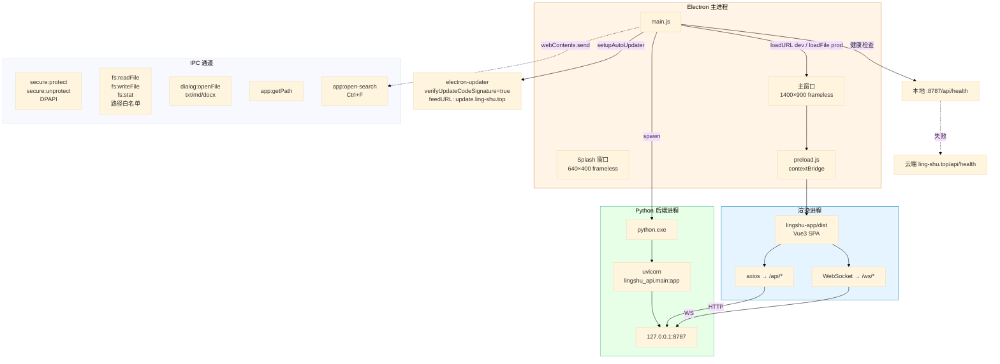

**安全沙箱**：
- `contextIsolation: true`
- `sandbox: true`
- `nodeIntegration: false`（默认）
- 文件 IPC 走 `isPathAllowed` 白名单
- 自动更新强制 `verifyUpdateCodeSignature = true`

---

## 7. 数据库架构

### 7.1 混合数据库分层

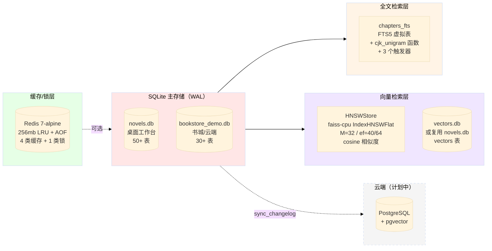

### 7.2 Database 类组合

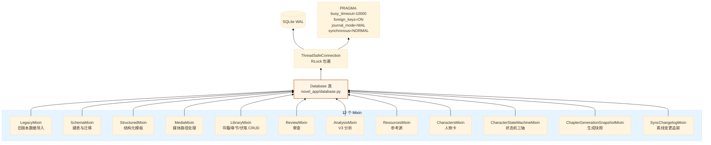

### 7.3 核心表 ER 图（精简）

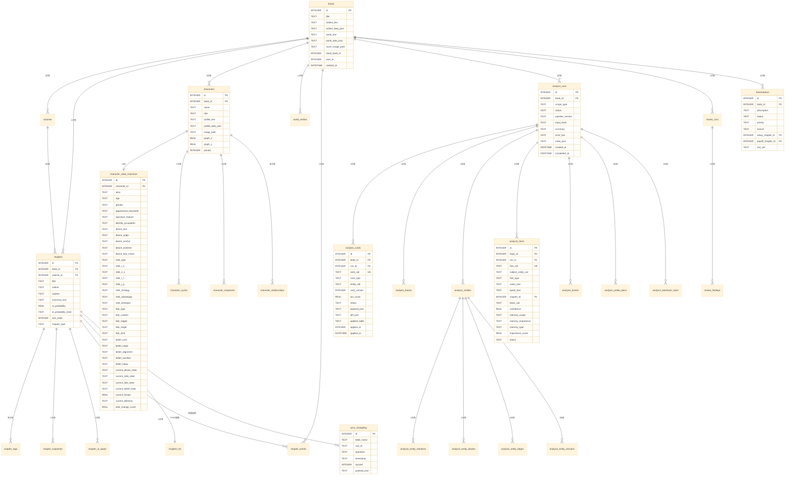

### 7.4 表分组统计

| 分组 | 表数 | 主要表 |
|------|------|--------|
| 核心业务 | 8 | books, volumes, chapters, characters, character_relationships, world_entries, chapter_events, chapter_tags |
| 章节辅助 | 5 | chapter_snapshots, chapter_generation_snapshots, chapter_ai_spans, name_shortcuts, sticky_notes |
| 人物状态机 | 3 | character_state_machines, character_cycles, character_snapshots |
| V3 分析 | 13 | analysis_runs, analysis_cards, analysis_blocks, analysis_entities, analysis_entity_mentions, analysis_entity_aliases, analysis_entity_edges, analysis_entity_versions, analysis_facts, analysis_events, analysis_card_dependencies, analysis_backtrack_tasks, analysis_probe_plans, analysis_probe_results, analysis_audit_logs, analysis_apply_snapshots, analysis_llm_cache |
| 审查 | 2 | review_runs, review_findings |
| 伏笔 | 1 | foreshadows |
| 参考源 | 4 | reference_sources, book_reference_sources, book_reference_segments, distilled_skills, skill_bindings |
| 全文检索 | 1 | chapters_fts（虚拟表） |
| 向量 | 1 | vectors |
| 同步 | 1 | sync_changelog |
| 社区 | 1 | community_card_posts |
| 元数据 | 3 | app_migrations, legacy_imports, sync_meta |
| 视图/样式 | 3 | node_styles, relationship_types, character_node_styles |
| **novels.db 合计** | **50+** | — |
| **bookstore_demo.db** | **30+** | users, auth_tokens, trusted_devices, admin_users, books, chapters, bookshelf_*, cloud_*, user_ai_settings, user_analysis_runs, user_ai_usage_events, ... |

### 7.5 数据库迁移机制

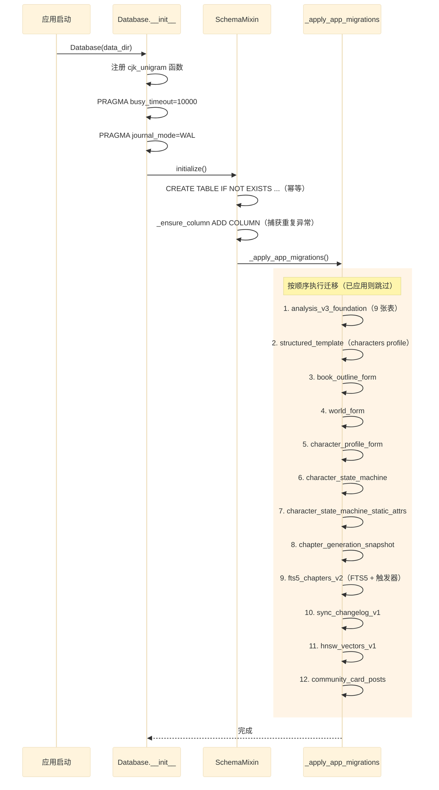

### 7.6 事务保护策略

**三级保护机制**：

1. **`Database.transaction()` 上下文管理器**（[database.py:198](file:///f:/项目/灵枢/novel_app/database.py)）：
   - 设置 `_commit_suppressed = True` 抑制内层 commit
   - 退出时统一 commit 或 rollback
   - **硬约束**：writeback.py 所有 multi-table 操作必须用此包裹

2. **`WorkspaceDB._write_lock`**（[db_bridge.py](file:///f:/项目/灵枢/lingshu_api/services/db_bridge.py)）：
   - `threading.Lock()` 串行化所有写操作
   - 与 Database 的 RLock 配合形成两级保护

3. **`CloudBookStore.begin_transaction()`**（[cloud_store.py](file:///f:/项目/灵枢/novel_app/bookstore/cloud_store.py)）：
   - `BEGIN IMMEDIATE` 显式事务
   - 用于 11 张表的原子克隆（范例小说分发）

### 7.7 Redis 缓存策略

| 缓存类型 | Key 模板 | TTL | 失效时机 |
|----------|----------|-----|----------|
| 书籍树 | `lingshu:book_tree:{book_id}` | 300s | 任何 book/volume/chapter 写操作 |
| 章节内容 | `lingshu:chapter:{chapter_id}` | 600s | 章节编辑/删除 |
| 分析运行状态 | `lingshu:analysis_run:{run_id}` | 60s | 短 TTL 自然过期 |
| 书籍列表 | `lingshu:book_list:{user_id}` | 300s | 任何 book 写操作 |
| 分析锁（分布式） | `lingshu:book:{id}:analysis_lock` | 3600s | 手动释放 / TTL 过期 |

**优雅降级**：
- Redis 不可用时所有缓存方法返回 `None/False`
- 分布式锁返回伪 token `nolock:<uuid>`（允许单机无锁运行）
- 桌面端不依赖 Redis，业务不受影响

### 7.8 HNSW 向量存储

**核心参数**（[hnsw_store.py](file:///f:/项目/灵枢/novel_app/db/hnsw_store.py)）：
- `M=32`（每节点连接数）
- `ef_construction=40`
- `ef_search=64`
- `oversample_factor=10`（filter 过采样倍数）
- 距离度量：cosine 相似度（向量归一化 + `METRIC_INNER_PRODUCT`）

**三个 collection**：

| Collection | point_id 格式 | 用途 |
|------------|---------------|------|
| `analysis_blocks_{book_id}` | `block:{block_uid}` | 文本块摘要向量 |
| `entity_mentions_{book_id}` | `mention:{mention_uid}` | 实体提及向量（共指消解辅助） |
| `entity_summaries_{book_id}` | `entity:{entity_uid}` | 实体规范化摘要向量 |

**延迟重建策略**：upsert/delete 仅写 SQLite + 标记 dirty，search 时若 dirty 则从 SQLite 全量重建 faiss 索引。

### 7.9 FTS5 中文全文检索

**实现要点**（[db_bridge.py:228-346](file:///f:/项目/灵枢/lingshu_api/services/db_bridge.py)）：

1. 创建 FTS5 虚拟表 `chapters_fts`，`content='chapters'` 外部表模式
2. 注册 `cjk_unigram(text)` 自定义函数：把每个 CJK 字符前后加空格
3. 创建 3 个触发器（INSERT/DELETE/UPDATE）调用 `cjk_unigram`
4. 查询时把查询串经 `cjk_unigram` 处理后用双引号包裹为 FTS5 phrase
5. 用 `bm25(chapters_fts)` 排序
6. FTS5 不可用时降级为 Python 逐章 `str.find` 扫描

---

## 8. AI 分析流水线

### 8.1 V3 流水线总览

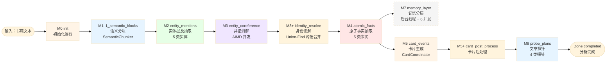

**11 个阶段定义**（[pipeline_v3.py:51-63](file:///f:/项目/灵枢/novel_app/analysis/pipeline_v3.py)）：

| Key | Phase | 标签 |
|-----|-------|------|
| init | M0 | 初始化 |
| l1_semantic_blocks | M1 | 语义分块 |
| entity_mentions | M2 | 实体提及抽取 |
| entity_coreference | M3 | 共指消解 |
| identity_resolve | M3+ | 身份消解 |
| atomic_facts | M4 | 原子事实抽取 |
| memory_layer | M7 | 记忆分层 |
| card_events | M5 | 卡片生成 |
| card_post_process | M5+ | 卡片后处理 |
| probe_plans | M8 | 文章探针 |
| completed | Done | 完成 |

### 8.2 AIMD 动态并发控制器

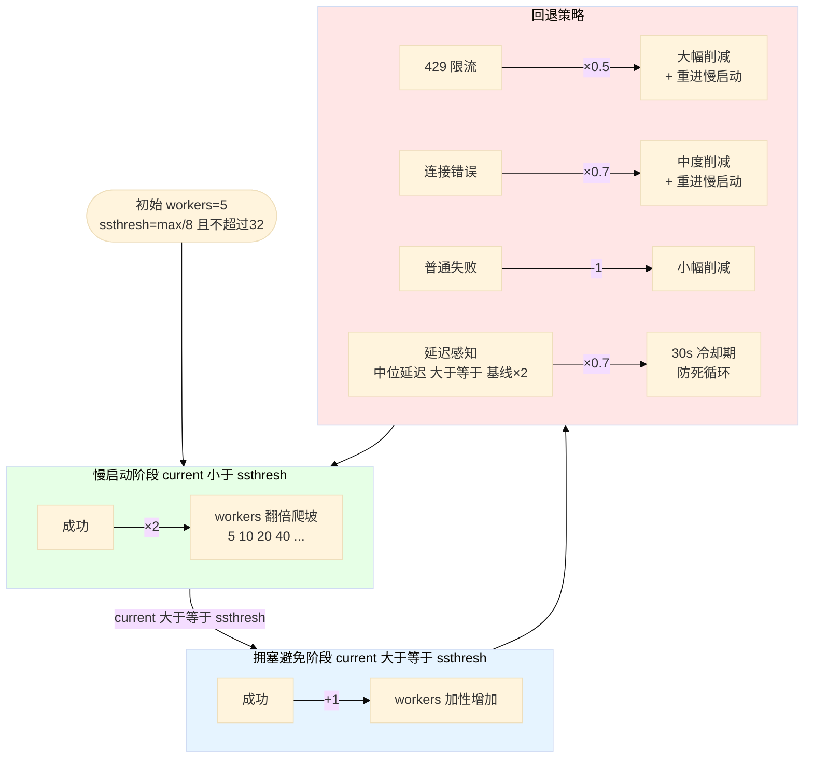

**关键参数**（[ai_provider.py:392-559](file:///f:/项目/灵枢/novel_app/analysis/ai_provider.py)）：
- `initial = 5`
- `maximum = 425`
- `ssthresh = min(maximum // 8, 32)`
- `BURST_SUBMIT_CAP = 8`（突发提交上限）
- `AI_MAX_ATTEMPTS = 4`（首次 + 3 重试）
- 限流退避：`2s / 4s / 8s` 指数
- 超时退避：`1s / 2s / 3s` 线性

### 8.3 写回层与证据门禁

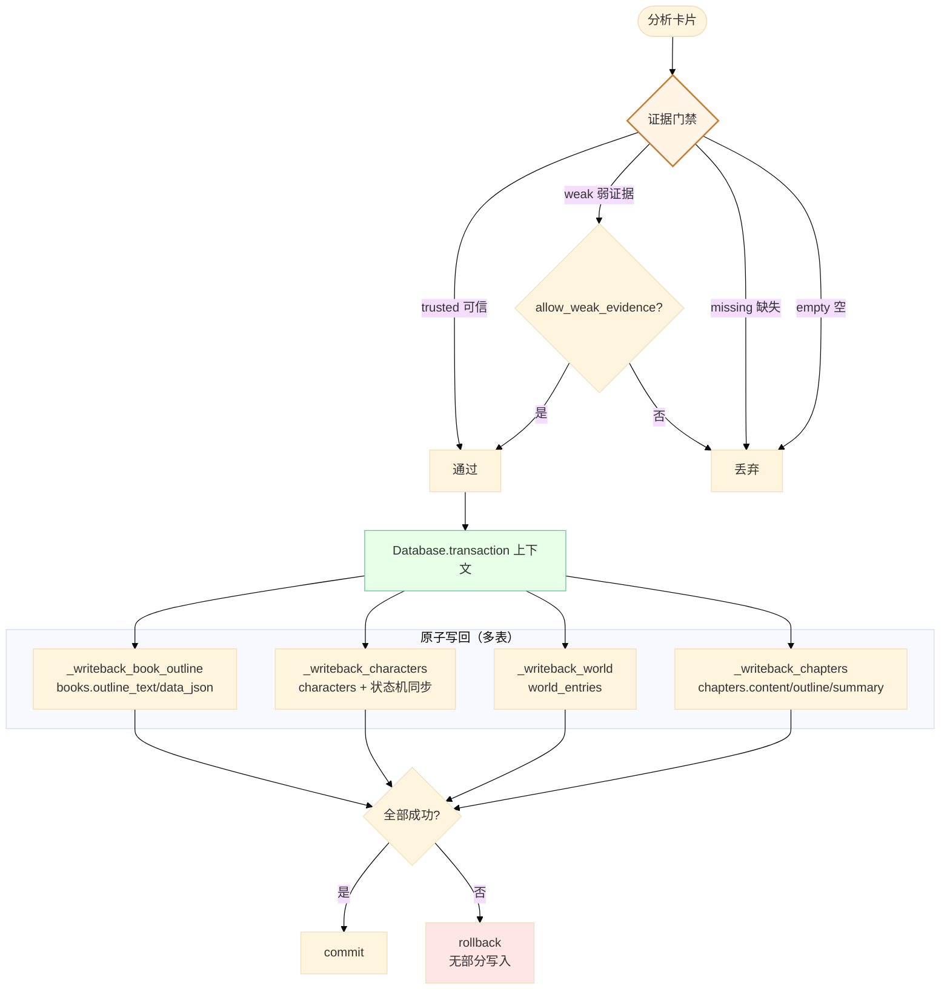

**证据门禁四级评估**（来自 project_memory 硬约束）：
- `trusted`：可信证据，直接通过
- `weak`：弱证据，受 `allow_weak_evidence` 开关控制
- `missing`：缺失证据，丢弃
- `empty`：空证据，丢弃

> **硬约束**：分析草稿不能直接写入官方数据库，必须经过证据门禁（trusted/weak/missing/empty 四级评估）。

### 8.4 记忆压缩并行化

**`MemoryCompressor.compress_parallel()`**（[memory_compressor.py](file:///f:/项目/灵枢/novel_app/analysis/memory_compressor.py)）：

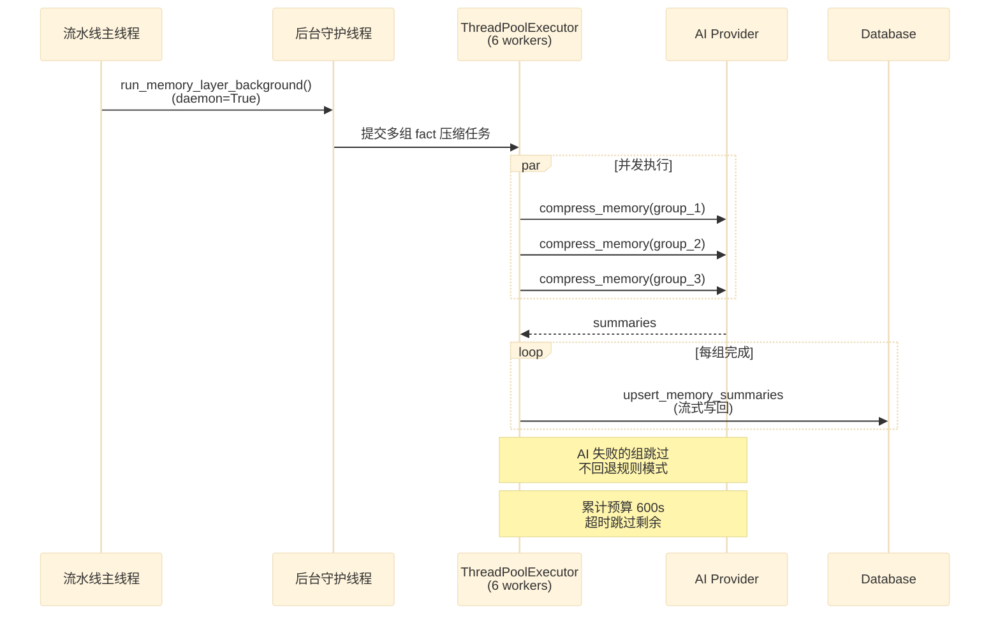

**关键配置**：
- `MEMORY_COMPRESS_AI_TIMEOUT = 90s`（远小于通用 300s）
- `MEMORY_COMPRESS_AI_BUDGET = 600s`（累计预算）
- `MEMORY_COMPRESS_PARALLEL_WORKERS = 6`
- `DEFAULT_CACHE_COMPRESSION_THRESHOLD = 3`

### 8.5 8 套 AI 系统提示词

| Prompt | 用途 |
|--------|------|
| `SYSTEM_PROMPT_MENTION` | 实体提及抽取（character/organization/location/item/concept） |
| `SYSTEM_PROMPT_COREFERENCE` | 共指消解（含简称与全名合并规则） |
| `SYSTEM_PROMPT_FACT` | 原子事实抽取（event/relation/state/foreshadowing/world_rule） |
| `SYSTEM_PROMPT_CARD_CONTENT` | 结构化卡片内容生成（v3_character/v3_world/v3_book_summary） |
| `SYSTEM_PROMPT_MEMORY_SCORE` | 记忆重要性评分（hot/warm/cold/archive + 0-1 分） |
| `SYSTEM_PROMPT_MEMORY_COMPRESS` | 记忆压缩摘要 |
| `SYSTEM_PROMPT_PROBE_QUESTION` | 探针问题生成（4 类） |
| `SYSTEM_PROMPT_SEMANTIC_CHUNK` | 语义边界判定 |

### 8.6 文章探针 4 类

| 探针类型 | 用途 |
|----------|------|
| `foreshadowing_recovery` | 伏笔回收检查 |
| `entity_state` | 实体状态一致性 |
| `world_rule` | 世界规则一致性 |
| `relationship_evolution` | 关系演变追踪 |

### 8.7 审计引擎 12 维度

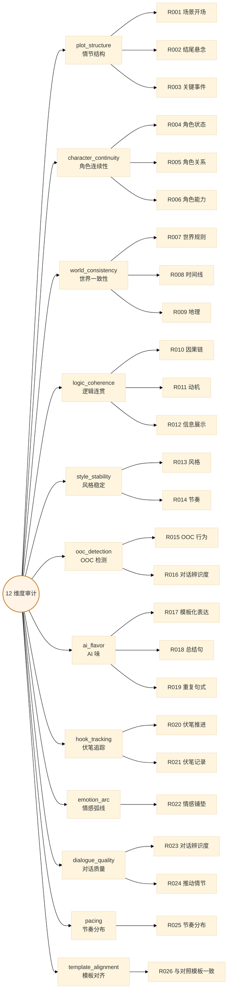

**判决规则**：
- `high >= 3` 或 `score < 60` → **REJECT**
- `high >= 1` 或 `score < 80` → **REVISE**
- 否则 → **APPROVE**

---

## 9. 安全架构

### 9.1 双轨认证体系

```mermaid
%%{init: {'theme': 'base', 'themeVariables': { 'darkMode': false }}}%%
graph TB
    subgraph UserAuth["普通用户认证"]
        Login["POST /api/auth/login"]
        Login --> Bearer["Bearer Token<br/>secrets.token_hex(32)<br/>64 字符 hex"]
        Bearer --> Hash1["SHA256 hash 存储<br/>auth_tokens.token_hash"]
        Bearer --> TTL1["无 TTL<br/>主动 revoke"]
    end

    subgraph AdminAuth["管理员独立认证"]
        AdminLogin["POST /api/admin/auth/login"]
        AdminLogin --> HMAC["HMAC-SHA256 签名<br/>X-Client-KeyId/Ts/Sig<br/>5 分钟时间窗口"]
        HMAC --> AESToken["Token + AES-256-GCM<br/>加密 HMAC 密钥"]
        AESToken --> Hash2["SHA256 hash 存储<br/>admin_auth_tokens"]
        AESToken --> TTL2["TTL 24h<br/>cleanup_on_startup"]
    end

    subgraph WSAuth["WebSocket 认证"]
        WSConn[WS 连接]
        WSConn --> FirstMsg["首条消息<br/>type:auth + token"]
        FirstMsg --> Verify[get_user_by_token]
        Verify --> Ban{失败次数<br/>超阈值?}
        Ban -->|是| BanIP[IP 封禁 900s]
        Ban -->|否| Allow[允许]
    end

    style UserAuth fill:#e6f4ff,stroke:#1a8fc4
    style AdminAuth fill:#ffe6e6,stroke:#c44030
    style WSAuth fill:#fff4e6,stroke:#c97c2d
```

### 9.2 三层密码哈希

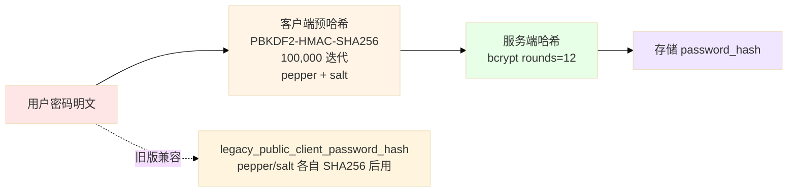

**密钥来源**：
- `data/.password_pepper`（64 字符 hex，自动生成）
- `data/.password_salt`（64 字符 hex，自动生成）
- 环境变量 `LINGSHU_PASSWORD_PEPPER` / `LINGSHU_PASSWORD_SALT` 优先

### 9.3 AI 访问控制

| 控制点 | 实现 | 文件 |
|--------|------|------|
| 登录强制 | `require_ai_access` 依赖 | [dependencies.py:81-89](file:///f:/项目/灵枢/lingshu_api/dependencies.py) |
| 配置校验 | `require_remote(purpose)` | [client.py:163-166](file:///f:/项目/灵枢/novel_app/ai/client.py) |
| 四要素校验 | `validate_profile_ready` | [ai_settings.py:354-363](file:///f:/项目/灵枢/lingshu_api/services/ai_settings.py) |
| SSRF 防护 | `_normalize_base_url` 拒绝私有 IP | [client.py:168-190](file:///f:/项目/灵枢/novel_app/ai/client.py) |
| 用户级隔离 | `user_ai_settings` 表 `(user_id, purpose)` 唯一 | [ai_settings.py](file:///f:/项目/灵枢/lingshu_api/services/ai_settings.py) |
| 密钥保护 | `protect_secret` DPAPI/keyring | [secure_storage.py](file:///f:/项目/灵枢/novel_app/secure_storage.py) |

### 9.4 安全检查清单

| 项 | 状态 | 说明 |
|----|------|------|
| 密码 bcrypt 哈希 | ✅ | rounds=12 |
| Token SHA256 哈希存储 | ✅ | auth_tokens + admin_auth_tokens |
| 用户名枚举防护 | ✅ | 注册冲突返回与成功一致 200 但无 token |
| SQL 注入防护 | ✅ | `_validate_local_table` 白名单 + `_sql_identifier` |
| SSRF 防护 | ✅ | 拒绝私有 IP、非 HTTPS 远程、含换行 URL |
| CSRF 防护 | ✅ | CORS allow_credentials + Origin 校验 |
| 点击劫持防护 | ✅ | `X-Frame-Options: DENY` |
| XSS 防护 | ✅ | `X-XSS-Protection: 1; mode=block` + CSP |
| 限流 | ✅ | slowapi（登录 5/min） |
| WS IP 封禁 | ✅ | 失败次数阈值 + 900s 封禁 |
| 发布令牌 | ✅ | `secrets.compare_digest` 防时序攻击 |
| 管理员审计日志 | ✅ | admin_audit_logs 表 |
| 错误信息脱敏 | ✅ | 500 错误仅通用提示 |
| 自动更新签名校验 | ✅ | `verifyUpdateCodeSignature=true` |
| Electron 沙箱 | ✅ | contextIsolation + sandbox + 无 nodeIntegration |
| 文件 IPC 白名单 | ✅ | `isPathAllowed` |
| 路径遍历防护 | ✅ | splash.html `isImagePathAllowed` |

---

## 10. API 接口契约

### 10.1 健康检查

| 方法 | 路径 | 响应 |
|------|------|------|
| GET | `/api/health` | `{"ok": true, "version": "v1", "redis": {"status": "ok", "latency_ms": 12.34}}` |
| GET | `/api/v1/health` | 同上 |
| GET | `/api/workspace/health` | 工作台层级健康 |

### 10.2 认证接口

| 方法 | 路径 | 限流 | 鉴权 | 用途 |
|------|------|------|------|------|
| POST | `/api/auth/login` | 5/min | 否 | 登录（密码客户端预哈希） |
| POST | `/api/auth/register` | 5/min | 否 | 注册（自动 seed 范例小说） |
| POST | `/api/auth/logout` | - | Bearer | 登出 |
| GET | `/api/auth/me` | - | Bearer | 获取当前用户 |
| POST | `/api/auth/check-device` | - | Bearer | 设备检查 |
| POST | `/api/auth/trust-device` | - | Bearer | 信任设备 |
| GET | `/api/auth/devices` | - | Bearer | 设备列表 |

### 10.3 管理员接口（HMAC 守卫）

| 方法 | 路径 | 用途 |
|------|------|------|
| POST | `/api/admin/auth/login` | 管理员登录（HMAC 签名） |
| GET | `/api/admin/auth/me` | 管理员信息 |
| POST | `/api/admin/auth/logout` | 管理员登出 |
| GET | `/api/admin/overview` | 总览统计 |
| GET | `/api/admin/user-stats` | 用户统计 |
| GET | `/api/admin/quotas` | 配额与计费 |
| GET/PATCH/DELETE | `/api/admin/users/{id}` | 用户 CRUD |
| POST | `/api/admin/users/{id}/restore` | 恢复软删除 |
| GET/PATCH/DELETE | `/api/admin/books/{id}` | 书籍 CRUD |
| GET/PATCH/DELETE | `/api/admin/chapters/{id}` | 章节 CRUD |
| GET/DELETE | `/api/admin/bookshelf/shelves\|items` | 书架管理 |
| GET/DELETE | `/api/admin/tokens/{token}` | Token 撤销 |
| GET/DELETE | `/api/admin/devices/{id}` | 设备撤销 |
| GET | `/api/admin/audit-logs` | 审计日志 |

### 10.4 工作台核心接口（节选）

| 方法 | 路径 | 用途 |
|------|------|------|
| GET | `/api/workspace/books` | 我的书列表（user_id 隔离） |
| POST | `/api/workspace/books` | 创建书 |
| GET | `/api/workspace/books/{book_id}` | 获取书（含 volume→chapter 树） |
| PATCH | `/api/workspace/books/{book_id}` | 更新书 |
| DELETE | `/api/workspace/books/{book_id}` | 删除书 |
| GET | `/api/workspace/books/{book_id}/search` | FTS5 全文搜索 |
| POST | `/api/workspace/books/{book_id}/volumes` | 创建分卷 |
| POST | `/api/workspace/books/{book_id}/chapters` | 创建章节 |
| GET | `/api/workspace/chapters/{chapter_id}` | 获取章节 |
| PATCH | `/api/workspace/chapters/{chapter_id}` | 更新章节 |
| POST | `/api/workspace/books/{book_id}/ai-probability` | AI 概率检测 |
| POST | `/api/workspace/books/{book_id}/writing-probe` | 写作探针（probe_enabled 开关） |

### 10.5 V3 分析接口（节选）

| 方法 | 路径 | 用途 |
|------|------|------|
| POST | `/api/workspace/books/{book_id}/analysis-v3/runs` | 创建分析运行 |
| POST | `/api/workspace/books/{book_id}/analysis-v3/incremental` | 增量分析 |
| GET | `/api/workspace/books/{book_id}/analysis-v3/runs` | 运行列表 |
| GET | `/api/workspace/analysis-v3/runs/{run_id}` | 运行详情 |
| POST | `/api/workspace/analysis-v3/runs/{run_id}/cancel` | 取消运行 |
| POST | `/api/workspace/analysis-v3/runs/{run_id}/steps/entity_mentions` | M2 实体提及 |
| POST | `/api/workspace/analysis-v3/runs/{run_id}/steps/entity_coreference` | M3 共指消解 |
| POST | `/api/workspace/analysis-v3/runs/{run_id}/steps/atomic_facts` | M4 原子事实 |
| POST | `/api/workspace/analysis-v3/runs/{run_id}/steps/memory_layer` | M7 记忆分层 |
| POST | `/api/workspace/analysis-v3/runs/{run_id}/steps/card_events` | M5 卡片生成 |
| POST | `/api/workspace/analysis-v3/runs/{run_id}/steps/probes` | M8 探针 |
| POST | `/api/workspace/analysis-v3/runs/{run_id}/cards/{card_uid}/apply` | 应用卡片 |
| POST | `/api/workspace/analysis-v3/runs/{run_id}/cards/{card_uid}/writeback` | 写回卡片 |
| POST | `/api/workspace/analysis-v3/runs/{run_id}/writeback` | 批量写回 |
| POST | `/api/workspace/books/{book_id}/active-probe` | 主动探针 |

### 10.6 云端同步接口

| 方法 | 路径 | 用途 |
|------|------|------|
| GET | `/api/cloud/books` | 云端书列表 |
| GET | `/api/cloud/books/{cloud_book_id}` | 云端书详情 |
| POST | `/api/cloud/books/{book_id}/upload` | 上传到云端 |
| POST | `/api/cloud/books/{cloud_book_id}/download` | 下载到本地 |
| POST | `/api/cloud/sync` | 触发同步 |
| GET | `/api/cloud/sync/status` | 同步状态 |

### 10.7 AI 设置接口

| 方法 | 路径 | 用途 |
|------|------|------|
| GET | `/api/settings/ai` | 获取 AI 配置（10 用途） |
| PUT | `/api/settings/ai` | 更新 AI 配置 |
| POST | `/api/settings/ai/test` | 测试 AI 连接 |
| GET | `/api/settings/workspace` | 工作区设置 |
| PUT | `/api/settings/workspace` | 更新工作区设置 |

---

## 11. 部署架构

### 11.1 部署模式

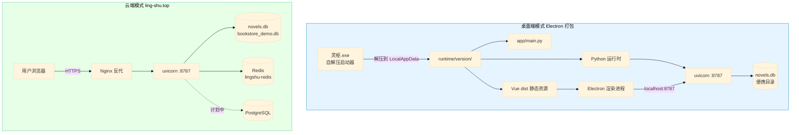

### 11.2 docker-compose.yml（Redis 服务）

```yaml
services:
  redis:
    image: redis:7-alpine
    container_name: lingshu-redis
    restart: unless-stopped
    command: >
      redis-server
      --requirepass "$${REDIS_PASSWORD:-lingshu_dev_password}"
      --maxmemory 256mb
      --maxmemory-policy allkeys-lru
      --appendonly yes
      --appendfsync everysec
    environment:
      REDIS_PASSWORD: ${REDIS_PASSWORD:-lingshu_dev_password}
    ports:
      - "${REDIS_PORT:-6379}:6379"
    volumes:
      - redis-data:/data
    healthcheck:
      test: ["CMD", "redis-cli", "-a", "$${REDIS_PASSWORD:-lingshu_dev_password}", "ping"]
      interval: 10s
      timeout: 3s
      retries: 5
      start_period: 5s
    mem_limit: 384m
    logging:
      driver: json-file
      options: { max-size: "10m", max-file: "3" }

volumes:
  redis-data:
    driver: local
```

### 11.3 打包流程

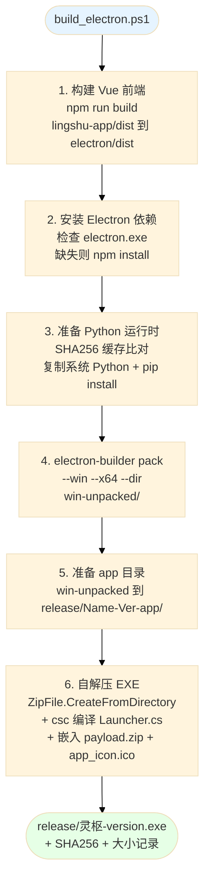

### 11.4 自动更新

- **provider**: `generic`
- **feedURL**: `https://update.ling-shu.top`
- **签名校验**: `verifyUpdateCodeSignature = true`
- **Windows 证书**: `WIN_CSC_LINK` + `WIN_CSC_KEY_PASSWORD`
- **mac 证书**: `MAC_CSC_NAME` + `hardenedRuntime: true`

---

## 12. 关键业务流程

### 12.1 用户注册与范例小说分发

```mermaid
%%{init: {'theme': 'base', 'themeVariables': { 'darkMode': false }}}%%
sequenceDiagram
    actor User as 用户
    participant API as /api/auth/register
    participant Store as BookstoreStore
    participant Sync as BookSyncService
    participant Workspace as WorkspaceDB
    participant Cloud as CloudBookStore

    User->>API: POST {username, password, is_author}
    API->>API: 密码强度校验（≥8 + 字母+数字）
    API->>Store: 创建 user（双层 bcrypt 哈希）

    rect rgb(255, 244, 230)
        Note over API,Cloud: 范例小说"镜中蝉"原子克隆（11 表）
        API->>Cloud: begin_transaction() BEGIN IMMEDIATE
        Cloud->>Cloud: 1. cloud_books (source_type='sample_clone')
        Cloud->>Cloud: 2. cloud_chapters (13 章)
        Cloud->>Cloud: 3. cloud_characters (6 人物)
        Cloud->>Cloud: 4. cloud_character_relationships (7 关系)
        Cloud->>Cloud: 5. cloud_character_state_machines (6)
        Cloud->>Cloud: 6. cloud_character_cycles
        Cloud->>Cloud: 7. cloud_character_snapshots
        Cloud->>Cloud: 8. cloud_chapter_events (50)
        Cloud->>Cloud: 9. cloud_chapter_tags
        Cloud->>Cloud: 10. cloud_analysis_runs
        Cloud->>Cloud: 11. cloud_analysis_cards (20)
        Cloud-->>API: commit_transaction()
    end

    rect rgb(230, 244, 255)
        Note over API,Workspace: 同步到 novels.db（避免锁冲突）
        API->>Workspace: 创建 books (category='范例', source_app=f'user_{id}')
        API->>Workspace: 同步章节/人物/状态机/分析卡
    end

    rect rgb(255, 230, 230)
        Note over API,Store: 同步到 bookstore_demo.db.books
        API->>Store: 创建 books (source_app=f'user_{id}')
    end

    API-->>User: 200 {token, user}<br/>（用户名冲突也返回 200 但无 token，防枚举）
```

### 12.2 V3 分析全流程

```mermaid
%%{init: {'theme': 'base', 'themeVariables': { 'darkMode': false }}}%%
sequenceDiagram
    actor User as 作者
    participant WS as /ws/analysis-v3
    participant Pipeline as AnalysisPipelineV3
    participant AI as AIAnalysisProvider
    participant AIMD as AIMDController
    participant DB as Database
    participant Vector as AnalysisVectorStore

    User->>WS: {type: analyze_v3, book_id, task_id}
    WS->>WS: authenticate_ws(token)
    WS->>Pipeline: start_run(book_id)

    rect rgb(255, 244, 230)
        Note over Pipeline,Vector: 11 阶段顺序执行
        Pipeline->>DB: 创建 analysis_run (status=running)
        Pipeline->>Pipeline: M0 init
        WS-->>User: progress M0 0%

        Pipeline->>Pipeline: M1 语义分块
        Pipeline->>DB: 写 analysis_blocks
        WS-->>User: progress M1 10%

        rect rgb(230, 244, 255)
            Note over Pipeline,AIMD: M2 实体提及（AIMD 并发）
            loop 每个 block
                Pipeline->>AIMD: 提交 extract_mentions(block)
                AIMD->>AIMD: 慢启动 5→10→20...
                AIMD->>AI: stream_chat(SYSTEM_PROMPT_MENTION)
                AI-->>AIMD: mentions JSON
                AIMD->>AIMD: 成功 → ×2 或 +1
            end
            Pipeline->>DB: 批量写 analysis_entity_mentions
        end
        WS-->>User: progress M2 30%

        Pipeline->>Pipeline: M3 共指消解（AIMD 并发）
        Pipeline->>AI: resolve_coreference(mentions, entities)
        Pipeline->>Pipeline: M3+ 跨批合并（Union-Find）
        Pipeline->>DB: 写 analysis_entities + aliases + edges
        WS-->>User: progress M3 50%

        Pipeline->>Pipeline: M4 原子事实（AIMD 并发）
        Pipeline->>AI: extract_facts(blocks, entities)
        Pipeline->>DB: 写 analysis_facts
        WS-->>User: progress M4 65%

        rect rgb(230, 255, 230)
            Note over Pipeline,Vector: M7 记忆分层（后台并行）
            Pipeline->>Pipeline: run_memory_layer_background()
            Pipeline->>AI: score_memory_importance(facts)
            Pipeline->>AI: compress_parallel(facts, 6 workers)
            Pipeline->>DB: upsert_memory_summaries（流式）
        end

        Pipeline->>Pipeline: M5 卡片生成
        Pipeline->>Pipeline: M5+ 卡片后处理
        Pipeline->>DB: 写 analysis_cards
        WS-->>User: progress M5 80%

        Pipeline->>Pipeline: M8 探针规划
        Pipeline->>DB: 写 analysis_probe_plans
        WS-->>User: progress M8 95%

        Pipeline->>DB: 更新 analysis_run (status=completed)
    end

    WS-->>User: result {status: ok, run_id, stats}
```

### 12.3 写回流程（V1 + V3 统一）

```mermaid
%%{init: {'theme': 'base', 'themeVariables': { 'darkMode': false }}}%%
sequenceDiagram
    actor User as 作者
    participant API as /analysis-v3/runs/{run_id}/writeback
    participant Writeback as writeback.py
    participant DB as Database
    participant Snapshot as analysis_apply_snapshots

    User->>API: POST writeback
    API->>API: require_login + check_book_owner
    API->>Writeback: apply_book_analysis_payload(db, book_id, payload)

    rect rgb(255, 244, 230)
        Note over Writeback: 1. 规整化 + 证据门禁
        Writeback->>Writeback: normalize_book_analysis_payload
        Writeback->>Writeback: 过滤 missing/empty 证据项
        opt allow_weak_evidence=False
            Writeback->>Writeback: 过滤 weak 证据项
        end
    end

    rect rgb(230, 244, 255)
        Note over Writeback,DB: 2. 快照 + 原子事务写回
        Writeback->>Snapshot: 创建 apply_snapshot（写前快照）
        Writeback->>DB: transaction() 上下文
        DB->>DB: _commit_suppressed = True

        Writeback->>DB: _writeback_book_outline
        Writeback->>DB: _writeback_characters<br/>(+ 状态机同步 writeback_to_state_machine)
        Writeback->>DB: _writeback_world
        Writeback->>DB: _writeback_chapters

        alt 全部成功
            DB->>DB: commit
            DB->>API: AnalysisWritebackResult
        else 任一失败
            DB->>DB: rollback（无部分写入）
            DB-->>API: 抛异常
        end
    end

    API-->>User: 200 {updated_chapter_ids, unresolved_count, evidence_gate_dropped}
```

### 12.4 本地↔云端同步

```mermaid
%%{init: {'theme': 'base', 'themeVariables': { 'darkMode': false }}}%%
sequenceDiagram
    actor User as 作者
    participant API as /api/cloud/sync
    participant Sync as BookSyncService
    participant Local as WorkspaceDB
    participant Cloud as CloudBookStore

    User->>API: POST sync
    API->>Sync: sync_uploaded_books(user_id)

    loop 每本已绑定 cloud_book_id 的书
        Sync->>Local: 读取本地 updated_at
        Sync->>Cloud: 读取云端 updated_at

        alt 本地更新（本地新）
            Sync->>Cloud: upload_book_to_cloud<br/>(开启云端事务)
            Cloud->>Cloud: 更新 cloud_books + 关联表
            Cloud-->>Sync: commit
        else 云端更新（云端新）
            Sync->>Local: download_cloud_book
            Local->>Local: 更新本地表
        else 时间差 ≤ 1s
            Note over Sync: 保留本地（视为同步）
        end
    end

    Sync-->>API: {uploaded, downloaded, skipped, conflicts}
    API-->>User: 200 sync result
```

### 12.5 AI 对话（WebSocket）

```mermaid
%%{init: {'theme': 'base', 'themeVariables': { 'darkMode': false }}}%%
sequenceDiagram
    actor User as 用户
    participant Vue as lingshu-app
    participant WS as /ws/chat
    participant ConnMgr as ConnectionManager
    participant Chat as chat.py
    participant AI as SimpleAIService

    User->>Vue: 输入消息
    Vue->>WS: {type: chat, task_id, messages}
    WS->>ConnMgr: authenticate_ws(token)
    ConnMgr-->>WS: auth_ok

    WS->>Chat: handle_chat(payload, user)
    Chat->>Chat: _build_chat_context_prompt<br/>(系统提示 + 章节大纲 + 正文节选<br/>+ 参考来源 + 全书上下文 7000 字<br/>+ 人物卡 + 技能)

    Chat->>Chat: _stream_chat(generator)<br/>(Thread + asyncio.Queue 桥接)

    loop 流式生成
        AI-->>Chat: chunk
        Chat-->>WS: {type: chunk, task_id, text}
        WS-->>Vue: chunk
        Vue-->>User: 实时显示
    end

    Chat-->>WS: {type: result, task_id, text, status: ok}
    WS-->>Vue: result
```

---

## 13. 配置与环境变量

### 13.1 应用配置

| 变量 | 默认 | 说明 |
|------|------|------|
| `BOOKSTORE_DB_PATH` | `data/bookstore_demo.db` | 书城数据库路径 |
| `BOOKSTORE_PUBLISH_TOKEN` | - | 桌面端发布令牌 |
| `CORS_ORIGINS` | `http://127.0.0.1:5173-5176, https://ling-shu.top` | 允许的源（逗号分隔） |
| `DISABLE_API_DOCS` | `true` | 关闭 `/docs` `/redoc` `/openapi.json` |
| `SIMPLE_AI_NOVEL_DATA_DIR` | - | 数据目录覆盖 |
| `SIMPLE_AI_NOVEL_LEGACY_DATA_DIRS` | - | 遗留数据目录（`os.pathsep` 分隔） |

### 13.2 AI 配置

| 变量 | 默认 | 说明 |
|------|------|------|
| `LINGSHU_AI_API_KEY` / `OPENAI_API_KEY` | - | AI API 密钥 |
| `LINGSHU_AI_BASE_URL` / `OPENAI_BASE_URL` | `https://api.openai.com/v1` | API 地址 |
| `LINGSHU_AI_MODEL` / `OPENAI_MODEL` | - | 模型名 |
| `LINGSHU_AI_TIMEOUT` | `30` | AI 调用超时（秒） |

### 13.3 V3 分析调优

| 变量 | 默认 | 说明 |
|------|------|------|
| `LINGSHU_ANALYSIS_V3_AI_MAX_WORKERS` | `425` | 最大并发数 |
| `LINGSHU_ANALYSIS_V3_STAGE_TIMEOUT_SECONDS` | `1200` | 单阶段超时 |
| `LINGSHU_AI_COREFERENCE_CONCURRENCY_INITIAL` | `5` | 共指消解初始并发 |
| `LINGSHU_AI_COREFERENCE_CONCURRENCY_MAX` | `425` | 共指消解最大并发 |
| `LINGSHU_AI_BURST_SUBMIT_CAP` | `8` | 突发提交上限 |
| `LINGSHU_AI_MAX_ATTEMPTS` | `4` | 最大重试次数 |
| `LINGSHU_AI_RATE_LIMIT_BACKOFF_BASE` | `2.0` | 限流退避基数 |
| `LINGSHU_AI_TIMEOUT_BACKOFF_BASE` | `1.0` | 超时退避基数 |
| `LINGSHU_AI_OTHER_BACKOFF` | `0.5` | 其他失败退避 |
| `LINGSHU_AI_MEMORY_SCORE_BATCH_SIZE` | `30` | 记忆评分批量 |
| `LINGSHU_ANALYSIS_V3_COREFERENCE_MENTION_LIMIT` | `2500` | 共指提及上限 |

### 13.4 Redis 配置

| 变量 | 默认 | 说明 |
|------|------|------|
| `REDIS_URL` | - | 完整连接 URL（优先） |
| `REDIS_HOST` | `127.0.0.1` | Redis 主机 |
| `REDIS_PORT` | `6379` | Redis 端口 |
| `REDIS_DB` | `0` | Redis 数据库 |
| `REDIS_PASSWORD` | `lingshu_dev_password` | 密码（生产必须覆盖） |

### 13.5 管理员配置

| 变量 | 默认 | 说明 |
|------|------|------|
| `ADMIN_TOKEN_TTL_HOURS` | `24` | 管理员 Token 有效期 |
| `ADMIN_HMAC_ENCRYPTION_KEY` | - | base64 编码 32 字节 AES 密钥 |

### 13.6 WebSocket 配置

| 变量 | 默认 | 说明 |
|------|------|------|
| `MAX_WS_CONNECTIONS` | `1000` | 最大 WS 连接数 |
| `WS_MAX_CONNECTS_PER_IP_PER_MINUTE` | `120` | IP 每分钟连接上限 |
| `WS_AUTH_FAILURE_BAN_THRESHOLD` | `0` | 认证失败封禁阈值（0=不封禁） |
| `WS_AUTH_FAILURE_BAN_SECONDS` | `900` | 封禁时长 |

---

## 14. 风险与约束

### 14.1 已知约束（来自项目硬约束）

> 以下约束来自 `project_memory.md`，违反将导致数据不一致或安全风险。

| 约束 ID | 内容 | 影响范围 |
|---------|------|----------|
| C-01 | `writeback.py` 必须用 `Database.transaction()` 包裹所有多表操作 | 写回层 |
| C-02 | 用户 Token 必须以哈希存储，禁止明文 | 认证系统 |
| C-03 | 500 错误响应不暴露原始异常详情，仅通用提示 + 服务端日志 | 全局异常处理 |
| C-04 | 所有 AI 能力必须先登录，由 `require_ai_access` 装饰器强制 | AI 路由 |
| C-05 | 分析草稿不能直接写入官方数据库，必须经证据门禁（trusted/weak/missing/empty 四级） | 写回层 |
| C-06 | 写回操作前必须快照 | 写回层 |
| C-07 | 写作探针必须经 AI 设置 `probe_enabled` 标志开启 | 探针 API |
| C-08 | `CharactersTab.vue` 默认仅显示本章节人物（按 appear_count 降序），可切换全书 | 前端 |
| C-09 | 写作探针草稿是章节级，无历史；`ContentEditor.vue` 用 8 秒 debounce 触发后台扫描 | 前端 |
| C-10 | `protect_secret` 在 keyring 不可用时必须 `allow_plaintext_fallback=True` | 密钥保护 |
| C-11 | 新用户注册自动克隆范例小说"镜中蝉"到 cloud_books + novels.db.books | 注册流程 |
| C-12 | 范例小说克隆必须同步章节/人物/状态机/分析卡（11 表原子） | 注册流程 |
| C-13 | 注册时必须用 WorkspaceDB 写 novels.db 避免锁冲突 | 注册流程 |
| C-14 | `/api/workspace/books` 查 novels.db.books（user_id 隔离） | API |
| C-15 | `/api/author/books` 查 bookstore_demo.db.books（source_app 过滤） | API |
| C-16 | 范例小说 books 行必须 `category='范例'` + `source_app=f'user_{user_id}'` | 数据标记 |
| C-17 | 已有账户需手动补数据接收范例小说；仅新注册自动克隆 | 注册流程 |
| C-18 | 范例小说 13 章 / 6 人物 / 6 状态机 / 7 关系 / 50 章节事件 / 20 分析卡 | 数据规格 |
| C-19 | 状态机同步必须对齐 V3 分析系统与 V1 写回层 | 状态机 |
| C-20 | 范例小说标题必须为"镜中蝉（灵枢范例小说）"，字数 30023 字 | 数据规格 |
| C-21 | cloud_books.source_type 区分 'sample'（原书）和 'sample_clone'（用户副本） | 数据标记 |

### 14.2 潜在风险

| 风险 | 等级 | 缓解措施 |
|------|------|----------|
| Redis 默认密码 `lingshu_dev_password` 泄露 | 🔴 高 | 生产环境必须通过 `REDIS_PASSWORD` 覆盖 |
| `WS_AUTH_FAILURE_BAN_THRESHOLD` 默认 0 不封禁 | 🟡 中 | 生产环境建议设为 5-10 |
| `MAX_WS_MESSAGE_SIZE = 1MB` 对长文本偏小 | 🟡 中 | V3 分析 WS 已放宽 pong 超时至 600s |
| 425 并发 workers 可能超出 AI API 承载 | 🟡 中 | AIMD 控制器提供保护，起始 5 + 慢启动 |
| SQLite 单机写入瓶颈 | 🟡 中 | WAL + busy_timeout=10s + WorkspaceDB 写锁串行化 |
| 范例小说克隆失败不阻断注册 | 🟢 低 | 失败静默忽略，用户可手动补数据 |
| 桌面端 Redis 不可用 | 🟢 低 | 优雅降级，业务不受影响 |

### 14.3 性能基准（参考）

> 数据来源：2026-07-02 真实环境测试（账号 001，64346 字书籍，DeepSeek v4 flash 非思考模式）

| 指标 | 数值 |
|------|------|
| V3 八阶段总耗时 | 2224.7s |
| 生成 blocks | 29 |
| 生成 mentions | 422（M2 优化后） |
| 生成 entities | 264 |
| 生成 facts | 519 |
| 生成 cards | 48 |
| 生成 probes | 37 |
| AI 调用次数 | 230 |
| 缓存命中 | 57 |
| 自动写回卡片 | 39 |
| M2/M4 峰值并发 | 4 |
| M3 峰值并发 | 62（后被 AIMD 正确回退） |

---

## 15. 附录

### 15.1 关键文件索引

#### 后端核心

| 文件 | 行数 | 职责 |
|------|------|------|
| [lingshu_api/main.py](file:///f:/项目/灵枢/lingshu_api/main.py) | 292 | FastAPI 应用工厂 |
| [lingshu_api/dependencies.py](file:///f:/项目/灵枢/lingshu_api/dependencies.py) | - | 依赖注入 |
| [lingshu_api/services/db_bridge.py](file:///f:/项目/灵枢/lingshu_api/services/db_bridge.py) | 700+ | WorkspaceDB 桥接 |
| [lingshu_api/services/book_sync.py](file:///f:/项目/灵枢/lingshu_api/services/book_sync.py) | 1207 | 双向同步 |
| [lingshu_api/services/ai_settings.py](file:///f:/项目/灵枢/lingshu_api/services/ai_settings.py) | - | 10 AI 用途配置 |
| [lingshu_api/services/usage_recorder.py](file:///f:/项目/灵枢/lingshu_api/services/usage_recorder.py) | - | AI 用量记录 |
| [lingshu_api/ws/connection.py](file:///f:/项目/灵枢/lingshu_api/ws/connection.py) | 310 | WS 连接管理 |

#### 领域核心

| 文件 | 行数 | 职责 |
|------|------|------|
| [novel_app/database.py](file:///f:/项目/灵枢/novel_app/database.py) | 217 | Database 类（12 Mixin） |
| [novel_app/db/schema.py](file:///f:/项目/灵枢/novel_app/db/schema.py) | 1664 | 全表 DDL + 迁移 |
| [novel_app/db/library.py](file:///f:/项目/灵枢/novel_app/db/library.py) | - | 书籍/章节/伏笔 CRUD |
| [novel_app/db/cache.py](file:///f:/项目/灵枢/novel_app/db/cache.py) | 333 | 4 类缓存 + 锁 |
| [novel_app/db/hnsw_store.py](file:///f:/项目/灵枢/novel_app/db/hnsw_store.py) | 524 | HNSW 向量存储 |
| [novel_app/db/sync_engine.py](file:///f:/项目/灵枢/novel_app/db/sync_engine.py) | 485 | 增量同步引擎 |
| [novel_app/ai/service.py](file:///f:/项目/灵枢/novel_app/ai/service.py) | - | SimpleAIService |
| [novel_app/ai/client.py](file:///f:/项目/灵枢/novel_app/ai/client.py) | 200 | AI 客户端（SSRF 防护） |
| [novel_app/analysis/pipeline_v3.py](file:///f:/项目/灵枢/novel_app/analysis/pipeline_v3.py) | 200+ | V3 流水线主类 |
| [novel_app/analysis/ai_provider.py](file:///f:/项目/灵枢/novel_app/analysis/ai_provider.py) | 2192 | AIAnalysisProvider + AIMD |
| [novel_app/analysis/writeback.py](file:///f:/项目/灵枢/novel_app/analysis/writeback.py) | - | 写回层 |
| [novel_app/analysis/memory_compressor.py](file:///f:/项目/灵枢/novel_app/analysis/memory_compressor.py) | - | 记忆压缩 |
| [novel_app/audit/rules.py](file:///f:/项目/灵枢/novel_app/audit/rules.py) | 128 | 26 条审计规则 |
| [novel_app/bookstore/security.py](file:///f:/项目/灵枢/novel_app/bookstore/security.py) | - | 密码哈希 |
| [novel_app/secure_storage.py](file:///f:/项目/灵枢/novel_app/secure_storage.py) | - | DPAPI/keyring |

#### 前端核心

| 文件 | 职责 |
|------|------|
| [web/src/api.ts](file:///f:/项目/灵枢/web/src/api.ts) | Web 书城 API 调用层 |
| [web/src/router.ts](file:///f:/项目/灵枢/web/src/router.ts) | Web 路由 |
| [web/src/stores/auth.ts](file:///f:/项目/灵枢/web/src/stores/auth.ts) | Pinia 认证 store |
| [web/src/utils/crypto.ts](file:///f:/项目/灵枢/web/src/utils/crypto.ts) | 客户端密码预哈希（已停用） |
| [lingshu-app/src/App.vue](file:///f:/项目/灵枢/lingshu-app/src/App.vue) | 写作台壳 |
| [lingshu-app/src/router.js](file:///f:/项目/灵枢/lingshu-app/src/router.js) | 写作台路由 |
| [electron/main.js](file:///f:/项目/灵枢/electron/main.js) | Electron 主进程 |
| [electron/preload.js](file:///f:/项目/灵枢/electron/preload.js) | Electron preload |
| [build_electron.ps1](file:///f:/项目/灵枢/build_electron.ps1) | 打包脚本 |
| [packaging/ElectronSelfExtractLauncher.cs](file:///f:/项目/灵枢/packaging/ElectronSelfExtractLauncher.cs) | C# 自解压启动器（旧版 Launcher.cs 已归档至 _attic/legacy-packaging/） |

### 15.2 数据库文件清单

| 文件 | 用途 |
|------|------|
| [data/novels.db](file:///f:/项目/灵枢/data/novels.db) | 桌面工作台主库（50+ 表） |
| [data/novels.db-wal](file:///f:/项目/灵枢/data/novels.db-wal) | WAL 预写日志 |
| [data/novels.db-shm](file:///f:/项目/灵枢/data/novels.db-shm) | WAL 共享内存索引 |
| [data/bookstore_demo.db](file:///f:/项目/灵枢/data/bookstore_demo.db) | 书城/云端库（30+ 表） |
| [data/.password_pepper](file:///f:/项目/灵枢/data/.password_pepper) | 密码 pepper（64 hex） |
| [data/.password_salt](file:///f:/项目/灵枢/data/.password_salt) | 密码 salt（64 hex） |
| [data/ai_settings.json](file:///f:/项目/灵枢/data/ai_settings.json) | 旧版全局 AI 配置 |
| [data/tags_map.json](file:///f:/项目/灵枢/data/tags_map.json) | 网文标签分类映射 |
| [data/ui_settings.json](file:///f:/项目/灵枢/data/ui_settings.json) | UI 偏好 |
| [data/1/](file:///f:/项目/灵枢/data/1) | 用户 ID=1 工作目录 |
| [release/data/novels.db](file:///f:/项目/灵枢/release/data/novels.db) | 发布版本数据库 |

### 15.3 相关文档

| 文档 | 用途 |
|------|------|
| [DATABASE_CHANGES.md](file:///f:/项目/灵枢/DATABASE_CHANGES.md) | 数据库变更记录 |
| [README.md](file:///f:/项目/灵枢/README.md) | 项目说明 |
| [CHANGELOG.md](file:///f:/项目/灵枢/CHANGELOG.md) | 变更日志 |
| [CONTRIBUTING.md](file:///f:/项目/灵枢/CONTRIBUTING.md) | 贡献指南 |
| [docs/架构/V3全链路架构图.md](file:///f:/项目/灵枢/docs/架构/V3全链路架构图.md) | V3 架构图详图 |
| [docs/灵枢-产品差异化与技术白皮书.md](file:///f:/项目/灵枢/docs/灵枢-产品差异化与技术白皮书.md) | 技术白皮书 |
| [docs/软件设计说明书.md](file:///f:/项目/灵枢/docs/软件设计说明书.md) | 软件设计说明书 |
| [docs/核心算法汇编.md](file:///f:/项目/灵枢/docs/核心算法汇编.md) | 核心算法汇编 |
| [docs/Qt迁移Vue技术栈方案.md](file:///f:/项目/灵枢/docs/Qt迁移Vue技术栈方案.md) | 技术栈迁移方案 |
| [docs/打包流程.md](file:///f:/项目/灵枢/docs/打包流程.md) | 打包流程 |

### 15.4 术语表

| 术语 | 含义 |
|------|------|
| **灵枢** | 项目名，长篇小说智能写作工作台 |
| **灵爻** | Web 书城品牌名（读者向） |
| **灵镜** | 管理台品牌名（运营向） |
| **V1 分析** | 旧版分析（基于规则 + LLM 混合） |
| **V3 分析** | 新版分析流水线（11 阶段 + AIMD） |
| **AIMD** | Additive Increase / Multiplicative Decrease，类 TCP 拥塞控制 |
| **HNSW** | Hierarchical Navigable Small World，向量近似最近邻算法 |
| **FTS5** | SQLite Full-Text Search 5 |
| **状态机三轴** | 星座（欲望层）/ MBTI（认知层）/ 命理（边界层） |
| **证据门禁** | 写回前的四级评估（trusted/weak/missing/empty） |
| **DPAPI** | Windows Data Protection API |
| **WAL** | Write-Ahead Logging，SQLite 日志模式 |
| **probe** | 文章探针（伏笔回收/实体状态/世界规则/关系演变） |
| **memory_summary** | 记忆摘要（analysis_facts 表中 fact_type='memory_summary'） |

### 15.5 联系方式

| 角色 | 联系方式 |
|------|----------|
| 架构问题 | 研发部架构组 |
| 安全问题 | 安全审计组 |
| 部署问题 | 运维组 |
| 文档反馈 | 研发部 |

---

<div align="center">

**—— 文档结束 ——**

🔒 本文档为 TSOFTP所有，请按角色需求使用。

**版权所有 © 2026 TSOFTP。保留所有权利。**

</div>
