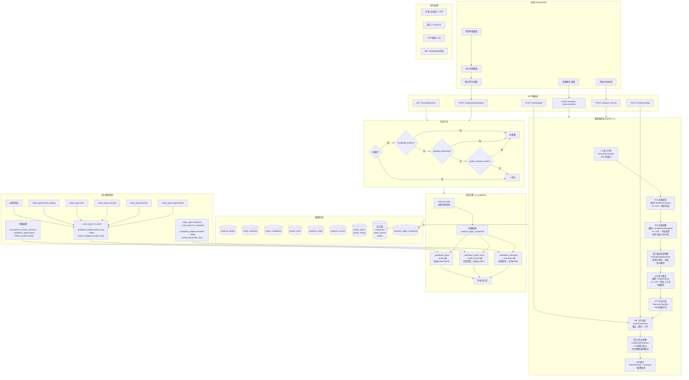

# 灵枢 V3 全书分析全链路架构图

---

## 新增功能标识

| 标识 | 功能 | 说明 |
|------|------|------|
| 🆕 全局身份消解 | EntityIdentityResolver | 跨章节识别同一角色的不同称号/身份，在共指消解之后、事实抽取之前运行 |
| 🆕 卡片后处理 | CardPostProcessor | 卡片生成后使用 LLM 审查全部卡片，执行合并/删除/类型修正 |

## 管道阶段

| 阶段 | 名称 | 输出 |
|------|------|------|
| L1 | 语义分块 | analysis_blocks |
| M2 | 实体提及 | entity_mentions |
| M3 | 共指消解 | entity_candidates |
| 🆕 | 全局身份消解 | entity_candidates (合并) |
| M4 | 原子事实 | atomic_facts |
| M7 | 记忆分层 | facts (memory字段) |
| M5 | 卡片生成 | analysis_cards + analysis_events |
| 🆕 | 卡片后处理 | analysis_cards (合并/删除/修正) |
| M8 | 探针 | probe_plans + probe_results |

## 卡片类型映射

| entity_type | card_type | writeback_target | writeback_fields |
|-------------|-----------|-----------------|------------------|
| character | v3_character | character | name, role, profile_text |
| organization | v3_world | world_entry | name, category, content_text |
| location | v3_world | world_entry | name, category, content_text |
| concept | v3_world | world_entry | name, category, content_text |
| item | v3_world | world_entry | name, category, content_text |
| world_setting | v3_world | world_entry | name, category, content_text |
| (未知) | v3_world | world_entry | name, category, content_text |
| — | v3_book_summary | book | outline_text, world_text |

## 写回门禁

| 条件 | 规则模式 | AI模式 |
|------|:---:|:---:|
| candidate_entities | ✅ 放行 | ❌ 需审核 |
| pending_backtrack | ❌ 阻塞 | ❌ 阻塞 |
| probe_manual_review | ❌ 阻塞 | ❌ 阻塞 |

## 关键 Bug 修复记录

| Bug | 修复文件 | 说明 |
|-----|---------|------|
| 书籍卡永远空 | card_generators_v3.py | fact_type_filter: "outline"/"world" → "foreshadowing"/"world_rule" |
| item/org 无法写回 | card_generators_v3.py | _writeback_target_for_entity: "none" → "world_entry" |
| 类型修正不完整 | store.py | fix_card_entity_type: 同步更新 payload_json |
| 规则模式门禁误锁 | analysis_v3.py | ai_invoked 检查: 仅AI模式要求审核 |
| 实体合并不更新卡片 | analysis_v3.py | merge/split 后调用 CardCoordinator.run() |
| LLMCache 无 query_one | llm_cache.py | 改为 database.connection.execute |
| HTTP 超时无限等 | client.py | 默认 30s 超时 |
| Cloudy 图标缺失 | LibraryPanel.vue | 替换为 Upload 图标 |
| 共指消解不分批合并 | ai_provider.py | 按 entity_type+quote_text 排序分批 |
| 并发数与文本量不匹配 | pipeline_v3_stages.py | _adaptive_workers: 自适应 4~425 |
