# 灵枢 V3 全书分析全链路架构详图

> **版本**: `analysis_v3_m8_probes_v1`
> **更新日期**: 2026-06-24
> **核心入口**: `novel_app/analysis/pipeline_v3.py` → `AnalysisPipelineV3`

---

## 一、全链路总览

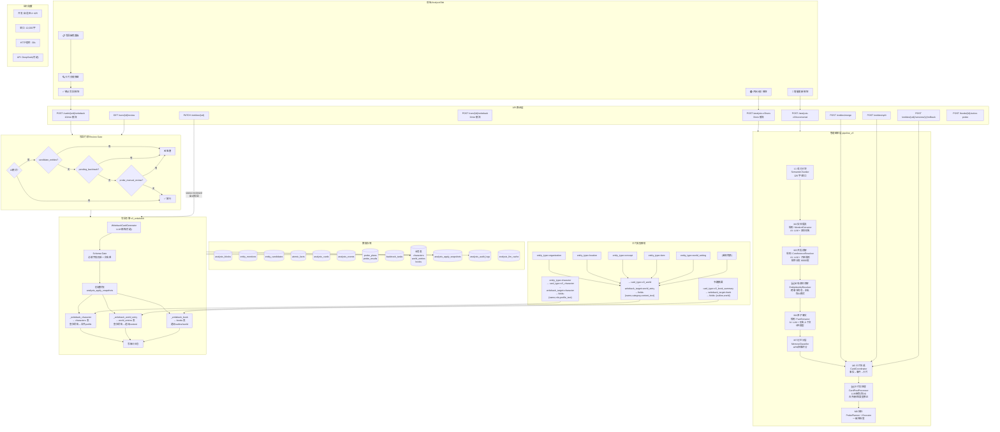

---

## 二、管道阶段数据流详图

```mermaid
flowchart LR
    subgraph L1["L1 语义分块"]
        L1_IN["章节文本"] --> L1_SCENE["场景边界识别\n正则匹配"]
        L1_SCENE --> L1_CUT["句子级软切分\ntarget=6000 max=8000"]
        L1_CUT --> L1_OVERLAP["重叠窗口\noverlap=1句"]
        L1_OVERLAP --> L1_OUT["SemanticBlock\nblock_uid\ncontent_hash\nstructure_hash"]
    end

    subgraph M2["M2 实体提及"]
        M2_IN["analysis_blocks"] --> M2_RULE{"use_ai?"}
        M2_RULE -->|规则| M2_SEED["种子提及\nDB characters/\nworld_entries\nconf=0.9~0.95"]
        M2_RULE -->|规则| M2_QUOTE["引号提及\n《》/"" 模式\nconf=0.62~0.72"]
        M2_RULE -->|规则| M2_SUFFIX["后缀提及\n宗门/城/剑\nconf=0.58"]
        M2_RULE -->|AI| M2_LLM["LLM 窗口提取\n12000字/窗口\n双向别名提取"]
        M2_SEED & M2_QUOTE & M2_SUFFIX --> M2_DEDUP["去重\nmention_uid\n取最高置信度"]
        M2_LLM -->|"失败回退"| M2_SEED
        M2_LLM --> M2_DEDUP
        M2_DEDUP --> M2_OUT["entity_mentions\nmention_uid\n=MEN-{hash[:16]}"]
    end

    subgraph M3["M3 共指消解"]
        M3_IN["entity_mentions"] --> M3_P1["Phase1: 同名聚类\n归一化名称分桶"]
        M3_P1 --> M3_P2["Phase2: 称谓链\n26个模式\n500字距离阈值"]
        M3_P2 --> M3_P3["Phase3: 跨章节合并\n编辑距离≥0.45\n子串匹配\n向量相似度≥0.75"]
        M3_P3 --> M3_OUT["entity_candidates\n+ aliases\n+ versions"]
    end

    subgraph ID["🆕 身份消解"]
        ID_IN["entity_candidates"] --> ID_LLM["LLM 批量判定\n80个/批\n4项标准"]
        ID_LLM --> ID_MERGE["merge_entities\nactor=identity_resolver"]
        ID_MERGE --> ID_OUT["合并后的\nentity_candidates"]
    end

    subgraph M4["M4 原子事实"]
        M4_IN["blocks + entities"] --> M4_RULE{"use_ai?"}
        M4_RULE -->|规则| M4_SENT["句法模式\nconf=mention*0.75\n+entity*0.25\n上限0.92"]
        M4_RULE -->|AI| M4_LLM["LLM 提取\n仅传入block中\n出现的实体"]
        M4_SENT --> M4_TYPE["5种类型\nevent/relation\nstate/foreshadowing\nworld_rule"]
        M4_LLM --> M4_TYPE
        M4_TYPE --> M4_OUT["atomic_facts\nfact_uid\n=FACT-{hash[:16]}"]
    end

    subgraph M7["M7 记忆分层"]
        M7_IN["atomic_facts"] --> M7_ARS["ARS 4维评分\n叙事0.30\n中心性0.25\n新颖0.25\n因果0.20"]
        M7_ARS --> M7_CLASS["分类\nfoundation/evidence/cache\nshort_term/long_term\nhigh/normal/low"]
        M7_CLASS --> M7_COMP["压缩\n≥3条cache→合并\nsummary_uid\n=FACT-MEMCACHE-*"]
        M7_COMP --> M7_WIN["窗口迁移\nshort_term→long_term\n伏笔/基础永不降级"]
        M7_WIN --> M7_OUT["facts\nmemory_scope\nmemory_type\nimportance_score"]
    end

    subgraph M5["M5 卡片生成"]
        M5_IN["facts + entities"] --> M5_EVT["创建卡片事件\ncard_requested"]
        M5_EVT --> M5_GEN["卡片生成\nv3_character(20)\nv3_world(20)\nv3_book_summary(10)"]
        M5_GEN --> M5_SUP["标记旧卡\nsuperseded"]
        M5_SUP --> M5_OUT["analysis_cards\n+ analysis_events\n+ dependencies"]
    end

    subgraph POST["🆕 卡片后处理"]
        POST_IN["analysis_cards"] --> POST_LLM["LLM 审查\ntemperature=0.15"]
        POST_LLM --> POST_ACT["4类操作\n1.重复合并\n2.称号合并\n3.噪声删除\n4.类型修正"]
        POST_ACT --> POST_OUT["修正后的\nanalysis_cards"]
    end

    subgraph M8["M8 探针"]
        M8_IN["facts + cards"] --> M8_PLAN["探针规划\n4种类型\nmax=12/类型"]
        M8_PLAN --> M8_EXEC["探针执行\nConsistencyChecker\nLLM优先→规则回退"]
        M8_EXEC --> M8_RESULT["probe_results\n+ backtrack_tasks\n(不一致时)"]
    end

    L1 --> M2 --> M3 --> ID --> M4 --> M7 --> M5 --> POST --> M8
```

---

## 三、AI 模式 vs 规则模式对比

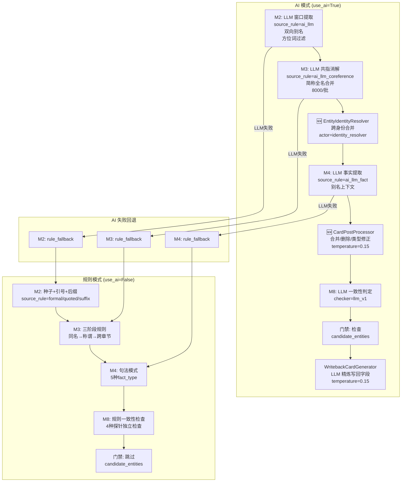

### Engine 标记体系

| 阶段 | 规则模式 | AI 成功 | AI 失败回退 |
|------|----------|---------|-------------|
| M2 提及 | `formal_character` / `quoted` / `suffix` | `ai_llm` | `rule_fallback` |
| M3 共指 | 规则聚类 | `ai_llm_coreference` | `rule_fallback` |
| M4 事实 | 句法模式 | `ai_llm_fact` | `rule_fallback` |

### AI 模式独有功能

| 功能 | 类名 | 阶段位置 | 说明 |
|------|------|----------|------|
| 全局身份消解 | `EntityIdentityResolver` | M3 之后 | 跨章节识别同一角色的不同称号/身份 |
| 卡片后处理 | `CardPostProcessor` | M5 之后 | LLM 审查全部卡片，合并/删除/类型修正 |
| LLM 一致性判定 | `ConsistencyChecker._llm_check` | M8 | 优先 LLM 判定一致性 |
| 写回字段精炼 | `WritebackCardGenerator` | 写回前 | LLM 将 facts + 已有数据精炼为目标格式 |

---

## 四、写回引擎详图

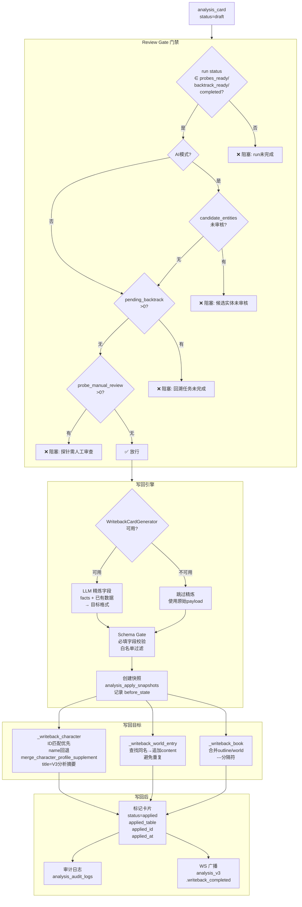

### Schema Gate 字段白名单

| writeback_target | 必填字段 | 允许字段 |
|-----------------|----------|----------|
| character | `name` | name, role, profile_text |
| world_entry | `name`, `category` | name, category, content_text |
| book | （无） | outline_text, world_text |

### 写回门禁规则

| 条件 | 规则模式 | AI模式 |
|------|:---:|:---:|
| candidate_entities | ✅ 放行 | ❌ 需审核 |
| pending_backtrack | ❌ 阻塞 | ❌ 阻塞 |
| probe_manual_review | ❌ 阻塞 | ❌ 阻塞 |

---

## 五、卡片类型映射详图

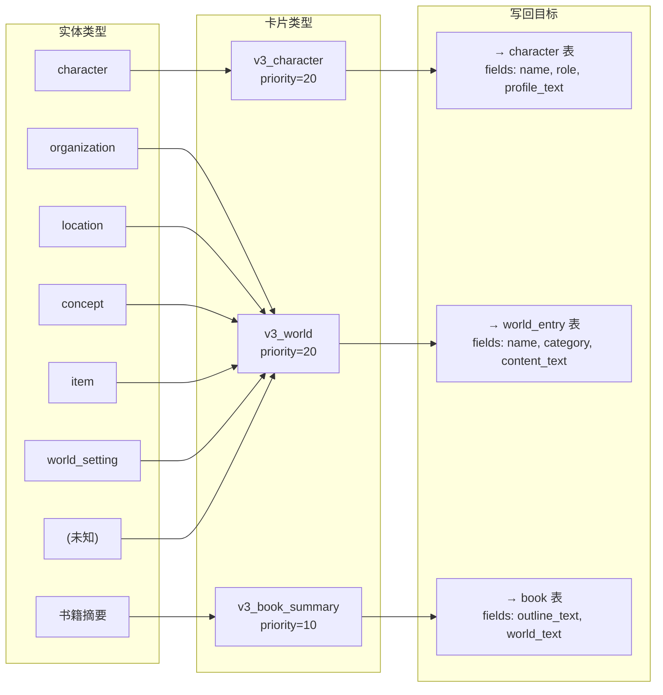

---

## 六、ARS 记忆分层详图

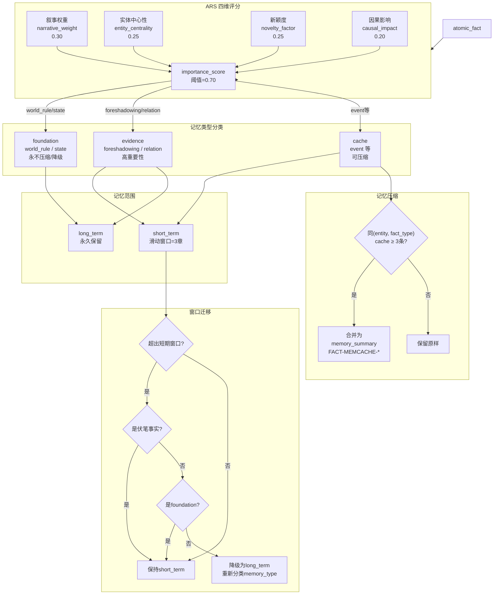

---

## 七、探针与回溯详图

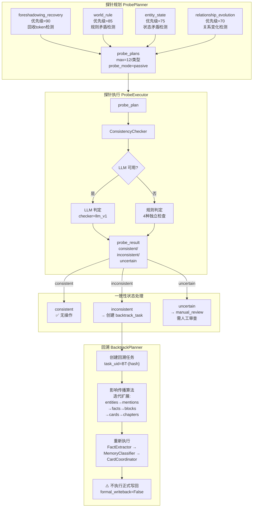

### 冲突检测关键词

| 类别 | 肯定词 | 否定词 |
|------|--------|--------|
| 许可 | 可以/允许/必须/can/may/allowed | 不能/禁止/无法/cannot/never/forbidden |
| 存活 | 活着/复活/alive | 死亡/陨落/dead |

### 伏笔回收 token

`("回收", "揭示", "揭开", "答案", "兑现", "reveal", "resolve", "answer", "payoff")`

---

## 八、增量分析流程

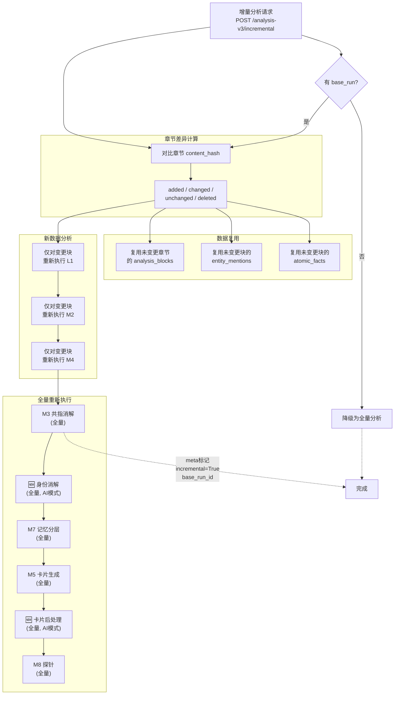

---

## 九、实体生命周期

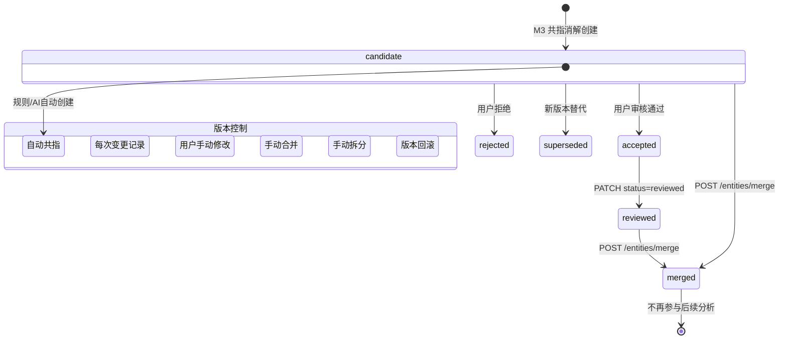

### 实体操作 API

| 操作 | 路径 | 效果 |
|------|------|------|
| 合并 | `POST /runs/{id}/entities/merge` | 合并多实体 → 重新生成卡片 + backtrack |
| 拆分 | `POST /runs/{id}/entities/{uid}/split` | 拆分实体 → 移动 mentions/facts |
| 更新 | `PATCH /runs/{id}/entities/{uid}` | 更新实体，status=reviewed 时自动写回 |
| 回滚 | `POST /entities/{uid}/versions/{v}/rollback` | 回滚到历史版本 |

---

## 十、卡片生命周期

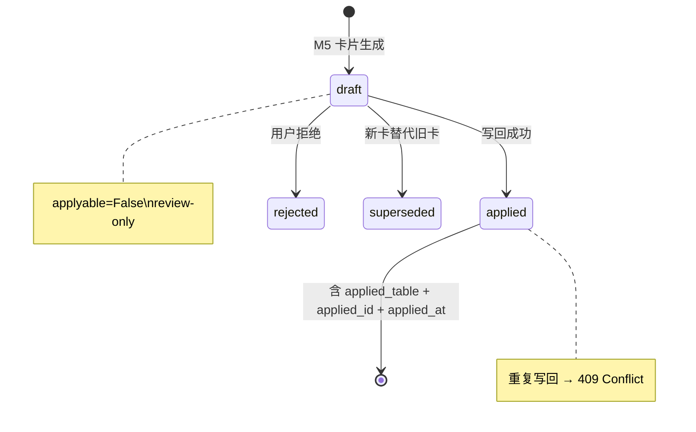

---

## 十一、WebSocket 实时进度协议

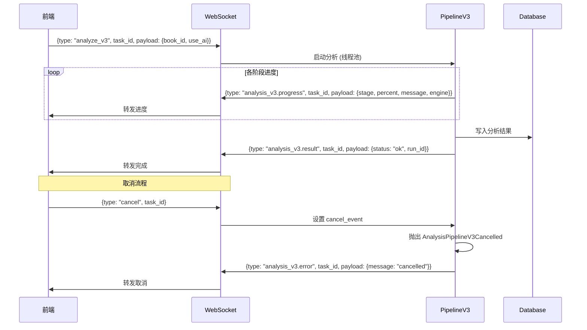

---

## 十二、数据库 Schema 关系图

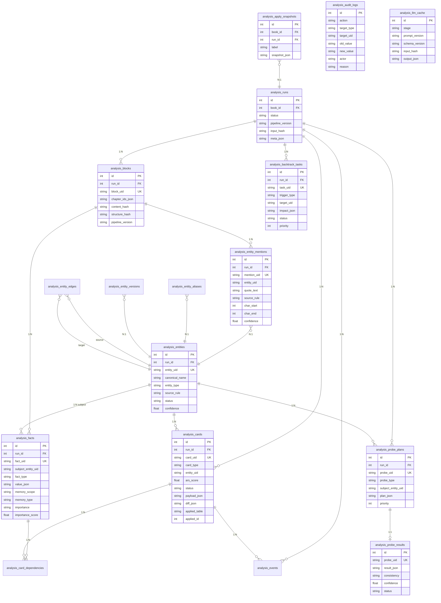

---

## 十三、API 路由全景

### runs 路由

| 方法 | 路径 | 限流 | 说明 |
|------|------|------|------|
| POST | `/api/workspace/books/{book_id}/analysis-v3/runs` | 3/min | 创建分析 run，AI 不可用返回 503 |
| POST | `/api/workspace/books/{book_id}/analysis-v3/incremental` | — | 增量分析 |
| GET | `/api/workspace/books/{book_id}/analysis-v3/runs` | — | 列出 runs |
| POST | `/api/workspace/analysis-v3/runs/{run_id}/cancel` | — | 取消运行中的分析 |

### cards 路由

| 方法 | 路径 | 限流 | 说明 |
|------|------|------|------|
| POST | `/runs/{run_id}/cards/{card_uid}/apply` | — | Phase 11 gate 占位 |
| POST | `/runs/{run_id}/cards/{card_uid}/writeback` | 10/min | 单卡写回 + WS 广播 |
| POST | `/runs/{run_id}/writeback` | 3/min | 批量写回，支持 207 multi-status |

### steps 路由

| 方法 | 路径 | 限流 | 说明 |
|------|------|------|------|
| POST | `/runs/{run_id}/steps/entity_mentions` | 5/min | M2 阶段执行 |
| POST | `/runs/{run_id}/steps/entity_coreference` | 5/min | M3 阶段执行 |
| POST | `/runs/{run_id}/steps/atomic_facts` | 5/min | M4 阶段执行 |
| POST | `/runs/{run_id}/steps/card_events` | 5/min | M5 阶段执行 |
| POST | `/runs/{run_id}/steps/memory_layer` | 5/min | M7 阶段执行 |
| POST | `/runs/{run_id}/steps/probes` | 5/min | M8 阶段执行 |
| POST | `/runs/{run_id}/entities/merge` | — | 实体合并 |
| PATCH | `/runs/{run_id}/entities/{entity_uid}` | — | 更新实体 |
| POST | `/runs/{run_id}/entities/{entity_uid}/split` | — | 实体拆分 |
| POST | `/runs/{run_id}/entities/{entity_uid}/versions/{version}/rollback` | — | 版本回滚 |
| GET | `/runs/{run_id}/review` | — | 门禁检查 |
| POST | `/books/{book_id}/active-probe` | — | 主动探针 |

---

## 十四、向量存储架构

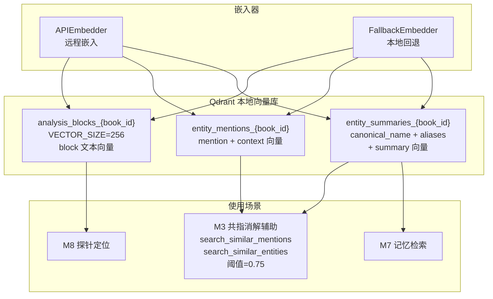

---

## 十五、LLM 调用链与缓存

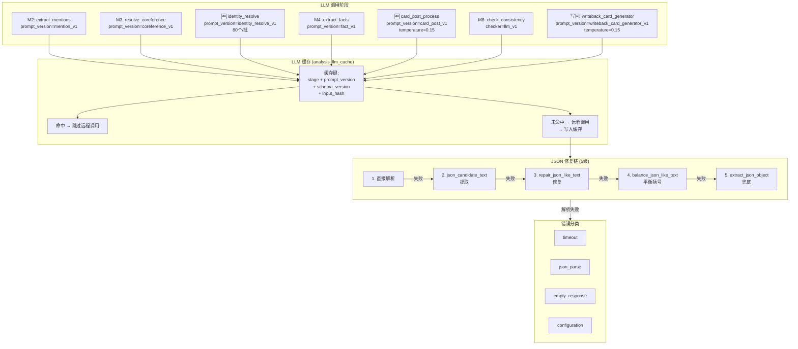

---

## 十六、核心文件索引

| 模块 | 文件路径 | 核心类/函数 |
|------|----------|------------|
| 流水线入口 | `novel_app/analysis/pipeline_v3.py` | `AnalysisPipelineV3` |
| 阶段实现 | `novel_app/analysis/pipeline_v3_stages.py` | `PipelineV3StagesMixin` |
| 增量分析 | `novel_app/analysis/pipeline_v3_incremental.py` | `PipelineV3IncrementalMixin` |
| 依赖注入 | `novel_app/analysis/pipeline_v3_config.py` | `PipelineV3Config` |
| 语义分块 | `novel_app/analysis/semantic_chunker.py` | `SemanticChunker` |
| 提及抽取 | `novel_app/analysis/mention_extractor.py` | `MentionExtractor` |
| 共指消解 | `novel_app/analysis/coreference.py` | `CoreferenceResolver` |
| 🆕 身份消解 | `novel_app/analysis/entity_identity_resolver.py` | `EntityIdentityResolver` |
| 事实抽取 | `novel_app/analysis/fact_extractor.py` | `FactExtractor` |
| 记忆分层 | `novel_app/analysis/memory_classifier.py` | `MemoryClassifier` |
| 记忆压缩 | `novel_app/analysis/memory_compressor.py` | `MemoryCompressor` |
| 记忆窗口 | `novel_app/analysis/memory_window.py` | `MemoryWindowBuilder` |
| 卡片协调 | `novel_app/analysis/card_coordinator.py` | `CardCoordinator` |
| 🆕 卡片后处理 | `novel_app/analysis/card_post_processor.py` | `CardPostProcessor` |
| 卡片生成 | `novel_app/analysis/card_generators_v3.py` | `build_v3_entity_card` / `build_v3_book_card` |
| 探针规划 | `novel_app/analysis/probe_planner.py` | `ProbePlanner` |
| 探针执行 | `novel_app/analysis/probe_executor.py` | `ProbeExecutor` |
| 一致性检查 | `novel_app/analysis/consistency_checker.py` | `ConsistencyChecker` |
| 回溯规划 | `novel_app/analysis/backtrack.py` | `BacktrackPlanner` |
| 写回引擎 | `novel_app/analysis/v3_writeback.py` | `writeback_v3_card` |
| 写回生成器 | `novel_app/analysis/writeback_card_generator.py` | `WritebackCardGenerator` |
| AI 提供器 | `novel_app/analysis/ai_provider.py` | `AIAnalysisProvider` |
| 数据模式 | `novel_app/analysis/schemas_v3.py` | `SemanticBlock` / `EntityMentionCandidate` / `AtomicFact` |
| 实体存储 | `novel_app/analysis/entity_store.py` | `EntityStore` |
| 事实存储 | `novel_app/analysis/fact_store.py` | `FactStore` |
| 分析存储 | `novel_app/analysis/store.py` | `AnalysisStore` |
| 向量存储 | `novel_app/analysis/vector_store.py` | `AnalysisVectorStore` |
| DB Schema | `novel_app/db/schema.py` | `_apply_analysis_v3_foundation_migration` |
| DB 操作 | `novel_app/db/analysis.py` | `AnalysisMixin` |
| API-runs | `lingshu_api/routers/analysis_v3_runs.py` | run 创建/增量/取消 |
| API-cards | `lingshu_api/routers/analysis_v3_cards.py` | 卡片写回/批量写回 |
| API-steps | `lingshu_api/routers/analysis_v3_steps.py` | 阶段执行/实体操作/审查门禁 |
| API 模型 | `lingshu_api/schemas/analysis_v3.py` | Pydantic 请求/响应模型 |
| WebSocket | `lingshu_api/ws/analysis_v3_ws.py` | 实时进度推送 |

---

## 十七、运行配置

| 参数 | 值 | 说明 |
|------|:--:|------|
| 自适应 Worker 下限 | 4 | `_adaptive_workers` |
| 自适应 Worker 上限 | 425 | `AI_MAX_WORKERS` |
| AI 文本窗口 | 12,000 字 | `AI_TEXT_WINDOW_CHARS` |
| AI 窗口重叠 | 300 字 | `AI_TEXT_WINDOW_OVERLAP` |
| 章节分批 | 20 | `CHAPTER_BATCH_SIZE` |
| LLM 重试次数 | 2 | `AI_MAX_ATTEMPTS` |
| HTTP 超时 | 30s | 默认超时 |
| AI 调用超时 | 300s | 单次 AI 调用 |
| 共指分批 | 8,000 | `MENTION_BATCH_SIZE` |
| 身份消解分批 | 80 | `BATCH_SIZE` |
| 探针上限 | 12/类型 | `max_plans_per_type` |
| 记忆压缩阈值 | 3 条 | `DEFAULT_CACHE_COMPRESSION_THRESHOLD` |
| 短期记忆窗口 | 3 章 | `DEFAULT_SHORT_TERM_CHAPTER_WINDOW` |
| ARS 重要性阈值 | 0.70 | `_ARS_IMPORTANCE_THRESHOLD` |
| 提及最低置信度 | 0.55 | `MENTION_MIN_CONFIDENCE` |
| 事实最低置信度 | 0.55 | `FACT_MIN_CONFIDENCE` |
| 卡片最低置信度 | 0.55 | `V3_CARD_MIN_FACT_CONFIDENCE` |
| LLM API | DeepSeek | 可选 |

---

## 十八、关键 Bug 修复记录

| Bug | 修复文件 | 说明 |
|-----|---------|------|
| 书籍卡永远空 | card_generators_v3.py | fact_type_filter: "outline"/"world" → "foreshadowing"/"world_rule" |
| item/org 无法写回 | card_generators_v3.py | `_writeback_target_for_entity`: "none" → "world_entry" |
| 类型修正不完整 | store.py | `fix_card_entity_type`: 同步更新 `payload_json` |
| 规则模式门禁误锁 | analysis_v3.py | `ai_invoked` 检查: 仅AI模式要求审核 |
| 实体合并不更新卡片 | analysis_v3.py | merge/split 后调用 `CardCoordinator.run()` |
| LLMCache 无 query_one | llm_cache.py | 改为 `database.connection.execute` |
| HTTP 超时无限等 | client.py | 默认 30s 超时 |
| Cloudy 图标缺失 | LibraryPanel.vue | 替换为 Upload 图标 |
| 共指消解不分批合并 | ai_provider.py | 按 `entity_type+quote_text` 排序分批 |
| 并发数与文本量不匹配 | pipeline_v3_stages.py | `_adaptive_workers`: 自适应 4~425 |

---

## 十九、与 V1 对比

| 维度 | V1 | V3 |
|------|-----|-----|
| 写回路径 | `writeback.py`（单函数 140 行写 4 表） | `v3_writeback.py`（单卡写回 + schema 白名单） |
| 门禁 | 无 | Schema Gate + Review 门禁（3 类阻断项） |
| 事务保护 | ❌ 无（半写回风险） | ✅ 快照 + 审计日志 |
| 限流 | ❌ 无 | ✅ 3/min ~ 10/min |
| WebSocket 通知 | ❌ 无 | ✅ 实时进度推送 |
| API 契约 | `dict[str, Any]` | Pydantic 模型 |
| 错误处理 | `str(exc)` 泄露 | `_sanitize_error_text()` 脱敏 |
| 测试覆盖 | E2E 完全缺失 | 16 个 E2E 测试 |
| 弃用状态 | DEPRECATED（未落地） | 当前主路径 |
| 增量分析 | ❌ 不支持 | ✅ 基于 content_hash 复用 |
| 探针/回溯 | ❌ 不支持 | ✅ 4 种探针 + 影响传播 |
| 记忆分层 | ❌ 不支持 | ✅ ARS 4维 + 压缩 + 窗口迁移 |
| 实体版本控制 | ❌ 不支持 | ✅ 版本记录 + 回滚 |
