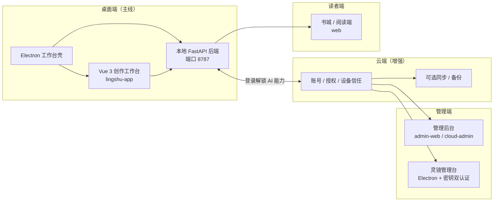
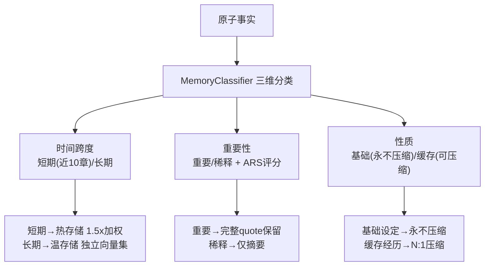
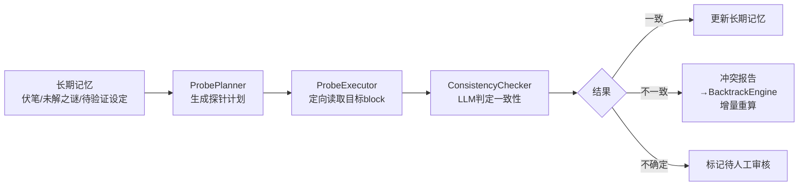
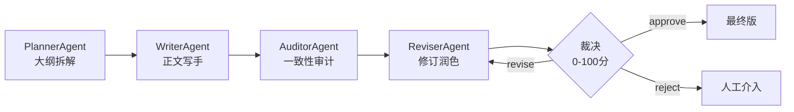
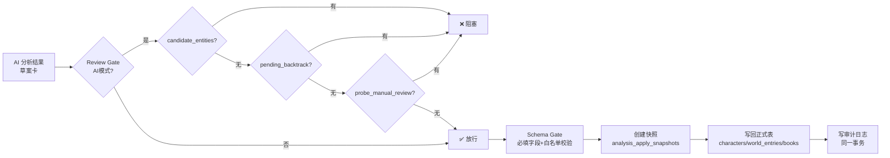

# 灵枢（LingShu）— 百万字级长篇网文 AI 写作工作台

> **项目定位**：本地优先的「小说工程学」基础设施，把长篇创作中依靠人力硬扛的设定管理工作，变成自动化、结构化、可验证的 AI 分析流程。
>
> **当前阶段**：V3 分析引擎已落地，桌面端 v2.0 发布，进入商业化验证期。
>
> **文档版本**：1.0 · 2026-06

---

## 一、一句话摘要

灵枢是一款面向百万字级长篇网文作者的 AI 辅助写作工作台。它构建了一条从「语义分块 → 实体共指消解 → 原子事实抽取 → 记忆分层 → 文章探针 → 证据门禁写回」的完整分析链路，让 AI 真正"读懂"长文本、"记住"该记住的、"验证"需要验证的，从根本上解决长篇创作中的**设定漂移**问题。

---

## 二、市场机会与痛点

### 2.1 目标市场规模

中国网络文学市场是一个持续扩张的内容产业：

- **作者侧**：截至最新数据，网络文学注册作者数以百万计，其中稳定连载的活跃作者群体庞大；头部平台日更总字数以亿计。
- **作品侧**：长篇连载是网文主流形态，单部作品普遍 **100 万字以上**，超长篇可达 **300–500 万字**，创作周期长达数月甚至数年。
- **趋势**：AI 辅助创作正在从"续写一两段"向"全工程化管理"演进，这是灵枢卡位的赛道。

### 2.2 长篇创作的核心痛点

| 痛点 | 现状 | 灵枢的解法 |
|------|------|-----------|
| **设定漂移** | 写到后期人物年龄、关系、境界前后矛盾，人工排查百万字几乎不可能 | V3 分析引擎 + 文章探针，自动发现"第3章左撇子→第87章右手提剑"这类隐性矛盾 |
| **伏笔遗失** | 挖坑不填是读者最大槽点之一，作者自己都忘了埋过什么 | Truth File 自动汇总待回收伏笔，探针追踪伏笔生命周期 |
| **信息过载** | 几十个角色、上百条设定、数百个伏笔全靠脑子记 | ARS 记忆分层 + 向量检索，AI 续写时智能注入相关上下文 |
| **工具割裂** | 续写、纠错、审查、设定管理各用一个工具 | 统一工作台：创作 + 分析 + 审查 + 设定 + RAG 一体化 |
| **数据安全担忧** | 百万字原稿上传第三方 AI 平台存在隐私风险 | 本地优先架构，正文和设定默认不出设备 |

### 2.3 为什么是现在

1. **大模型能力临界点**：GPT-4 / Claude / DeepSeek 等模型的推理与结构化输出能力，已足以支撑"抽取 → 验证 → 写回"的工程化管线，而两年前还做不到。
2. **上下文窗口红利**：长上下文模型让"分块分析 + 局部精读"成为可能，但仍需记忆管理才能覆盖百万字。
3. **创作者代际更替**：年轻网文作者天然接受 AI 辅助，"AI 辅助独立开发"已是创作者主流心态。

---

## 三、产品形态

灵枢是一套**多端协同的本地优先工作台**：

- **创作工作台**：Vue 3 + Element Plus + Monaco Editor，承载大纲、正文、人物、世界观、分析抽屉、审查抽屉。
- **本地后端**：FastAPI + SQLite，100+ REST 端点 + 4 路 WebSocket，离线可用。
- **桌面壳**：Electron，一键启动本地后端，登录后解锁 AI、同步、备份等账号能力。
- **读者/书城端**：面向发布、阅读、书架和作者门户。
- **管理后台 + 灵镜管理台**：用户、作品、设备、配额、审计管理，密钥文件 + HMAC 签名双认证。

**核心数据原则**：正文、设定、Truth File、RAG 索引默认留在本地数据目录；账号登录是所有 AI 能力的前置条件；云端只承担账号、授权、同步、备份，不默认上传创作数据。

---

## 四、核心技术亮点（自研技术壁垒）

> 灵枢的核心壁垒不是"接一个大模型 API"，而是一条**完整自研的小说工程学分析链路**。以下每一项机制都是为"百万字长文本"这一具体场景定制的工程化方案，市面同类工具均不具备。

### 亮点 1：V3 九阶段全书分析管线

这是一条从原始文本到可写回结构化设定的全自动流水线，是灵枢最核心的技术资产：

| 阶段 | 能力 | 技术难点 |
|:---:|------|------|
| 语义分块 | 不按字数硬切，识别场景切换/时间跳跃/视角转移 | 自研场景边界识别 + 句子级重叠窗口 |
| 实体提及抽取 | 精确到段落句子，识别所有人/地/组织/道具/概念提及 | 规则+LLM 混合，失败自动回退 |
| 两级共指消解 | 把"张三/张老师/他/白衣青年/青云剑尊"归一为同一实体 | NLP 高难度任务，网文场景定向工程化 |
| 原子事实抽取 | 抽取不可再分事实 `张三→获得→青云剑→第23章→0.92` | 强制 JSON + quote 绑定 + 伪造 UID 拦截 |
| 事件驱动卡片 | 零散事实自动聚合成人物卡/世界卡/书籍卡 | 触发阈值 + 依赖就绪判断 + 同实体并发锁 |
| ARS 记忆分层 | 四维评分决定保留/压缩/降级 | 见亮点 2 |
| 文章探针 | 主动验证伏笔回收、实体状态、世界规则一致性 | 见亮点 3 |
| 证据门禁写回 | 写回前 Schema Gate + 自动快照 + 审计 | 杜绝 AI 幻觉污染正式设定 |

**工程化指标**：

- 支持百万字级书籍，**10 万字 30 秒内完成分块和规则实体抽取**，**100 万字 5 分钟内完成分块、索引、规则实体抽取**，300 万字支持断点续跑。
- 并发自适应 4~425，HTTP 超时 30s，写回限流 10/min，分析运行限流 3/min。
- 幂等设计：`content_hash + structure_hash + pipeline_version` 未变的块可跨 run 复用 RAG 索引和 LLM 输出。

### 亮点 2：ARS 四维记忆分层系统

> 解决大模型在百万字长文本上的**上下文窗口瓶颈**——这是通用 AI 工具根本无法处理长篇的根本原因。

对每个原子事实进行四维加权评分：

| 维度 | 权重 | 含义 |
|:---|:---:|------|
| 叙事权重 Narrative Weight | 0.30 | 该事实在全局故事中的比重 |
| 实体中心度 Entity Centrality | 0.25 | 关联实体在故事网络中的连接数 |
| 新颖性 Novelty Factor | 0.25 | 新信息 vs 反复出现的旧信息 |
| 因果影响力 Causal Impact | 0.20 | 对后续情节的影响链长度 |

基于评分的三维分类策略：

**实用价值**：当作者在第 300 章用 AI 续写时，灵枢自动注入「前 3 章完整记忆 + 全局重要设定 + 压缩后的历史事件摘要」，而不是无脑塞入 300 章全文——既省 Token，又比"只给最近几章"精准得多。伏笔事实和基础设定**永不降级、永不压缩**。

### 亮点 3：文章探针 — 主动一致性验证机制

> 传统 RAG 是"被动检索"，探针是"主动验证"。这是灵枢区别于所有向量检索类工具的关键。

四种探针类型覆盖长篇创作最常见的一致性问题：

| 探针类型 | 验证内容 | 示例 |
|------|------|------|
| 伏笔回收探针 | 铺垫是否被回收 | 第3章"长老眼中闪过杀意"→第150章长老是否叛变 |
| 实体状态一致性 | 角色状态变化是否有铺垫 | 第80章金丹期→第200章元婴期，中间是否有突破描写 |
| 世界规则一致性 | 是否违反基础设定 | "只有五行灵根才能修炼"→出现无灵根修炼者 |
| 关系演变探针 | 关系变化是否有铺垫 | 师徒→敌对，是否有冲突事件链 |

**核心差异**：探针不依赖语义相似度全局搜索（容易漏掉语义不相似但逻辑相关的块），而是基于长期记忆**精确定位**到章节/块级别读取原文验证。

### 亮点 4：AI / 规则双引擎 + 自动降级

> 离线可用，上线更强——这是大多数纯在线 AI 工具不具备的工程鲁棒性。

每个分析阶段（提及抽取、共指消解、事实抽取、卡片生成）都实现双引擎：

- **AI 引擎**：连接大模型时高精度分析
- **规则引擎**：断网或 AI 失败时自动降级到本地启发式系统（正则、TF-IDF、规则模板）
- **回退策略**：AI 返回空/异常时自动 fallback，审计日志记录引擎类型 `ai` / `rule` / `rule_fallback`

**用户价值**：核心分析能力离线可用；接入 AI 时获得更高精度但不会因网络波动丢失能力；是否让 AI 参与由用户决定（`use_ai` 参数）。

### 亮点 5：AgentGraph 多智能体编排流水线

> 把 AI 写作从"一问一答"升级为"规划→写作→审计→修订"的工程化流水线。

- 每步可取消，作者随时中断
- 裁决分数化 + 三级判定 `approve/revise/reject`，作者不被"AI 默默改坏"
- 多用途 AI 配置：Planner 用推理强的模型、Writer 用文笔好的模型、Auditor 用逻辑强的模型——**9 种用途独立配模型**，降低 Token 成本同时保证各环节质量

### 亮点 6：Truth File 七维设定体系 + 自动构建

7 个核心设定文件**不是让作者手写**，而是通过 `build_all()` 从数据库自动拼装：

| 文件 | 内容 |
|------|------|
| `current_state.md` | 当前故事状态（角色位置、状态、持有物） |
| `particle_ledger.md` | 关键道具账本（获得时间、持有者变化、最后出现） |
| `pending_hooks.md` | 待回收伏笔清单（自动汇总） |
| `chapter_summaries.md` | 章节摘要（自动生成，非人工梳理） |
| `subplot_board.md` | 支线看板（起点、转折点、当前状态） |
| `emotional_arcs.md` | 情感弧光（角色情感状态变化轨迹） |
| `character_matrix.md` | 人物矩阵（关系、立场、能力变化全景） |

**关键价值**：作者不需要单独维护设定文档——创作的同时灵枢在后台持续更新设定。**设定漂移的根本原因"设定文档和正文脱节"被从根本上解决了。**

### 亮点 7：写回证据门禁（Schema Gate + 自动快照）

> 这是灵枢在 AI 写作工具中独一无二的设计——大多数工具"分析完就结束"，灵枢是"分析 → 门禁 → 写回 → 可回滚"。

- 杜绝 AI 幻觉（虚构人物、误判关系）污染正式设定
- `weak/missing/empty` 证据默认不能写回
- 人工 override 须写审计日志，所有操作可追溯可回滚

### 亮点 8：12 维度审查引擎 + 26 条内置规则

`AuditorAgent` 将草稿与 Truth File 交叉比对，覆盖 12 个维度：

> 人物一致性 · 时间线 · 世界观规则 · 因果逻辑 · 伏笔回收 · 关系演变 · 情感弧光 · 节奏 · 信息密度 · 文风 · 语言 · 安全

内置 26 条规则 + `@DSL` 上下文注入 + Pydantic 校验，支持章节/卷/全书三级批量审查。

---

## 五、自研技术展现的工程能力

> 灵枢由**单人 + AI 辅助独立开发**完成。以下技术资产体现了独立设计与落地复杂 AI 系统的工程能力，每一项都是从零设计、非套壳、非调库的原创工程。

### 5.1 自研算法清单

| 自研模块 | 文件位置 | 技术含量 | 体现的能力 |
|------|------|------|------|
| 语义感知分块器 | `novel_app/analysis/semantic_chunker.py` | 场景边界识别 + 句子级重叠窗口 + hash 幂等 | 领域定制的 NLP 工程化 |
| 两级共指消解 | `novel_app/analysis/coreference.py` | 章内聚类 + 跨章合并 + 称谓链 + 向量辅助 | 高难度 NLP 任务的工程化落地 |
| 身份消解器 | `novel_app/analysis/identity_resolver.py` | 跨章节称号→本名，LLM 批量判定 | 实体图谱构建 |
| 原子事实抽取 | `novel_app/analysis/fact_extractor.py` | 5 种事实类型 + quote 绑定 + 伪造 UID 拦截 | LLM 结构化输出 + 安全防护 |
| ARS 记忆分类器 | `novel_app/analysis/memory_classifier.py` | 四维加权评分 + 三维分类 | 认知科学启发的设计能力 |
| 记忆压缩流水线 | `novel_app/analysis/memory_compressor.py` | N:1 压缩 + 向量索引更新 + 解压 | 长期记忆管理 |
| 滑动窗口迁移 | `novel_app/analysis/memory_window.py` | 短期→长期降级 + 伏笔豁免 | 时序状态机设计 |
| 探针规划器 | `novel_app/analysis/probe_planner.py` | 长期记忆→探针计划 + 优先级排序 | 主动验证机制设计 |
| 探针执行器 | `novel_app/analysis/probe_executor.py` | 定向 block 读取 + 批量并发 | 精准检索工程 |
| 一致性判定器 | `novel_app/analysis/consistency_checker.py` | 伏笔/实体/世界规则/关系四类验证 | LLM 判定 + 证据链 |
| 精准回溯引擎 | `novel_app/analysis/backtrack.py` | 影响范围计算 + 增量重算 | 依赖图 + 最小重算 |
| 事件驱动卡片协调器 | `novel_app/analysis/card_coordinator.py` | 触发阈值 + 依赖就绪 + 同实体并发锁 | 事件 outbox + 并发控制 |
| 写回门禁引擎 | `novel_app/analysis/writeback.py` | Schema Gate + 快照 + 审计同事务 | 安全写回 + 事务保护 |
| AgentGraph 编排 | `novel_app/agents/` | Planner/Writer/Auditor/Reviser 四 Agent 状态图 | 多智能体编排 |
| 模型路由器 | `novel_app/model_router.py` | 9 用途独立路由 + budget/quality 双预设 | 多模型成本优化 |
| TruthManager | `novel_app/truth/` | 7 维设定文件自动拼装 | 设定体系设计 |
| RAG 检索模块 | `novel_app/rag/` | doc_type 分区 + 混合检索 + Jina Reranker | 向量检索工程 |

### 5.2 工程质量与安全实践

项目沉淀了真实生产级的工程规范（来自实际踩坑，非纸面规则）：

- **事务保护**：`writeback.py` 所有多表操作使用 `Database.transaction()` 上下文管理器，防止部分写入
- **安全存储**：用户 token 必须哈希存储，绝不存明文；`safeStorage` 不可用时拒绝明文降级
- **错误隔离**：500 响应不暴露原始异常，使用通用信息 + 服务端日志记录详情
- **批量化**：章节事件用 `executemany` 批量操作，避免逐次提交
- **接口治理**：废弃端点必须 `deprecated=True` + docstring 注明 V3 替代方案
- **测试覆盖**：100+ 自动化测试，V3 写回链路有端到端测试，CI 双 job（后端测试 + 前端构建）

### 5.3 架构演进能力

项目展现了清晰的架构演进判断力：

- **v1.0 → v2.0 全栈迁移**：因 PyQt6 (GPL v3) 与项目 CC BY-NC 4.0 许可证冲突，从 Qt 桌面应用迁移到 **Vue 3 + FastAPI + Electron**，统一技术栈、消除双轨维护成本、为跨平台和云端协同铺路。这是一次有战略判断的全栈重写。
- **V1 → V3 分析引擎演进**：从"全书压缩后整体分析"升级为"九阶段流水线"，通过 feature flag 平滑切换，旧流程保留兼容。
- **记忆架构设计**：借鉴认知科学的人类记忆模型，对叙事信息做三维分类——这是通用 AI 应用中罕见的领域深度。

---

## 六、竞争格局与差异化

### 6.1 与现有工具对比

| 能力 | Word | Notion | Scrivener | AI续写插件 | **灵枢** |
|------|:---:|:---:|:---:|:---:|:---:|
| 全书自动分析 | ✗ | ✗ | ✗ | ✗ | **✓** |
| 实体共指消解 | ✗ | ✗ | ✗ | ✗ | **✓** |
| 原子事实抽取 | ✗ | ✗ | ✗ | ✗ | **✓** |
| 记忆分层压缩 | ✗ | ✗ | ✗ | ✗ | **✓** |
| 文章探针一致性 | ✗ | ✗ | ✗ | ✗ | **✓** |
| Agent 编排流水线 | ✗ | ✗ | ✗ | 部分(单步) | **✓** |
| 离线可用 | ✓ | ✗ | ✓ | ✗ | **✓** |
| 证据门禁写回 | ✗ | ✗ | ✗ | ✗ | **✓** |
| 数据本地优先 | ✓ | ✗ | ✓ | ✗ | **✓** |
| 多模型独立配置 | - | - | - | ✗ | **✓** |

### 6.2 护城河

1. **技术深度护城河**：共指消解、记忆分层、文章探针等机制是为网文长文本场景定向工程化的，通用 AI 工具不会做这种领域深度。
2. **数据闭环护城河**：用户使用越久，Truth File / RAG / 记忆层越完善，迁移成本越高。
3. **工程闭环护城河**：从分析到写回的完整证据链 + 可回滚，是"分析完就结束"的工具无法快速复制的。
4. **生态护城河（规划中）**：灵爻共创模式 + 书城端，形成"创作 → 分析 → 发布 → 共创"闭环。

---

## 七、商业模式与前景

### 7.1 收入结构（规划）

| 收入源 | 说明 |
|------|------|
| **AI 用量订阅** | 9 种用途独立计费，按 Token 用量分级订阅（核心收入） |
| **本地工作台买断** | 桌面端一次买断 + 年度大版本升级 |
| **云端同步/备份** | 可选增值服务 |
| **书城分成** | 灵爻平台发布分成（远期） |
| **企业/工作室版** | 多人协作、私有部署 |

### 7.2 商业化优势

- **本地优先降低获客门槛**：用户数据不出设备，消除隐私顾虑，转化率高于纯云方案
- **AI 用量天然分摊成本**：用户为 Token 买单，平台聚合采购获得价差
- **多模型路由降本**：不同任务用不同模型，相比"全用 GPT-4"可降 60%+ Token 成本
- **长篇创作者高 LTV**：一部百万字作品创作周期数月到数年，用户留存天然长久

### 7.3 生态愿景：灵字系列

灵枢是【灵字系列】生态的创作工具台，与共创社区平台【灵爻】共同构成：

- **共创模式**：作者开启后，读者可在任意节点插入 if 线分支创作，解决"结局定格、想象戛然而止"的读者痛点
- **版权理念**：大部分版权归还作者，二创管理权归原创者
- **闭环**：灵枢负责创作辅助 → 灵爻负责发布与共创 → 数据回流优化灵枢分析

---

## 八、发展规划与里程碑

### 8.1 已完成

| 里程碑 | 时间 | 交付 |
|------|------|------|
| v1.0 预发布 | 2026-05 | 整合真相文件系统 + RAG + 多 Agent + 12 维审计，103 条测试通过 |
| v2.0 全栈迁移 | 2026-06 | Qt → Vue3 + FastAPI + Electron，100 REST 端点 + 4 路 WebSocket |
| V3 分析引擎 | 2026-06 | 九阶段管线 + ARS 记忆 + 文章探针 + 证据门禁写回落地 |

### 8.2 路线图

| 阶段 | 目标 |
|------|------|
| **近期** | 商业化验证：AI 用量订阅、本地买断；多模型成本优化；用户增长 |
| **中期** | 灵爻共创平台上线，形成创作-发布-共创闭环；企业/工作室版 |
| **远期** | 记忆架构与探针机制开源，构建长文本 AI 分析技术标准；拓展至剧本/漫画脚本等长叙事场景 |

### 8.3 技术演进方向

- 五级分析流水线持续深化：L1 语义分块 → L5 书籍卡的完整事件驱动链路
- 记忆架构：缓存压缩流水线 + 滑动窗口降级 + 伏笔豁免的精细化
- 探针机制：四种探针全覆盖 + 回溯联动 + 人工审核闭环
- 跨平台：从 Windows 扩展到 macOS / Linux（Electron + Vue 已具备基础）

---

## 九、团队与开发模式

### 9.1 开发模式

灵枢由**单人 + AI 辅助独立开发**完成。开发者负责产品定义、架构决策、领域建模和质量把关；AI 辅助负责代码生成、文档撰写、测试编写等执行层工作。

这种模式已被验证可行：在数月内完成了从 v1.0 预发布到 v2.0 全栈迁移 + V3 分析引擎落地的完整演进，体现了：

- **独立设计与架构能力**：从零设计九阶段分析管线、ARS 记忆架构、文章探针机制
- **AI 工程化能力**：将 AI 作为生产力工具，高效交付复杂系统
- **领域深度**：理解网文长篇创作的真实痛点，做出通用 AI 工具不会做的领域工程化
- **工程判断力**：GPL 许可证冲突时果断全栈迁移，V1→V3 用 feature flag 平滑演进

### 9.2 核心竞争力

> 不是"会用 AI 写代码"，而是"知道该让 AI 写什么、不该写什么、怎么验证它写得对"——这是 AI 时代稀缺的**系统设计能力**。

---

## 十、核心数据一览

| 维度 | 数据 |
|------|------|
| 后端 REST 端点 | 100+ |
| WebSocket 通道 | 4 路（generation/review/chat/analysis-v3） |
| V3 分析阶段 | 9 阶段 |
| 自研分析模块 | 17+ 个核心模块 |
| 内置审计规则 | 26 条 / 12 维度 |
| Truth File 维度 | 7 个自动构建文件 |
| AI 用途独立配置 | 9 种 |
| 自动化测试 | 100+ 条 |
| 支持文本规模 | 百万字级（300 万字断点续跑） |
| 分析性能 | 10 万字 30 秒 / 100 万字 5 分钟 |
| 技术栈 | Vue 3 + FastAPI + Electron + SQLite + 本地 RAG |

---

## 结语

> **灵枢不是"又一个 AI 写作工具"——它是一套完整的「小说工程学」基础设施。**
>
> 在 AI 辅助创作从"续写一两段"向"全工程化管理"演进的关键节点，灵枢用一条自研的九阶段分析链路，把长篇创作中依靠人力硬扛的设定管理工作，变成了自动化、结构化、可验证的流程。
>
> 这条链路上的每一个机制——语义分块、共指消解、原子事实、ARS 记忆、文章探针、证据门禁——都是为"百万字长文本"这一具体场景定制的工程化方案，构成了难以快速复制的技术壁垒。
>
> 我们相信：**让 AI 真正"读懂"长文本，是 AI 辅助创作的下一个十年。灵枢正在这条路上。**

---

*本文档基于灵枢项目实际代码与架构撰写，技术细节可在 [V3全链路架构详图.md](file:///f:/项目/灵枢/docs/架构/V3全链路架构详图.md) 与 [灵枢技术发展方向.md](file:///f:/项目/灵枢/docs/规划/灵枢技术发展方向.md) 中溯源验证。*
