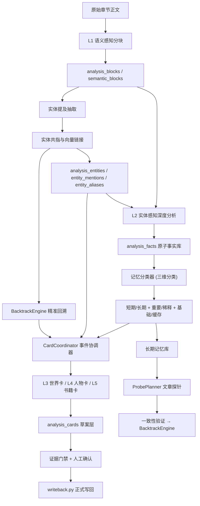
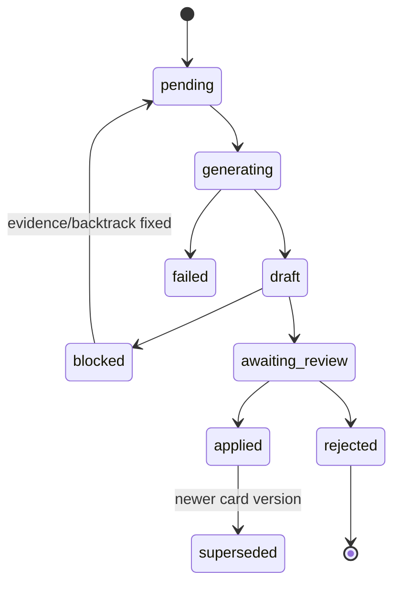
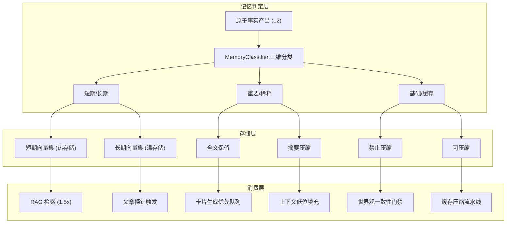
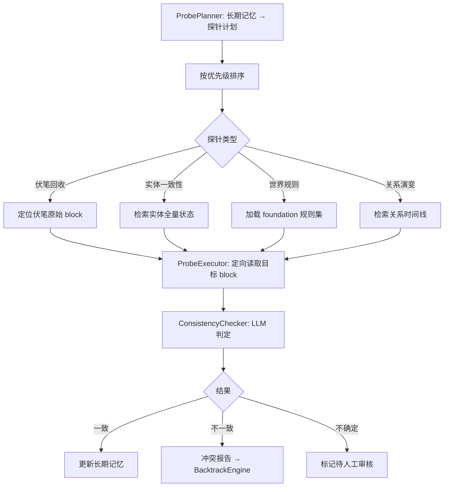

# 灵枢技术发展方向

> 灵枢（LingShu）是一款面向长文本网文作者的 AI 辅助写作工具，基于 PyQt6、SQLite、本地 RAG 和 LLM 结构化分析构建。
> 本文档阐述灵枢分析引擎的下一代技术发展方向，涵盖五级分析流水线、记忆分层架构、文章探针三大核心能力。

---

## 一、概述

灵枢分析引擎的演进遵循一个核心命题：**如何让 AI 真正"理解"百万字级别的网文？**

当前系统已具备基础的分块、实体识别、草案卡生成和证据门禁能力（P0/P1/P2）。下一步需要突破三个瓶颈：

1. **分析深度不足**：当前是以"全书压缩后整体分析"的模式工作，粒度太粗，无法捕捉章节级别的细节变化和伏笔演进。
2. **记忆管理缺失**：所有信息以同等精度存储，导致存储膨胀、检索效率低，LLM 上下文窗口被大量低价值信息占据。
3. **一致性保障缺乏**：百万字长文中最常见的质量问题就是前后矛盾——境界跳跃、关系错乱、伏笔遗漏——当前系统缺乏主动检测机制。

为此，本文档提出**三大技术发展方向**：

| 方向 | 解决的问题 | 核心思路 |
|------|-----------|----------|
| **五级分析流水线** | 分析深度与粒度 | 从"全书整体分析"升级为 L1 分块 → L2 事实抽取 → 实体共指 → L3/L4/L5 事件驱动卡片生成 → 精准回溯。 |
| **记忆分层架构** | 存储膨胀与检索效率 | 借鉴认知科学中的人类记忆模型，对叙事信息做三维分类：时间跨度（短期/长期）、重要性（重要/稀释）、性质（基础/缓存）。 |
| **文章探针机制** | 前后文一致性 | 不依赖被动向量检索，而是基于长期记忆主动规划、定向搜索特定文本区域，验证伏笔回收、实体状态一致性和世界规则遵守。 |

---

## 二、当前基线

### 2.1 已有代码模块

| 模块 | 当前职责 | 演进方向 |
|------|----------|----------|
| `novel_app/analysis/chunker.py` | 按章节、段落和长段落切分。 | 升级为语义感知分块器，增加场景识别和句子级重叠窗口。 |
| `novel_app/analysis/entity_resolver.py` | 从 payload 中抽取显式实体，生成稳定 ID。 | 扩展为原文提及级实体抽取，支持向量辅助共指消解。 |
| `novel_app/analysis/pipeline.py` | 创建分析运行，索引 RAG，构建草案卡。 | 改造为五级流水线 run coordinator。 |
| `novel_app/analysis/card_builder.py` | 全书分析 payload 拆成草案卡。 | 升级为事件驱动卡片生成器的适配层。 |
| `novel_app/analysis/evidence.py` | 证据引用评估，输出 `trusted/weak/missing/empty`。 | 保持为所有卡片写回前的统一门禁。 |
| `novel_app/analysis/writeback.py` | 正式写回服务。 | 保持为最终写回唯一入口，扩展接受更多元信息。 |
| `novel_app/db/analysis.py` | 分析相关表的 CRUD。 | 新增表围绕它扩展。 |
| `novel_app/rag/qdrant_client.py` | 本地 JSON 文件模拟向量集合。 | 继续用于实体提及向量和分析块向量。 |
| `novel_app/qt/drawer/analysis.py` | 右侧抽屉展示分析运行和草案。 | 扩展为实体、回溯、探针结果视图。 |

### 2.2 已有数据库表

| 表 | 用途 |
|----|------|
| `analysis_runs` | 一次分析运行的主记录。 |
| `analysis_cards` | 草案卡记录。 |
| `analysis_blocks` | 分块原文和索引状态。 |
| `analysis_audit_logs` | 审计日志。 |
| `analysis_apply_snapshots` | 写回前快照。 |

### 2.3 当前不足

| 蓝图能力 | 主要缺口 |
|----------|----------|
| 语义感知分块 | 缺少场景识别、句子级重叠窗口、块版本和内容 hash 复用。 |
| 全实体共指消解 | 缺少原文提及级抽取、跨块实体聚类、向量辅助消歧、人工纠错版本图。 |
| 实体感知深度分析 | 缺少以 `entity_uid` 为主键的原子事实和关系三元组。 |
| 事件驱动卡片生成 | 缺少 card coordinator、事件队列、依赖就绪判断、同实体并发锁。 |
| 精准回溯 | 缺少实体版本图、影响范围计算、增量重算队列。 |

---

## 三、目标架构

### 3.1 总体数据流



### 3.2 分层原则

1. **读取层只读原文**：分块、实体提及、事实抽取不得直接写正式书籍表。
2. **分析层只产出草案和事实**：LLM 输出只能进入 `analysis_*` 表。
3. **门禁层负责可信判断**：所有写回必须经过 evidence gate、Schema gate、人工确认或明确 override。
4. **写回层唯一入口**：正式层写入仍通过 `analysis/writeback.py`，避免 UI 和 pipeline 各自写库。
5. **回溯层最小重算**：实体变更只重算受影响实体、事实和卡片，不做全书重跑。
6. **UI 层只展示和确认**：PyQt6 抽屉显示运行状态、实体冲突、卡片草案和回溯任务，不承载业务算法。

---

## 四、核心分析流水线：五级架构

### 4.1 L1 — 语义感知融合层叠分块

#### 目标

将分块从"章节/段落长度约束"升级为"章节/场景/句子边界感知"。

#### 切分策略（优先级递减）

1. 章节边界。
2. 明显场景分隔符：`***`、`---`、空行 + 时间/地点转换词、章节内小标题。
3. 段落边界。
4. 句子边界：`。！？!?`。
5. 最后才按字符硬切。

#### 重叠策略

前后各保留 1-2 个完整句子作为跨块重叠：

| 参数 | 默认值 |
|------|--------|
| `max_chars` | 20,000 |
| `soft_min_chars` | 12,000 |
| `overlap_sentence_count` | 2 |
| `max_overlap_chars` | 1,200 |
| `scene_split_confidence_threshold` | 0.6 |

#### 幂等与缓存

每个 block 必须具备：
- `content_hash = sha256(normalized_text)`
- `structure_hash = sha256(chapter_id + scene_index + offsets)`
- `pipeline_version`

新 run 中 hash 均未变化的 block 可复用 RAG 索引、实体提及结果和二级事实。

### 4.2 全实体共指消解

#### 实体类型

| 类型 | 前缀 | 示例 |
|------|------|------|
| `character` | `ENT-P` | 人物、代称、称号。 |
| `location` | `ENT-L` | 城市、宫殿、秘境。 |
| `organization` | `ENT-O` | 宗门、帝国、公司。 |
| `item` | `ENT-I` | 神器、药剂、关键道具。 |
| `concept` | `ENT-C` | 修炼体系、规则、能力名。 |
| `world` | `ENT-W` | 世界观整体概念。 |

#### 提及抽取（混合策略）

1. **规则抽取**：书名号/引号内专名、"某某宗/城/国"等模式、代称仅作低置信候选。
2. **正式层种子**：`characters` 表、`world_entries`、`book_outline_form`。
3. **LLM JSON 抽取**：只输出 mention 列表，禁止输出最终事实卡，每条 mention 带 `quote_text` 和字符范围。

#### 两级共指

- **章内聚类**：完全同名 → 规范化同名 → 姓名+称号包含 → 高置信别名 → 称谓链。
- **跨章合并**：须满足至少两类证据（名称相似、别名显式、上下文向量相似、关系约束一致、时间线不冲突）。

#### 向量存储

复用 `QdrantLocalClient`，三个 collection：
- `analysis_blocks_{book_id}`：block 文本摘要、章节、hash。
- `entity_mentions_{book_id}`：mention、上下文、候选实体。
- `entity_summaries_{book_id}`：canonical_name、aliases、summary。

#### 人工纠错

UI 支持合并/拆分实体、设置规范名、添加/删除别名、标记错误提及。每次操作写入 `analysis_entity_versions` 和审计日志。

### 4.3 L2 — 实体感知深度分析

LLM 以结构化输入（block + 实体上下文 + Truth/Skills 上下文）产出 JSON：

```json
{
  "facts": [
    {
      "fact_type": "character_attribute",
      "subject_entity_uid": "BOOK-1::ENT-P-1234",
      "predicate": "身份",
      "value": {"text": "帝国女皇"},
      "quote_text": "她是帝国的女皇",
      "block_uid": "BOOK-1::B-000001",
      "confidence": 0.86
    }
  ],
  "new_entity_hints": [],
  "conflicts": [],
  "coverage_gaps": []
}
```

**校验规则**：
- `subject_entity_uid` 必须存在于 entity store，或进入 `new_entity_hints`。
- `quote_text` 必须能在原文中找到或被 evidence gate 判为 weak。
- `confidence < 0.55` 的事实不触发卡片，只进入审查池。

**并发策略**：分块级 fact extraction 可并发；同一实体的事实合并串行执行。

### 4.4 L3/L4/L5 — 事件驱动卡片生成

`CardCoordinator` 消费 `analysis_events`，判断阈值，创建/更新草案卡，记录依赖。

#### 触发规则

| 卡片级别 | 触发条件 |
|----------|----------|
| **L3 世界卡** | 某实体事实数 >= 3；或出现 `world_rule` 事实且置信度 >= 0.75；或 UI 手动触发。 |
| **L4 人物卡** | `character` 实体 mention_count >= 5；或识别为主角/重要配角；或具备两类以上事实。 |
| **L5 书籍卡** | 至少一个主角卡稳定 + 至少一个核心世界卡稳定 + 分析完成率 >= 80% + 无 critical conflict。 |

#### 卡片状态机



#### 并发控制

SQLite 内使用事件状态 + 乐观锁：`card_version` 递增、依赖 hash 校验、冲突时创建冲突事件而非覆盖。

### 4.5 精准回溯

#### 触发条件

| 触发 | 来源 |
|------|------|
| 两个实体相似度超过阈值 | coreference resolver |
| 新别名可能属于旧实体 | mention extractor |
| 人工合并或拆分实体 | UI |
| 卡片证据门禁失败 | evidence gate |
| L2 事实冲突 / 探针发现不一致 | fact extractor / probe |

#### 影响范围计算

1. 从 `analysis_entity_versions` 找到新旧 UID。
2. 查 mentions 找到相关 block。
3. 查 facts 找到命中的事实。
4. 查 card_dependencies 找到受影响卡片。
5. 仅重算受影响部分，不做全书重跑。

#### 回滚

- 卡片版本回滚：新卡标记 `deprecated`，恢复旧版本。
- 实体版本回滚：从 `analysis_entity_versions` 恢复。
- 正式库回滚：只允许用户从快照手动恢复，不自动覆盖。

---

## 五、记忆架构与分层存储

### 5.1 概述

百万字网文中信息密度严重不均衡：既有关键的情节转折，也有大量过渡性内容。不加区分地同等存储会导致存储膨胀、检索效率下降、LLM 上下文浪费。记忆分层架构借鉴人类记忆模型，对叙事信息进行**三维分类**：

| 维度 | 分类 | 区分标准 |
|------|------|----------|
| **时间跨度** | 短期记忆 vs 长期记忆 | 信息发生的"时间距离"（相对当前分析位置） |
| **重要性** | 重要记忆 vs 稀释记忆 | 信息对主线剧情的影响程度 |
| **性质** | 基础记忆 vs 缓存记忆 | 信息是"不变设定"还是"可变经历" |

三条原子事实和每个实体摘要都同时拥有这三组标签，形成立体的记忆管理策略。

### 5.2 短期记忆与长期记忆

**短期记忆**：最近 N 章（默认 10 章）内的活跃事件、角色状态变化、未解决冲突、新引入元素。
**长期记忆**：跨越大段篇幅的伏笔、已完成的角色弧线、早期世界规则、历史事件。

| 策略维度 | 短期记忆 | 长期记忆 |
|----------|----------|----------|
| **存储位置** | 热存储，向量索引 1.5x 加权。 | 温存储，独立长期记忆向量集合。 |
| **检索优先级** | RAG 时优先填充 LLM 上下文。 | 仅在探针触发、一致性校验、回溯重算时检索。 |
| **更新频率** | 每次新增章节后自动刷新。 | 仅在伏笔回收或实体状态变更时更新。 |
| **压缩策略** | 不压缩，保留完整 quote。 | 可压缩为摘要，仅保留关键指涉和引用路径。 |
| **过期迁移** | 滑动窗口自动降级为长期记忆。 | 不自动过期，伏笔回收后标记 `resolved`。 |

#### 滑动窗口迁移

```
分析位置推进时：
  1. 新章节 → 标记 short_term
  2. 最旧 (N - window_size) 章 → 降级为 long_term
  3. 降级时按重要性分类压缩
  4. 伏笔事实永不压缩，标记 is_foreshadowing = true
```

### 5.3 重要记忆与稀释记忆

**重要记忆**：角色死亡、身份揭示、境界突破、势力更迭、主线完成、核心关系确立——这些需要完整 detail 保留。
**稀释记忆**："问路"、"吃饭"、非关键战斗的回合描述、过渡场景的环境描写——可以只留摘要甚至跳过。

#### 自动判定：ARS 扩展评分

```json
{
  "narrative_weight": 0.0,    // 是否改变角色状态/关系/世界状态
  "entity_centrality": 0.0,   // 涉及实体的重要程度
  "novelty_factor": 0.0,      // 是否首次出现或显著不同
  "causal_impact": 0.0,       // 是否被后续事件引用
  "final_score": 0.0          // >= 0.6 → 重要记忆
}
```

| 处理维度 | 重要记忆 | 稀释记忆 |
|----------|----------|----------|
| **事实抽取** | 完整抽取属性、关系、状态、因果链。 | 仅摘要级描述，不产生独立 fact。 |
| **quote 保留** | 完整 quote（最多 500 字符）。 | 仅 block_uid 引用。 |
| **卡片生成** | 进入队列，触发 backfill。 | 不触发独立卡片。 |
| **上下文窗口** | 优先填入。 | 仅作补充。 |
| **存储周期** | 长期保留。 | TTL 默认 90 天。 |

### 5.4 基础记忆与缓存记忆

**基础记忆**（Foundation）：作者设定的**不变性知识**——修炼体系、境界划分、地理版图、种族设定、世界底层规则。**永不压缩**——任何省略都可能导致逻辑崩溃。

**缓存记忆**（Cache）：主角**已完成的事件**——曾经重要但已完结的弧线。特点是可以**大幅度省略**，将完整因果链、对话、战斗压缩为一句话摘要。

```
基础记忆（框架）                 缓存记忆（填充）
┌─────────────────────┐       ┌─────────────────────┐
│ 修炼境界：筑基→金丹   │ ←──→ │ 主角在第50章突破筑基   │
│ 宗门体系：三大宗派     │ ←──→ │ 主角加入了青云宗       │
│ 地理：大陆分五域       │ ←──→ │ 主角目前在东南域活动   │
│ 规则：灵力源于灵脉     │ ←──→ │ 主角发现了一处废弃灵脉 │
└─────────────────────┘       └─────────────────────┘
        永不压缩                     可压缩为摘要
```

#### 缓存记忆压缩流水线

```
触发条件：
  1. 某实体缓存事实数 > 50
  2. 某事件弧线所有 facts 均标记 completed
  3. 用户手动触发

压缩步骤：
  1. 选取同实体 + 已完成 + 非伏笔的事实集合
  2. LLM 生成汇总摘要（N 条 → 1 条 + 原始 UID 引用链）
  3. 写入汇总 fact（fact_type='cached_summary', compression_ratio=N:1）
  4. 原始事实标记 status='compressed'
  5. 向量索引更新：替换为摘要向量
```

### 5.5 记忆分层整体数据流



---

## 六、文章探针机制

### 6.1 探针原理

传统 RAG 是被动检索——根据当前上下文的语义向量相似度去全局向量空间搜索，容易漏掉语义不相似但逻辑相关的块。

**文章探针**（Article Probe）是主动机制——基于长期记忆中的伏笔、未解之谜、待验证设定，**精确地到文章特定部分**读取原文，验证前后一致性。

| 维度 | 传统 RAG | 文章探针 |
|------|---------|----------|
| **触发** | 被动：语义相似度匹配。 | 主动：长期记忆的"待验证项"生成计划。 |
| **范围** | 全局向量空间。 | 精确到章节/块，由伏笔链或实体关联定位。 |
| **目标** | 找"最相似"内容。 | 验证"伏笔是否回收"、"状态是否一致"。 |
| **输出** | 相关文本片段。 | 一致性判定 + 冲突报告 + 原文证据。 |

### 6.2 四种探针类型

#### 伏笔回收探针

```
伏笔（第3章）："长老看着主角的背影，眼中闪过一丝杀意。"
当前（第150章）：长老确实背叛了宗门。

探针输出: {
  "foreshadowing_resolved": true,
  "consistency_score": 0.92,
  "evidence": "长老在第150章公开叛变，与第3章伏笔一致"
}
```

#### 实体状态一致性探针

```
长期记忆：主角在第80章突破"金丹期"。
当前第200章：主角展示"元婴期"实力。

→ 搜索第80-200章之间是否有突破元婴的描写
→ 如果没有 → consistency_warning
```

#### 世界规则一致性探针

```
基础记忆：只有"五行灵根"拥有者才能修炼。
当前第300章：出现了一个无灵根的修炼者。

→ 如果是特殊设定（金手指）→ world_rule_exception
→ 如果是笔误 → potential_inconsistency
```

#### 关系演变探针

两个实体已建立确定关系（师徒/敌对），当前出现可能改变关系的事件时，验证变化是否有铺垫。

### 6.3 探针执行流程



### 6.4 探针与记忆架构的闭环

```
长期记忆（伏笔/设定）→ ProbePlanner → 探针计划 → ProbeExecutor
                                                   ↓
短期记忆（近期章节） ← 定向读取原文 → ConsistencyChecker
                                          ↓
                                    一致性结果
                                    ↙        ↘
                                 一致          不一致
                                  ↓            ↓
                           更新长期记忆    BacktrackEngine
                                           ↓
                                      增量重算 + 冲突报告
```

---

## 七、工程实现

### 7.1 模块设计

`novel_app/analysis/` 完整包结构：

```text
novel_app/analysis/
├── pipeline_v3.py               # 五级流水线总入口
├── schemas.py                   # JSON Schema / dataclass / 校验
├── cache.py                     # LLM 调用缓存与幂等键
│
├── semantic_chunker.py          # L1 语义感知分块
├── mention_extractor.py         # 实体提及抽取
├── coreference.py               # 两级共指：章内聚类 + 跨章合并
├── entity_store.py              # 实体/提及/别名/版本图持久化
├── fact_extractor.py            # L2 原子事实抽取
├── card_coordinator.py          # 事件驱动卡片生成协调器
├── card_generators.py           # L3/L4/L5 卡片生成策略
├── backtrack.py                 # 精准回溯
│
├── memory_classifier.py         # 记忆三维分类器
├── memory_compressor.py         # 缓存记忆压缩流水线
├── memory_window.py             # 短期记忆滑动窗口
│
├── probe_planner.py             # 探针计划生成器
├── probe_executor.py            # 探针执行器
└── consistency_checker.py       # 一致性判定 (LLM 驱动)
```

保留并改造的现有模块：

| 现有模块 | 改造方式 |
|----------|----------|
| `chunker.py` | 保留为兼容分块器，`semantic_chunker.py` 复用其 `_split_long_paragraph`。 |
| `entity_resolver.py` | 保留 `stable_entity_uid`；新增 V2 不直接替换旧类。 |
| `pipeline.py` | 继续服务当前草案闭环；`pipeline_v3.py` 通过 feature flag 切换。 |
| `card_builder.py` | 保留全 payload 拆卡；新协调器复用它。 |
| `writeback.py` | 扩展接受 `source_chunks`、`entity_uid`、`card_version` 等元信息。 |

### 7.2 数据库设计

#### 新增表总览

不破坏当前表，通过 `app_migrations` 标记迁移：

| 表 | 作用 |
|----|------|
| `analysis_entities` | 全局实体主表。 |
| `analysis_entity_mentions` | 原文实体提及，可追溯到 block/章节/字符范围。 |
| `analysis_entity_aliases` | 别名映射：规范名、昵称、代称、误写。 |
| `analysis_entity_edges` | 实体关系图。 |
| `analysis_entity_versions` | 实体合并/分裂/重命名历史。 |
| `analysis_facts` | 原子事实（含记忆三维分类字段）。 |
| `analysis_events` | 卡片生成协调器事件 outbox。 |
| `analysis_card_dependencies` | 卡片依赖的实体、事实和 block。 |
| `analysis_backtrack_tasks` | 回溯任务队列。 |
| `analysis_probe_plans` | 探针计划。 |
| `analysis_probe_results` | 探针执行结果。 |
| `analysis_llm_cache` | LLM 结构化输出缓存。 |

#### `analysis_facts`（核心表）

```sql
CREATE TABLE IF NOT EXISTS analysis_facts (
    id INTEGER PRIMARY KEY AUTOINCREMENT,
    book_id INTEGER NOT NULL,
    run_id INTEGER NOT NULL,
    fact_uid TEXT NOT NULL,
    fact_type TEXT NOT NULL,           -- character_attribute/state/relationship/world_rule/event/...
    subject_entity_uid TEXT NOT NULL DEFAULT '',
    predicate TEXT NOT NULL DEFAULT '',
    object_entity_uid TEXT NOT NULL DEFAULT '',
    value_json TEXT NOT NULL DEFAULT '{}',
    block_uid TEXT NOT NULL,
    chapter_id INTEGER,
    quote_text TEXT NOT NULL DEFAULT '',
    confidence REAL NOT NULL DEFAULT 0.0,
    status TEXT NOT NULL DEFAULT 'active',

    -- 记忆三维分类
    memory_scope TEXT NOT NULL DEFAULT 'short_term',     -- short_term | long_term
    memory_importance TEXT NOT NULL DEFAULT 'normal',   -- critical | important | normal | diluted
    memory_type TEXT NOT NULL DEFAULT 'cache',           -- foundation | cache
    importance_score REAL NOT NULL DEFAULT 0.0,
    is_foreshadowing INTEGER NOT NULL DEFAULT 0,
    foreshadowing_chain_uid TEXT NOT NULL DEFAULT '',
    is_compressible INTEGER NOT NULL DEFAULT 1,
    source_fact_uids TEXT NOT NULL DEFAULT '[]',         -- 压缩引用链
    compression_ratio REAL NOT NULL DEFAULT 1.0,
    ttl_days INTEGER,                                    -- 稀释记忆存活天数
    memory_expires_at_chapter INTEGER,                    -- 短期记忆降级章节号

    created_at DATETIME NOT NULL DEFAULT CURRENT_TIMESTAMP,
    updated_at DATETIME NOT NULL DEFAULT CURRENT_TIMESTAMP,
    FOREIGN KEY (book_id) REFERENCES books(id) ON DELETE CASCADE,
    FOREIGN KEY (run_id) REFERENCES analysis_runs(id) ON DELETE CASCADE,
    UNIQUE(book_id, run_id, fact_uid)
);
```

#### `analysis_probe_plans` 和 `analysis_probe_results`

```sql
CREATE TABLE IF NOT EXISTS analysis_probe_plans (
    id INTEGER PRIMARY KEY AUTOINCREMENT,
    book_id INTEGER NOT NULL,
    run_id INTEGER NOT NULL,
    probe_uid TEXT NOT NULL,
    probe_type TEXT NOT NULL,          -- foreshadowing_resolution | entity_consistency | world_rule_consistency | relationship_evolution
    source_fact_uid TEXT NOT NULL DEFAULT '',
    source_entity_uid TEXT NOT NULL DEFAULT '',
    target_chapter_id INTEGER,
    target_block_uid TEXT NOT NULL DEFAULT '',
    priority INTEGER NOT NULL DEFAULT 5,
    status TEXT NOT NULL DEFAULT 'pending',
    created_at DATETIME NOT NULL DEFAULT CURRENT_TIMESTAMP,
    executed_at DATETIME,
    FOREIGN KEY (book_id) REFERENCES books(id) ON DELETE CASCADE,
    FOREIGN KEY (run_id) REFERENCES analysis_runs(id) ON DELETE CASCADE,
    UNIQUE(book_id, run_id, probe_uid)
);

CREATE TABLE IF NOT EXISTS analysis_probe_results (
    id INTEGER PRIMARY KEY AUTOINCREMENT,
    book_id INTEGER NOT NULL,
    run_id INTEGER NOT NULL,
    probe_uid TEXT NOT NULL,
    probe_plan_id INTEGER NOT NULL,
    consistency_score REAL NOT NULL DEFAULT 0.0,
    result_type TEXT NOT NULL DEFAULT 'pending',  -- consistent | inconsistent | uncertain | error
    source_evidence_json TEXT NOT NULL DEFAULT '[]',
    target_evidence_json TEXT NOT NULL DEFAULT '[]',
    conflict_description TEXT NOT NULL DEFAULT '',
    recommendation TEXT NOT NULL DEFAULT '',
    created_backtrack_task_id INTEGER,
    created_at DATETIME NOT NULL DEFAULT CURRENT_TIMESTAMP,
    FOREIGN KEY (book_id) REFERENCES books(id) ON DELETE CASCADE,
    FOREIGN KEY (run_id) REFERENCES analysis_runs(id) ON DELETE CASCADE,
    UNIQUE(book_id, run_id, probe_uid)
);
```

### 7.3 核心数据结构

#### SemanticBlock

```json
{
  "block_uid": "BOOK-1::B-000001",
  "chapter_ids": [1], "scene_index": 2,
  "offset_start": 10420, "offset_end": 15980,
  "prev_block_uid": "...", "next_block_uid": "...",
  "overlap_before_chars": 420, "overlap_after_chars": 380,
  "content_hash": "sha256:...",
  "split_reason": "scene_boundary"
}
```

#### AtomicFact

```json
{
  "fact_uid": "BOOK-1::F-00001234",
  "fact_type": "relationship",
  "subject_entity_uid": "BOOK-1::ENT-P-1234",
  "predicate": "敌对",
  "object_entity_uid": "BOOK-1::ENT-P-5678",
  "value": {"description": "女皇与叛军首领处于公开敌对状态"},
  "block_uid": "BOOK-1::B-000014",
  "quote_text": "叛军首领公开宣称要推翻女皇。",
  "confidence": 0.87,
  "memory_scope": "short_term",
  "memory_importance": "important",
  "memory_type": "cache"
}
```

#### ProbePlan / ProbeResult

```json
// ProbePlan
{
  "probe_uid": "BOOK-1::PROBE-00001",
  "probe_type": "entity_consistency",
  "source_fact_uid": "BOOK-1::F-00000042",
  "source_chapter_id": 80, "target_chapter_id": 200,
  "priority": 3,
  "reason": "entity_state_transition_check: 金丹 → 元婴 需验证中间过程"
}

// ProbeResult
{
  "probe_uid": "BOOK-1::PROBE-00001",
  "consistency_score": 0.45,
  "result_type": "inconsistent",
  "source_evidence": [{"fact_uid": "...", "quote": "主角在第八十章突破金丹期。"}],
  "target_evidence": [{"fact_uid": "...", "quote": "主角释放出元婴期的威压。"}],
  "conflict_description": "中间未找到突破元婴的描写。",
  "recommendation": "backtrack: 建议回溯第80-200章",
  "gap_chapters": [81, 199]
}
```

### 7.4 核心接口

#### PipelineV3

```python
class AnalysisPipelineV3:
    def start_run(self, book_id: int, *, scope: str = "book") -> AnalysisRunHandle: ...
    def prepare_blocks(self, run_id: int) -> list[SemanticBlock]: ...
    def extract_mentions(self, run_id: int, block_uids: list[str] | None = None) -> MentionBatchResult: ...
    def resolve_entities(self, run_id: int) -> EntityResolutionSummary: ...
    def extract_facts(self, run_id: int, block_uids: list[str] | None = None) -> FactBatchResult: ...
    def classify_memory(self, run_id: int) -> MemoryClassificationSummary: ...
    def generate_probes(self, run_id: int) -> list[ProbePlan]: ...
    def execute_probes(self, run_id: int, probes: list[ProbePlan]) -> list[ProbeResult]: ...
    def generate_ready_cards(self, run_id: int) -> CardGenerationSummary: ...
    def schedule_backtrack(self, run_id: int, reason: str, payload: dict) -> int: ...
```

#### EntityStore

```python
class EntityStore:
    def upsert_entity(self, book_id: int, entity: ResolvedEntity) -> str: ...
    def save_mentions(self, book_id: int, run_id: int, mentions: list[EntityMention]) -> list[int]: ...
    def link_mention(self, mention_uid: str, entity_uid: str, confidence: float) -> None: ...
    def merge_entities(self, book_id: int, source_uids: list[str], target_uid: str, actor: str) -> None: ...
    def split_entity(self, book_id: int, entity_uid: str, mention_uids: list[str], actor: str) -> str: ...
```

#### MemoryClassifier / MemoryCompressor / MemoryWindow

```python
class MemoryClassifier:
    def classify(self, fact: AtomicFact, *, run_context, entity_store) -> MemoryClassification: ...
    def batch_classify(self, facts: list[AtomicFact], **kwargs) -> list[MemoryClassification]: ...

class MemoryCompressor:
    def should_compress(self, entity_uid: str, *, max_cache_facts: int = 50) -> bool: ...
    def compress_entity_cache(self, book_id: int, entity_uid: str) -> CompressionResult: ...
    def decompress(self, fact_uid: str) -> list[AtomicFact]: ...

class MemoryWindow:
    def __init__(self, window_size: int = 10): ...
    def advance(self, book_id: int, new_chapter_id: int) -> WindowAdvanceResult: ...
    def get_active_window(self, book_id: int) -> tuple[int, int]: ...
```

#### ProbePlanner / ProbeExecutor / ConsistencyChecker

```python
class ProbePlanner:
    def generate_probes(self, book_id, run_id, *, current_chapter_id, long_term_facts) -> list[ProbePlan]: ...
    def prioritize(self, probes: list[ProbePlan]) -> list[ProbePlan]: ...

class ProbeExecutor:
    def execute(self, book_id, run_id, probe: ProbePlan) -> ProbeResult: ...
    def execute_batch(self, book_id, run_id, probes, *, max_concurrent=5) -> list[ProbeResult]: ...

class ConsistencyChecker:
    def check_foreshadowing(self, foreshadowing_block, current_block, foreshadowing_fact) -> ConsistencyResult: ...
    def check_entity_state(self, entity_uid, prev_facts, current_fact, intermediate) -> ConsistencyResult: ...
    def check_world_rule(self, rule_facts, current_block) -> ConsistencyResult: ...
    def check_relationship(self, entity_a, entity_b, timeline, current_event) -> ConsistencyResult: ...
```

---

## 八、LLM 工程与提示词

### 8.1 通用约束

- 所有 LLM 阶段强制 JSON 输出。
- 每个阶段有独立 `prompt_version` 和 `schema_version`。
- 输出失败时允许最多 N 次修复重试。
- 不允许模型自行编造 `entity_uid`，只能从候选列表选择；新实体须放进 `new_entity_hints`。

### 8.2 阶段 prompt

| 阶段 | 职责 |
|------|------|
| `mention_extract_v1` | 从原文块抽取实体提及、代称、称谓。 |
| `entity_link_v1` | 候选实体链接判断，输出置信度和理由。 |
| `fact_extract_v1` | 基于实体 ID 抽取属性、关系、事件、世界规则。 |
| `world_card_v1` | 基于事实汇总世界卡。 |
| `character_card_v1` | 基于事实汇总人物卡。 |
| `book_card_v1` | 基于稳定人物卡和世界卡生成书籍卡。 |
| `memory_compress_v1` | 将 N 条缓存事实压缩为 1 条摘要。 |
| `consistency_check_v1` | 判定伏笔回收、实体状态、世界规则、关系演变的一致性。 |

### 8.3 缓存策略

```text
llm_cache_key = sha256(prompt_version + model + schema_version + normalized_input_json)
```

缓存命中时不重复调用模型。block 的 `content_hash` 和 `structure_hash` 均未变化时可跨 run 复用 LLM 输出。

---

## 九、UI 设计

### 9.1 右侧分析抽屉扩展

继续使用现有右侧抽屉，Tab 分区：

1. **运行概览**：当前 run 状态，分块/实体/事实/卡片数，失败/阻塞/待确认数量。
2. **实体**：实体列表（类型、规范名、别名数、提及数、置信度、状态），双击详情，支持合并/拆分/改名/标记错误提及。
3. **卡片**：复用草案列表，新增来源事实、依赖实体、版本信息。
4. **回溯**：回溯任务队列，影响范围预览，执行/取消/查看日志。
5. **探针**：探针计划列表，执行结果，一致性评分，冲突详情与原文证据对照。
6. **证据**：source chunks、quote、evidence gate 结果。

### 9.2 UI 原则

- 不暴露 raw JSON 给普通用户；技术字段保留"复制诊断信息"按钮。
- 任何正式写回必须有明确按钮，不自动发生。
- 低置信实体默认不进入正式层。
- 所有危险操作有确认（合并/拆分实体、回滚正式层）。

---

## 十、工程质量

### 10.1 安全与可靠性

**AI 输出防护**：
- JSON 结构错误、字段类型错误、伪造 `entity_uid`/quote/block 引用均被拦截。
- 超长字段截断，prompt injection 检测。

**写回安全**：
- 正式写回只走 `apply_book_analysis_payload()`。
- `weak/missing/empty` 默认不能写回。
- 人工 override 须写审计日志。
- 回溯任务不能自动覆盖正式层。
- 写回、卡片状态、审计日志同一事务。

**并发安全**：
- 事件消费幂等，同实体卡生成串行。
- card UID 更新版本校验。
- 后台线程错误必须回写 run/event 状态。

### 10.2 测试计划

#### 单元测试

| 测试文件 | 覆盖 |
|----------|------|
| `test_semantic_chunker.py` | 场景切分、句子重叠、hash 稳定。 |
| `test_mention_extractor.py` | 人名/地点/组织/物品/概念提及抽取。 |
| `test_coreference.py` | 章内合并、跨章合并、低置信歧义。 |
| `test_entity_store.py` | 实体/提及/别名/版本图 CRUD。 |
| `test_fact_extractor.py` | fact schema 校验、quote 绑定、伪造 UID 拦截。 |
| `test_card_coordinator.py` | 触发条件、依赖关系、卡片版本、事件幂等。 |
| `test_backtrack.py` | 影响范围计算。 |
| `test_memory_classifier.py` | 三维记忆分类正确性。 |
| `test_memory_window.py` | 滑动窗口推进、降级、伏笔豁免。 |
| `test_memory_compressor.py` | 缓存压缩/解压、向量索引更新。 |
| `test_probe_planner.py` | 探针计划生成、优先级排序。 |
| `test_probe_executor.py` | 定向 block 读取、探针执行、批量并发。 |
| `test_consistency_checker.py` | 伏笔回收、实体状态、世界规则验证。 |

#### 集成测试

1. 10 章小说导入 → 生成 semantic blocks。
2. 抽取实体提及 → 生成实体表。
3. L2 事实只引用合法实体 ID。
4. 事实达到阈值 → 生成角色卡和世界卡。
5. 手动合并实体 → 只重算受影响卡片。
6. 探针检测不一致 → 自动创建回溯任务。
7. 卡片写回前快照、写回、审计日志在一个事务内完成。

#### 性能基准

| 文本规模 | 目标 |
|----------|------|
| 10 万字 | 30 秒内完成分块和规则实体抽取。 |
| 100 万字 | 5 分钟内完成分块、索引、规则实体抽取。 |
| 300 万字 | 支持断点续跑。 |

### 10.3 分阶段实施

| Phase | 目标 | 核心交付 |
|-------|------|----------|
| **0** | 开关与兼容层 | `analysis_pipeline_mode = "legacy"/"v3"`，新表迁移，旧流程不变。 |
| **1** | 语义分块 | `SemanticChunker`，hash 复用，分块不切断句子。 |
| **2** | 实体提及层 | `mention_extractor.py`，`analysis_entities/mentions/aliases` 三表。 |
| **3** | 共指与版本图 | 章内聚类 + 跨章合并，向量索引，`analysis_entity_versions`。 |
| **4** | 事实抽取 | `fact_extractor.py`，LLM 输出 `analysis_facts`，evidence gate 校验。 |
| **5** | 卡片生成 | `analysis_events` outbox，`CardCoordinator`，L3/L4/L5 generator。 |
| **6** | 精准回溯 | `BacktrackEngine`，影响范围计算，增量重算。 |
| **7** | 记忆架构 | `MemoryClassifier/Compressor/Window`，三维分类 + 压缩流水线。 |
| **8** | 文章探针 | `ProbePlanner/Executor/ConsistencyChecker`，四种探针 + 回溯联动。 |
| **9** | UI 与体验 | 实体/回溯/探针视图，卡片依赖可视化，危险操作确认流。 |

### 10.4 关键验收标准

**功能验收**：
- 支持百万字级书籍分块，不破坏章节归属和字符范围。
- 能生成全书实体表，实体 ID 稳定。
- 人物卡、世界卡、书籍卡可分别生成草案且可全链路溯源。
- 实体纠错后触发最小范围重算。
- 原子事实自动完成三维记忆分类。
- 基础记忆永不被压缩，伏笔事实豁免降级。
- 新章节分析完成时自动生成探针计划并执行。

**工程验收**：
- 旧流程不回归，新流程可 feature flag 关闭。
- 每个阶段可独立重试，失败状态可在 UI 查看。
- 无外部服务也能运行最小规则版。
- 数据库迁移可重复执行。

**安全验收**：
- AI 输出不能直接写正式库。
- 伪造 block/quote/entity_uid 被阻止。
- 所有 override 记录审计，所有 SQL 参数化。

### 10.5 风险与缓解

| 风险 | 缓解 |
|------|------|
| 全实体共指准确率不足 | 低置信进入审查；人工拆分；保留版本图。 |
| LLM 成本过高 | 规则先行、缓存、hash 复用、只对关键块调用 LLM。 |
| 数据表膨胀 | 分区索引、按 run 清理、缓存压缩流水线。 |
| UI 信息过载 | 默认摘要视图，详情逐层展开。 |
| 回溯误改正式层 | 回溯只产草案，正式层必须人工确认。 |
| 与现有流程冲突 | feature flag、旧 pipeline 保留、逐阶段测试。 |

---

## 十一、总结

灵枢的技术发展方向可以归结为一句话：**让 AI 不仅"读懂"长文本，更要"记住"该记住的、"忘记"该忘记的、"验证"需要验证的**。

| 维度 | 核心问题 | 解决方案 |
|------|----------|----------|
| **分析深度** | 如何捕捉百万字中的细节变化？ | 五级分析流水线：从语义分块到事件驱动卡片生成。 |
| **记忆时间跨度** | 近期事件与远古伏笔如何差异化存储？ | 短期/长期记忆分离 + 滑动窗口自动降级。 |
| **记忆重要性** | 关键转折与过渡桥段如何分配资源？ | 重要/稀释记忆分层 + ARS 扩展多维评分。 |
| **记忆性质** | 不变设定与可压缩经历如何区分？ | 基础/缓存记忆分离 + 缓存压缩流水线。 |
| **主动验证** | 如何保证百万字前后文一致？ | 文章探针 + 长期记忆规划 + 定向搜索验证。 |

这五层机制彼此配合：流水线负责"生产"知识，记忆架构负责"管理"知识，探针负责"验证"知识——共同构成灵枢下一代分析引擎的完整技术法相。
