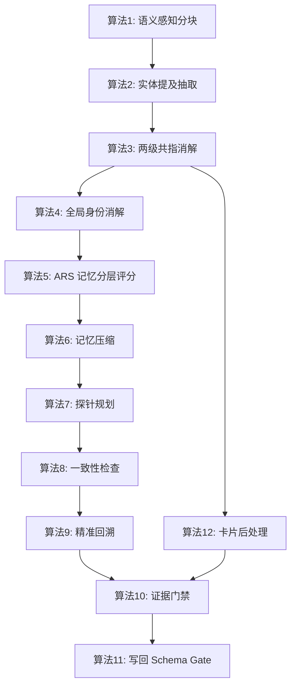

# 灵枢智能写作工作台软件 核心算法汇编

> **软件名称**：灵枢智能写作工作台软件
> **版本号**：V3.0
> **汇编日期**：2026 年 6 月
> **用途**：软件著作权申请核心算法提交材料
> **算法来源**：本项目 `novel_app/analysis/` 目录自研代码

---

## 算法总览

本软件的核心算法集中在 V3 全书分析引擎中，共包含以下 12 项核心算法，构成完整的「分块 → 实体 → 事实 → 记忆 → 探针 → 回溯 → 写回」处理链路：

| 编号 | 算法名称 | 实现文件 | 功能 |
|:---:|---------|---------|------|
| 1 | 语义感知分块算法 | `semantic_chunker.py` | 按场景/段落/句子边界切分长文本 |
| 2 | 实体提及抽取算法 | `mention_extractor.py` | 规则 + LLM 双通道抽取实体候选 |
| 3 | 两级共指消解算法 | `coreference.py` | 同名聚类 + 称谓链 + 跨章合并 |
| 4 | 全局身份消解算法 | `entity_identity_resolver.py` | LLM 识别跨章节同一角色 |
| 5 | ARS 记忆分层评分算法 | `memory_classifier.py` | 四维评分划分记忆重要性 |
| 6 | 记忆压缩算法 | `memory_compressor.py` | 长期缓存记忆合并为摘要 |
| 7 | 探针规划算法 | `probe_planner.py` | 主动生成一致性检查计划 |
| 8 | 一致性检查算法 | `consistency_checker.py` | LLM + 规则双模式判定一致性 |
| 9 | 精准回溯算法 | `backtrack.py` | 计算变更影响范围并重算 |
| 10 | 证据门禁算法 | `evidence.py` | 校验证据可信度 |
| 11 | 写回 Schema Gate 算法 | `v3_writeback.py` | 字段约束与白名单校验 |
| 12 | 卡片后处理算法 | `card_post_processor.py` | LLM 卡片去重合并与类型修正 |

---

## 算法 1：语义感知分块算法

**实现文件**：`novel_app/analysis/semantic_chunker.py`
**版本常量**：`semantic_chunker_v1`

### 1.1 算法目的

将百万字级长篇小说按语义边界切分为可分析的字块，避免段落与句子被生硬切断，保留块版本与内容 hash 以支持复用。

### 1.2 核心参数

```python
target_chars: int = 6000        # 目标字数
max_chars: int = 8000           # 最大字数
min_sentence_cut_chars: int = 1200  # 最小可切分句长
overlap_sentences: int = 1      # 句子级重叠窗口
```

### 1.3 算法流程

```python
def chunk_chapters(self, book_id, chapters, *, pipeline_version):
    blocks = []
    for chapter in chapters:
        chapter_content_hash = stable_hash(content)
        for span in self._chapter_spans(content):
            block = SemanticBlock.from_text_span(...)
            blocks.append(block)
    # 句子级重叠窗口
    if self.overlap_sentences > 0 and len(blocks) > 1:
        blocks = self._apply_overlap_window(blocks)
    return blocks
```

**三级边界识别**：

1. **场景边界**：正则 `^\s*(?:[-*_=—]{3,}|#{3,}|第[一二三四五六七八九十百千万\d]+幕)\s*$`
2. **段落边界**：双换行分隔
3. **句子边界**：中英文句号、感叹号、问号、换行

**长段落处理**：超过 `max_chars` 时按句子边界切分；找不到合适句子边界则硬切。

### 1.4 重叠窗口算法

为每个块添加前一末尾的 `overlap_sentences` 个句子作为上下文，**不修改原块的 `char_start/char_end/content_hash`**，仅存入 `metadata["overlap_prefix"]`，保持幂等性。

```python
def _apply_overlap_window(self, blocks):
    result = [blocks[0]]
    for i in range(1, len(blocks)):
        overlap_text = self._extract_trailing_sentences(
            blocks[i-1].text, self.overlap_sentences
        )
        new_metadata = dict(blocks[i].metadata)
        new_metadata["overlap_prefix"] = overlap_text
        new_metadata["overlap_source_block_uid"] = blocks[i-1].block_uid
        result.append(SemanticBlock(..., metadata=new_metadata))
    return result
```

### 1.5 算法特性

- **场景感知**：优先在场景分隔符处切分；
- **句子级重叠**：跨块上下文连续，避免实体在边界处丢失；
- **幂等性**：通过 content_hash 识别未变更块，支持增量分析复用。

---

## 算法 2：实体提及抽取算法

**实现文件**：`novel_app/analysis/mention_extractor.py`
**最低置信度**：`MENTION_MIN_CONFIDENCE = 0.55`

### 2.1 算法目的

从文本块中抽取实体提及候选，支持三种规则通道与 LLM 增强通道。

### 2.2 三规则通道

#### 通道 A：种子匹配（confidence ≥ 0.9）

从数据库 `characters` 与 `world_entries` 表预加载正式实体作为种子：

```python
@classmethod
def from_database(cls, database, book_id, *, min_confidence):
    for character in database.list_characters(book_id):
        seeds.append(MentionSeed(
            text=name,
            entity_type="character",
            source_rule="formal_character",
            confidence=0.95,
        ))
    for entry in database.list_world_entries(book_id):
        seeds.append(MentionSeed(
            text=name,
            entity_type=_world_category_type(entry["category"]),
            source_rule="formal_world_entry",
            confidence=0.9,
        ))
```

#### 通道 B：引号实体抽取

```python
_QUOTE_PATTERNS = (
    ("quoted_title", re.compile(r"《([^》]{2,40})》")),       # 书名号，conf=0.72
    ("quoted_name", re.compile(r"["「『\"]([^"」』\"\n]{2,32})["」』\"]")),  # 引号，conf=0.62
)
```

#### 通道 C：后缀模式匹配

基于中文网文常见实体后缀（宗门、阁、城、国、灵根、剑法、丹等）正则匹配，confidence = 0.58：

```python
_SUFFIX_RE = re.compile(
    r"[\u4e00-\u9fff]{1,12}(?:"
    r"宗门|门派|宗|派|阁|楼|宫|城|国|谷|山|院|司|会|盟|族|军|卫|队|殿|府|塔|"
    r"秘境|洞天|世界|大陆|界|域|"
    r"灵根|境界|体系|规则|功法|剑法|心法|法诀|功|法|诀|"
    r"剑|刀|珠|鼎|镜|令|印|阵|符|丹"
    r")"
)
```

后缀匹配后通过 `_clean_suffix_value` 剥离前缀动词（如"主角获得"、"拜入"、"修炼"），保留实体名本身。

### 2.3 实体名过滤

```python
def _looks_like_entity_name(value):
    if len(text) < 2 or len(text) > 40: return False
    if _PUNCTUATION_RE.search(text): return False   # 含标点
    if normalize_entity_alias(text) in {"他说", "她说", "这一切", "不知道"}: return False
    return bool(normalize_entity_alias(text))
```

### 2.4 LLM 增强通道

```python
class LLMentionExtractor:
    """LLM 增强实体提及抽取的抽象基类。
    子类实现 extract() 方法调用 LLM 抽取，
    结果只进候选池，不直接写入正式层。"""
    def extract(self, *, book_id, run_id, blocks, existing_candidates):
        return []  # 默认实现返回空
```

### 2.5 去重与择优

按 `(block_uid, char_start, char_end, entity_type, normalized_text)` 五元组去重，保留 confidence 最高的候选：

```python
@staticmethod
def _keep_best(by_key, candidate):
    if candidate.confidence < MENTION_MIN_CONFIDENCE:
        return
    key = (candidate.block_uid, candidate.char_start, candidate.char_end,
           candidate.entity_type, candidate.normalized_text)
    existing = by_key.get(key)
    if existing is None or candidate.confidence > existing.confidence:
        by_key[key] = candidate
```

---

## 算法 3：两级共指消解算法

**实现文件**：`novel_app/analysis/coreference.py`
**名称相似度阈值**：`_NAME_SIMILARITY_THRESHOLD = 0.45`

### 3.1 算法目的

将不同位置出现的同一实体提及合并为同一实体候选，支持三级合并策略。

### 3.2 三级消解流程

```python
def resolve_mentions(self, *, book_id, mentions):
    # Phase 1: 同名/规范化同名聚类
    buckets = self._phase1_same_name_clustering(book_id, mention_list)
    # Phase 2: 称谓链消解 — 师父→他、师姐→她等
    self._phase2_appellation_linking(buckets, mention_list)
    # Phase 3: 跨章合并 — 名称相似 + 别名显式 + 时间线不冲突
    buckets = self._phase3_cross_chapter_merge(buckets, book_id)
    # 构建最终实体列表
    return entities
```

### 3.3 Phase 1：同名聚类

按 `(entity_type, normalized_text)` 分桶：

```python
def _phase1_same_name_clustering(self, book_id, mentions):
    buckets = defaultdict(list)
    for mention in mentions:
        entity_type = normalize_entity_type(mention.get("entity_type"), "concept")
        normalized = normalize_entity_alias(mention.get("normalized_text"))
        buckets[(entity_type, normalized)].append(dict(mention))
    return buckets
```

### 3.4 Phase 2：称谓链消解

**称谓规则表**（节选）：

```python
_APPELLATION_PATTERNS = [
    ("师父", "character", 0.15),
    ("师尊", "character", 0.15),
    ("师姐", "character", 0.12),
    ("掌门", "character", 0.10),
    ("长老", "character", 0.10),
    ("城主", "character", 0.10),
    ("父亲", "character", 0.15),
    ("爷爷", "character", 0.15),
    # ... 共 26 个称谓
]
```

**就近关联算法**：对每个称谓提及，在同一章节内查找类型匹配且**位置距离 < 500 字符**的最近实体候选：

```python
for appellation in appellation_mentions:
    for key, positions in bucket_positions.items():
        if key[0] != appellation_type: continue
        for pos_chapter, pos_char in positions:
            if pos_chapter != chapter_id: continue
            distance = abs(pos_char - char_start)
            if distance < best_distance:
                best_distance = distance
                best_key = key
    if best_key is not None and best_distance < 500:
        buckets[best_key].append(appellation)
```

### 3.5 Phase 3：跨章合并

**合并条件**（满足任一）：

1. **别名显式**：一方 quote 是另一方的子串（长度 ≥ 2）：
   ```python
   short, long = (name_a, name_b) if len(name_a) < len(name_b) else (name_b, name_a)
   if len(short) >= 2 and long.startswith(short):
       return True
   ```

2. **名称相似度**：基于 Levenshtein 编辑距离，相似度 ≥ 0.55：
   ```python
   def _name_similarity(a, b):
       if a == b: return 1.0
       dist = _edit_distance(a, b)
       max_len = max(len(a), len(b))
       return 1.0 - (dist / max_len)
   ```

3. **向量相似度**：上下文向量相似度 ≥ 0.75（向量存储可用时）。

### 3.6 编辑距离实现

```python
def _edit_distance(a, b):
    """Levenshtein 编辑距离。"""
    n, m = len(a), len(b)
    prev = list(range(m + 1))
    curr = [0] * (m + 1)
    for i in range(1, n + 1):
        curr[0] = i
        for j in range(1, m + 1):
            cost = 0 if a[i-1] == b[j-1] else 1
            curr[j] = min(prev[j] + 1, curr[j-1] + 1, prev[j-1] + cost)
        prev, curr = curr, prev
    return prev[m]
```

### 3.7 规范名选举

按"出现次数最多 → 名称最长 → 字典序"优先级选出 canonical_name：

```python
@staticmethod
def _canonical_name(quotes):
    counts = defaultdict(int)
    for quote in quotes:
        counts[quote] += 1
    return sorted(counts, key=lambda item: (-counts[item], -len(item), item))[0]
```

---

## 算法 4：全局身份消解算法

**实现文件**：`novel_app/analysis/entity_identity_resolver.py`
**Prompt 版本**：`identity_resolve_v1`
**批大小**：`BATCH_SIZE = 80`

### 4.1 算法目的

在共指消解之后运行，识别跨章节的同一角色不同称号（如"张三"→"青云剑尊"），共指消解只能合并文本相似的提及，本算法利用 LLM 跨身份判断。

### 4.2 实体摘要构建

为每个角色实体构建摘要送入 LLM：

```python
entity_summaries.append({
    "entity_uid": entity_uid,
    "canonical_name": entity.get("canonical_name"),
    "aliases": list(aliases),
    "fact_count": len(entity_facts),
    "chapter_range": [min(chapters), max(chapters)],
    "top_facts": [
        {
            "fact_type": f.get("fact_type"),
            "chapter_id": f.get("chapter_id"),
            "summary": str(f.get("value", {}).get("summary"))[:150],
        }
        for f in top_facts  # 按重要性取前 8 条
    ],
})
```

### 4.3 LLM 判断标准（系统提示）

LLM 基于以下四个标准判断是否为同一角色：

1. **叙事连续性**：实体 A 的事实 → 实体 B 的事实有因果关系或时间承接；
2. **身份继承**：A 获得的身份/称号与 B 一致；
3. **关系网络重叠**：A 和 B 与相同的第三方角色互动；
4. **事实中的指代线索**：A 的 fact 中提到了 B 的名字。

### 4.4 输出格式

```json
{
  "merges": [
    {
      "keep_entity_uid": "BOOK-1::ENT-P-xxx",
      "keep_name": "张三",
      "merge_entity_uids": ["BOOK-1::ENT-P-yyy"],
      "merge_names": ["青云剑尊"],
      "confidence": 0.9,
      "reason": "张三后来成为青云剑尊，叙事连续"
    }
  ]
}
```

### 4.5 合并执行

```python
def apply_merges(self, book_id, run_id, merges):
    applied = 0
    for merge in merges:
        keep_uid = merge.get("keep_entity_uid")
        for uid in merge.get("merge_entity_uids", []):
            self.entity_store.merge_entities(
                book_id, run_id,
                target_entity_uid=keep_uid,
                source_entity_uids=[uid],
                actor="identity_resolver",
            )
            applied += 1
    return applied
```

---

## 算法 5：ARS 记忆分层评分算法

**实现文件**：`novel_app/analysis/memory_classifier.py`
**分类器版本**：`ars_v2`

### 5.1 算法目的

借鉴认知科学记忆模型，对叙事信息按四维评分分类，避免 LLM 上下文被低价值信息占据。

### 5.2 ARS 四维评分权重

```python
_ARS_WEIGHTS = {
    "narrative_weight": 0.30,    # 叙事权重
    "entity_centrality": 0.25,   # 实体中心度
    "novelty_factor": 0.25,      # 新颖度
    "causal_impact": 0.20,       # 因果影响
}
_ARS_IMPORTANCE_THRESHOLD = 0.70  # 重要记忆阈值
_DILUTED_TTL_DAYS = 90            # 稀释记忆 TTL
```

### 5.3 四维评分计算

#### 维度 1：narrative_weight（叙事权重）

```python
narrative_weight = confidence * 0.5
if fact_type in {"foreshadowing", "world_rule", "relation"}:
    narrative_weight += 0.35
elif fact_type == "state":
    narrative_weight += 0.25
elif fact_type == "event":
    narrative_weight += 0.10
if len(quote_text) > 100:  # 长引用包含更多叙事信息
    narrative_weight += 0.10
narrative_weight = min(1.0, narrative_weight)
```

#### 维度 2：entity_centrality（实体中心度）

实体在全书中的出现频率：

```python
entity_mention_counts = {}
for f in all_facts:
    uid = f.get("subject_entity_uid")
    if uid: entity_mention_counts[uid] = entity_mention_counts.get(uid, 0) + 1
max_mentions = max(entity_mention_counts.values())
entity_centrality = min(1.0, entity_mentions / max(1, max_mentions)) * 0.7 + 0.3
```

#### 维度 3：novelty_factor（新颖度）

该实体的此类型事实是否首次出现：

```python
if fact_type not in seen_types_for_entity or len(seen_types_for_entity) <= 1:
    novelty_factor = 0.85
elif chapter_id is not None:
    distance = abs(chapter_id - entity_first_chapter[subject_uid])
    novelty_factor = max(0.3, 1.0 - distance * 0.05)
```

#### 维度 4：causal_impact（因果影响）

该事实所在 block 是否被其他事实引用：

```python
block_uid = fact.get("block_uid")
ref_count = sum(1 for f in all_facts
    if f.get("block_uid") == block_uid
    and f.get("fact_uid") != fact.get("fact_uid"))
causal_impact = min(1.0, 0.3 + ref_count * 0.15)
```

#### 综合得分

```python
final_score = (
    0.30 * narrative_weight
    + 0.25 * entity_centrality
    + 0.25 * novelty_factor
    + 0.20 * causal_impact
)
```

### 5.4 重要性分级

```python
@staticmethod
def _importance_from_ars(ars, fact_type, confidence):
    if fact_type in HIGH_IMPORTANCE_FACT_TYPES:  # foreshadowing/world_rule/relation/state
        return "high"
    if final_score >= 0.70:
        return "high"
    if final_score < 0.35 and confidence < 0.62:
        return "low"
    return "normal"
```

### 5.5 记忆类型分类

```python
@staticmethod
def _memory_type(fact_type, memory_scope, memory_importance):
    if fact_type in FOUNDATION_FACT_TYPES:  # world_rule, state
        return "foundation"     # 基础层，永不压缩
    if fact_type == "foreshadowing":
        return "evidence"       # 证据层，永不压缩
    if memory_scope == "long_term" and fact_type in CACHEABLE_FACT_TYPES:  # event, relation
        return "cache"          # 缓存层，可压缩
    return "evidence"
```

### 5.6 永不压缩规则

```python
@staticmethod
def never_compress(fact):
    return (fact_type == "foreshadowing"
            or memory_type == "foundation"
            or fact_type in FOUNDATION_FACT_TYPES)
```

---

## 算法 6：记忆压缩算法

**实现文件**：`novel_app/analysis/memory_compressor.py`
**压缩阈值**：`DEFAULT_CACHE_COMPRESSION_THRESHOLD = 3`

### 6.1 算法目的

将长期缓存层中同实体同类型的事实合并为摘要事实，减少 LLM 上下文占用。

### 6.2 可压缩条件

```python
@staticmethod
def _compressible(fact):
    if MemoryClassifier.never_compress(fact):
        return False
    if fact.get("fact_type") == "memory_summary":
        return False
    return (fact.get("memory_type") == "cache"
            and fact.get("memory_scope") == "long_term")
```

### 6.3 压缩流程

按 `(subject_entity_uid, fact_type)` 分组，组内事实数 ≥ 3 时生成摘要：

```python
def compress(self, facts):
    by_group = defaultdict(list)
    for fact in facts:
        if not self._compressible(fact): continue
        by_group[(fact["subject_entity_uid"], fact["fact_type"])].append(fact)

    summaries = []
    for (entity_uid, fact_type), group in by_group.items():
        if len(group) < self.cache_threshold: continue
        summary_uid = f"FACT-MEMCACHE-{stable_hash('|'.join([...]))[:16]}"
        summary_text = f"{subject_name} has {len(group)} cached {fact_type} memories."
        if source_quotes:
            summary_text += " " + " / ".join(quote[:80] for quote in source_quotes[:3])
        summaries.append({
            "fact_uid": summary_uid,
            "fact_type": "memory_summary",
            "value": {"summary": summary_text, "source_fact_uids": source_fact_uids},
            "memory_type": "summary_cache",
            ...
        })
    return [*source, *summaries]
```

### 6.4 幂等性保证

通过 `stable_hash` 生成确定性 UID，并检查 `existing_summary_uids` 避免重复生成：

```python
existing_summary_uids = {f["fact_uid"] for f in source
                         if f.get("fact_type") == "memory_summary"}
if summary_uid in existing_summary_uids:
    continue  # 已存在，跳过
```

---

## 算法 7：探针规划算法

**实现文件**：`novel_app/analysis/probe_planner.py`
**规划器版本**：`rules_v1`

### 7.1 算法目的

不依赖被动向量检索，基于长期记忆主动规划、定向搜索特定文本区域，验证一致性。

### 7.2 探针类型与优先级

```python
SUPPORTED_PROBE_TYPES = {
    "foreshadowing_recovery",      # 伏笔回收，priority=90
    "entity_state",                # 实体状态，priority=75
    "world_rule",                  # 世界规则，priority=85
    "relationship_evolution",      # 关系演进，priority=70
}
```

### 7.3 四类探针规划

#### 7.3.1 伏笔回收探针

```python
def _plan_foreshadowing(self, book_id, run_id, facts, entity_by_uid):
    candidates = [f for f in facts
        if f.get("fact_type") == "foreshadowing"
        or _has_any_text(f, ("伏笔", "线索", "clue", "hint", "secret"))]
    for fact in candidates[:self.max_plans_per_type]:
        targets = _later_related_facts(fact, facts)
        recovery_targets = [t for t in targets
            if _has_any_text(t, _RECOVERY_TOKENS)]  # 回收/揭示/揭开/答案/兑现
        selected_targets = (recovery_targets or targets)[:3]
        plans.append(self._build_plan(
            probe_type="foreshadowing_recovery",
            source_facts=[fact],
            target_facts=selected_targets,
            question="伏笔或线索是否在后续章节被回收或解释？",
        ))
```

#### 7.3.2 实体状态探针

按实体分组，取第一条状态事实为源，后续 1-3 条为目标。

#### 7.3.3 世界规则探针

按实体分组，取第一条规则事实为源，后续 1-3 条为目标。

#### 7.3.4 关系演进探针

按实体分组，取第一条关系事实为源，后续 1-3 条为目标。

### 7.4 探针 UID 生成

```python
uid_seed = "|".join([str(book_id), str(run_id), probe_type,
                     subject_entity_uid, ",".join(source_uids), ",".join(target_uids)])
probe_uid = f"PROBE-{stable_hash(uid_seed)[:16]}"
```

### 7.5 后续事实筛选

```python
def _later_related_facts(source, facts):
    """筛选同一实体、章节号 ≥ 源事实的目标事实。"""
    targets = []
    for fact in facts:
        if fact.get("fact_uid") == source_uid: continue
        if fact.get("subject_entity_uid") != source_entity: continue
        if _int_or_zero(fact.get("chapter_id")) < source_chapter: continue
        targets.append(fact)
    return targets
```

---

## 算法 8：一致性检查算法

**实现文件**：`novel_app/analysis/consistency_checker.py`

### 8.1 算法目的

对每个探针计划，判断源证据与目标证据是否前后一致。支持 LLM 优先 + 规则降级双模式。

### 8.2 双模式判定流程

```python
def check(self, plan, facts):
    # 优先使用 LLM 判定
    if self._ai_provider is not None:
        try:
            result = self._llm_check(plan, source_evidence, target_evidence, probe_type)
            if result is not None:
                return result
        except Exception:
            pass  # 降级到规则
    # 规则引擎降级
    if probe_type == "foreshadowing_recovery":
        consistency, confidence, finding = self._check_foreshadowing(...)
    elif probe_type == "entity_state":
        consistency, confidence, finding = self._check_state(...)
    # ...
```

### 8.3 规则模式判定

#### 伏笔回收检查

```python
@staticmethod
def _check_foreshadowing(source_evidence, target_evidence):
    if not source_evidence:
        return "uncertain", 0.45, "missing source evidence"
    if any(_has_recovery_text(item) for item in target_evidence):
        return "consistent", 0.78, "later evidence appears to recover or explain the setup"
    if target_evidence:
        return "uncertain", 0.62, "later related evidence exists, but payoff is not explicit"
    return "uncertain", 0.56, "no later target evidence found for this setup"
```

#### 状态/规则冲突检查

通过极性词检测冲突：

```python
def _has_conflict(source_evidence, target_evidence):
    source_text = " ".join(_evidence_text(item) for item in source_evidence)
    target_text = " ".join(_evidence_text(item) for item in target_evidence)
    return (
        (_has_negative(source_text) and _has_positive(target_text))
        or (_has_positive(source_text) and _has_negative(target_text))
        or (_has_dead(source_text) and _has_alive(target_text))
        or (_has_alive(source_text) and _has_dead(target_text))
    )

def _has_negative(text):
    return bool(re.search(r"\b(cannot|never|forbidden|impossible)\b", text)) \
        or any(t in text for t in ("不能", "不可", "禁止", "无法", "不允许"))

def _has_dead(text):
    return any(t in text for t in ("死亡", "死去", "陨落", "dead", "dies", "died"))
```

### 8.4 一致性三态

| 状态 | 含义 | 后续动作 |
|------|------|---------|
| `consistent` | 一致 | 放行 |
| `inconsistent` | 矛盾 | 触发回溯任务 |
| `uncertain` | 不确定 | 进入人工审核 |

### 8.5 LLM 输出格式

```json
{
  "consistency": "consistent/inconsistent/uncertain",
  "confidence": 0.0-1.0,
  "finding": "判定理由"
}
```

---

## 算法 9：精准回溯算法

**实现文件**：`novel_app/analysis/backtrack.py`

### 9.1 算法目的

在实体修正、事实变更后，计算受影响的块、事实、卡片范围，仅重算受影响部分而非全书重算。

### 9.2 影响范围计算（闭包算法）

```python
def calculate_impact(self, *, book_id, run_id, trigger_type, target_uid):
    mentions = self.entity_store.list_mentions(book_id, run_id)
    facts = self.fact_store.list_facts(book_id, run_id)
    cards = [row for row in self.store.list_cards(run_id)
             if row["card_type"].startswith("v3_")]
    dependencies = self.store.list_card_dependencies(book_id, run_id)

    entity_uids, mention_uids, fact_uids, block_uids, card_uids, chapter_ids = set(), set(), ...

    # 初始种子
    if "card" in trigger: card_uids.add(target_uid)
    elif "fact" in trigger: fact_uids.add(target_uid)
    elif "block" in trigger: block_uids.add(target_uid)
    else: entity_uids.add(target_uid)

    # 闭包迭代直到收敛
    changed = True
    while changed:
        before = (len(entity_uids), len(mention_uids), ...)
        # 遍历 mentions：实体→提及→块
        for mention in mentions:
            if mention.entity_uid in entity_uids or mention.block_uid in block_uids:
                mention_uids.add(mention.mention_uid)
                block_uids.add(mention.block_uid)
                chapter_ids.add(mention.chapter_id)
        # 遍历 facts：实体/块→事实
        for fact in facts:
            if fact.entity_uid in entity_uids or fact.block_uid in block_uids:
                fact_uids.add(fact.fact_uid)
        # 遍历 dependencies：事实/实体/块→卡片
        for dep in dependencies:
            if dep.dependency_uid in (entity_uids | fact_uids | block_uids):
                card_uids.add(dep.card_uid)
        changed = before != (len(entity_uids), ...)
```

### 9.3 回溯任务执行

```python
def execute_task(self, *, book_id, run_id, task_id):
    # 1. 取出受影响块
    source_blocks = [row for row in self.store.list_blocks(book_id, run_id)
                     if row["block_uid"] in set(block_uids)]
    # 2. 重新抽取事实
    facts = FactExtractor().extract_from_context(
        blocks=source_blocks, mentions=mentions, entities=entities)
    # 3. 重新分类记忆
    classified = self.memory_classifier.classify_facts(all_facts)
    compressed = self.memory_compressor.compress(classified)
    # 4. 重新生成卡片
    card_result = self.card_coordinator.run(
        book_id=book_id, run_id=run_id, target_entity_uids=target_entities)
    # 5. 标记运行状态为 backtrack_ready
    self._mark_run_backtracked(...)
```

### 9.4 任务 UID 生成

```python
def _task_uid(book_id, run_id, trigger_type, target_uid):
    seed = "|".join([str(book_id), str(run_id),
                     trigger_type or "manual", target_uid or ""])
    return f"BT-{stable_hash(seed)[:16]}"
```

---

## 算法 10：证据门禁算法

**实现文件**：`novel_app/analysis/evidence.py`

### 10.1 算法目的

校验分析结果中的证据引用可信度，未通过门禁的草稿不得写回正式设定。

### 10.2 证据字段识别

```python
EVIDENCE_KEYS = {
    "evidence", "evidence_ref", "evidence_refs",
    "evidence_quote", "evidence_quotes",
    "source_quote", "source_quotes",
    "source_block_uid", "source_blocks",
    "chunk_id", "chunk_ids",
    "block_uid", "block_uids",
}
```

### 10.3 证据引用解析

递归遍历 payload，提取所有证据引用并去重：

```python
def extract_evidence_refs(value):
    refs = []
    def walk(node, path):
        if isinstance(node, list):
            for index, item in enumerate(node):
                walk(item, f"{path}[{index}]")
        elif isinstance(node, dict):
            inline_refs = _inline_refs_from_dict(node, path)
            refs.extend(inline_refs)
            for key, item in node.items():
                walk(item, f"{path}.{key}" if path else str(key))
    walk(value, "")
    return _dedupe_refs(refs)
```

### 10.4 证据可信度分级

```python
def resolve_evidence_refs(value, block_lookup):
    for ref in refs:
        block_uid = ref.block_uid.strip()
        quote = ref.quote.strip()
        if not block_uid:
            weak += 1  # 无 block_uid → weak
            continue
        block = block_lookup(block_uid)
        block_text = _block_text(block)
        if not block_text:
            missing += 1  # block 不存在 → missing
            continue
        if quote and quote not in block_text:
            weak += 1  # 引用不匹配 → weak
            mismatches += 1
            continue
        if quote:
            trusted += 1  # 引用匹配 → trusted
        else:
            weak += 1  # 无引用文本 → weak

    if missing: status = "missing"
    elif weak: status = "weak"
    else: status = "trusted"
```

### 10.5 证据门禁结果

```python
def evidence_gate_result(payload):
    # 统计 evidence/quote/chunk 字段数
    for value in walk_analysis_values(payload):
        for key, item in value.items():
            if normalized in EVIDENCE_KEYS and analysis_value_has_content(item):
                evidence_count += 1
                if "quote" in normalized: quote_count += 1
                if "chunk" in normalized or "block" in normalized: chunk_count += 1
    # 判定门禁状态
    if dropped or unresolved_count: status = "weak"
    elif evidence_count: status = "trusted"
    else: status = "missing"
```

### 10.6 四级证据状态

| 状态 | 含义 | 是否允许写回 |
|------|------|:----------:|
| `trusted` | 引用文本与原文匹配 | ✅ |
| `weak` | 有引用但不匹配，或无 block_uid | ⚠️ 需人工审核 |
| `missing` | 引用的 block 不存在 | ❌ |
| `empty` | 无任何证据字段 | ❌ |

---

## 算法 11：写回 Schema Gate 算法

**实现文件**：`novel_app/analysis/v3_writeback.py`

### 11.1 算法目的

写回正式业务表前，校验 `writeback_fields` 符合目标表的 schema 约束，防止非法字段污染业务数据。

### 11.2 Schema 约束定义

```python
# 每种 writeback_target 的必填字段及类型
_SCHEMA_REQUIREMENTS = {
    "character": {"name": str},
    "world_entry": {"name": str, "category": str},
    "book": {},
}

# 每种 writeback_target 允许的字段白名单
_WRITEBACK_FIELDS_ALLOWLIST = {
    "character": {"name", "role", "profile_text"},
    "world_entry": {"name", "category", "content_text"},
    "book": {"outline_text", "world_text"},
}
```

### 11.3 校验流程

```python
def validate_schema_gate(card):
    payload = _extract_payload(card)
    writeback_target = payload.get("writeback_target")
    writeback_fields = payload.get("writeback_fields")

    if not writeback_target:
        return ["缺少 writeback_target"]
    if not isinstance(writeback_fields, dict):
        return ["writeback_fields 不是字典"]

    requirements = _SCHEMA_REQUIREMENTS.get(writeback_target)
    if requirements is None:
        return [f"未知的 writeback_target: {writeback_target}"]

    errors = []
    # 必填字段校验
    for field_name, field_type in requirements.items():
        value = writeback_fields.get(field_name)
        if value is None or (isinstance(value, str) and not value.strip()):
            errors.append(f"必填字段 '{field_name}' 缺失或为空")
        elif not isinstance(value, field_type):
            errors.append(f"字段 '{field_name}' 类型错误")

    # 白名单过滤：移除不允许的额外字段
    allowed_fields = _WRITEBACK_FIELDS_ALLOWLIST.get(writeback_target, set())
    extra_keys = set(writeback_fields.keys()) - allowed_fields
    if extra_keys:
        logger.warning("writeback_fields 白名单过滤：移除不允许的字段 %s", extra_keys)
        for key in extra_keys:
            del writeback_fields[key]

    return errors
```

### 11.4 写回主流程

```python
def writeback_v3_card(database, book_id, card, *, writeback_generator=None, require_generator=False):
    # 1. Schema gate 校验
    schema_errors = validate_schema_gate(card)
    if schema_errors:
        return WritebackResult(False, "", None, f"Schema gate 校验失败: {'; '.join(schema_errors)}")

    # 2. 可选 LLM 字段精炼
    if writeback_generator is not None or require_generator:
        generated = writeback_generator.generate(database, book_id, card, payload=payload)
        # 二次 Schema 校验
        refined_schema_errors = validate_schema_gate(refined_card)
        if refined_schema_errors:
            return WritebackResult(False, "", None, "AI 写回字段二次校验失败")

    # 3. 写回前创建快照
    snapshot_id = create_writeback_snapshot(database, book_id, card)

    # 4. 按 target 分发写回
    if writeback_target == "character":
        result = _writeback_character(database, book_id, writeback_fields)
    elif writeback_target == "world_entry":
        result = _writeback_world_entry(database, book_id, writeback_fields)
    elif writeback_target == "book":
        result = _writeback_book(database, book_id, writeback_fields)

    return WritebackResult(result.success, result.applied_table,
                          result.applied_id, result.detail, snapshot_id, ...)
```

### 11.5 快照保护

写回前自动创建 `analysis_apply_snapshots` 记录，保存 `before_state`（当前业务数据），失败时可回滚：

```python
def create_writeback_snapshot(database, book_id, card):
    snapshot_data = {
        "card_uid": card_uid,
        "entity_uid": entity_uid,
        "writeback_target": writeback_target,
        "writeback_fields": payload.get("writeback_fields", {}),
    }
    # 记录当前业务数据状态
    if writeback_target == "character":
        existing = _find_character_by_name(database, book_id, character_name)
        if existing:
            snapshot_data["before_state"] = dict(existing)
    # ...
    return database.create_analysis_apply_snapshot(book_id, run_id, label, snapshot_data)
```

---

## 算法 12：卡片后处理算法

**实现文件**：`novel_app/analysis/card_post_processor.py`
**Prompt 版本**：`card_post_v1`

### 12.1 算法目的

在 V3 管道 M5（卡片生成）之后运行，使用 LLM 对卡片进行去重、合并和类型修正。

### 12.2 处理对象

四类问题：

1. **重复/近似卡片合并**：同一角色的多个名称卡片（如"方源"和"古月方源"）；
2. **称号/尊称/代称合并**：将"仙尊"、"长老"、"老者"等称号卡合并到具体人物；
3. **噪声卡片删除**：非命名实体（如"成功"、"远处"）、句子片段、代词；
4. **实体类型修正**：如"酒虫"应从 character 改为 item。

### 12.3 卡片摘要构建

为 LLM 构建精简卡片摘要：

```python
def _build_compact_cards(self, cards):
    return [{
        "card_uid": card.get("card_uid"),
        "entity_type": card.get("entity_type"),
        "canonical_name": card.get("canonical_name"),
        "fact_count": len(card.get("facts", [])),
        "summary": card.get("summary", "")[:200],
        "top_facts": [f.get("summary")[:80] for f in card.get("facts", [])[:3]],
    } for card in cards]
```

### 12.4 LLM 输出格式

```json
{
  "merges": [
    {
      "keep_card_uid": "CARD-V3-xxx",
      "merge_card_uids": ["CARD-V3-yyy"],
      "canonical_name": "古月方源",
      "reason": "简称与全名合并"
    }
  ],
  "deletes": [
    {"card_uid": "CARD-V3-zzz", "reason": "非命名实体的通用词汇"}
  ],
  "type_fixes": [
    {"card_uid": "CARD-V3-www", "new_entity_type": "item", "reason": "酒虫是物品而非人物"}
  ]
}
```

### 12.5 合并规则约束

- 称号合并时，优先合并到 `fact_count` 最多且有真实姓名的角色；
- `keep_card_uid` 必须是合并组中 `fact_count` 最多的那张卡；
- 不确定时宁可保留，不误删；
- 卡片数量多时逐一审查，不遗漏。

---

## 算法依赖关系图



---

## 算法版本与配置常量汇总

| 算法 | 版本常量 | 关键阈值 |
|------|---------|---------|
| 1 语义分块 | `semantic_chunker_v1` | target=6000, max=8000, overlap=1 |
| 2 实体抽取 | — | min_confidence=0.55 |
| 3 共指消解 | — | 名称相似度阈值=0.45, 称谓距离<500 |
| 4 身份消解 | `identity_resolve_v1` | BATCH_SIZE=80, temperature=0.15 |
| 5 ARS 评分 | `ars_v2` | 阈值=0.70, 权重 0.30/0.25/0.25/0.20 |
| 6 记忆压缩 | — | cache_threshold=3, TTL=90 天 |
| 7 探针规划 | `rules_v1` | max_plans_per_type=12 |
| 8 一致性检查 | `rules_v1`/`llm_v1` | 三态：consistent/inconsistent/uncertain |
| 9 精准回溯 | — | 闭包迭代至收敛 |
| 10 证据门禁 | — | 四级：trusted/weak/missing/empty |
| 11 Schema Gate | — | 必填 + 白名单 + 类型校验 |
| 12 卡片后处理 | `card_post_v1` | temperature=0.15 |

---

*本汇编基于灵枢 V2.0 实际实现，所有算法代码位于 `novel_app/analysis/` 目录，为申请人独立开发。*
